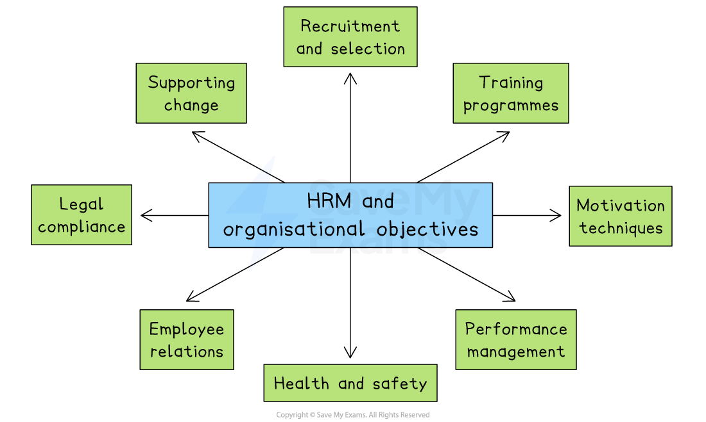

# The Role of Human Resource Management

## The role of HRM in meeting organisational objectives

> **Spec point** — `spcpt_f849WsvfWDr6448Y`

## The role of HRM in meeting organisational objectives

- **Human Resource Management (HRM)** is the business function that focuses on managing the people who work there
- It involves **recruiting**, **training**, **motivating **and **retaining employees** so that the business can run efficiently and meet its goals

#### How HRM helps meet organisational objectives

*HRM supports operational objectives through recruitment and selection, training, performance management and employee relations*

- **Recruitment and selection**

  - HRM designs job adverts, interviews candidates, and chooses the best person for each job
  - This helps the business run efficiently with the right staff
- **Training programmes**

  - HRM organises training and development activities for workers
  - This helps them improve their skills and contribute more effectively
- **Motivation techniques**

  - HRM can introduce **financial** (*bonuses*, pay rises) and **non-financial rewards **(promotion opportunities, *job rotation*)
  - This helps keep workers happy and productive
- **Performance management**

  - HRM monitors performance through *appraisals *and gives feedback to help employees improve and feel valued
- **Health and safety**

  - HRM ensures that legal requirements are met and the workplace is safe
  - This helps reduce accidents and *absenteeism*
- **Employee relations**

  - HRM works with *trade unions* and staff to solve conflicts and maintain a positive work atmosphere
- **Legal compliance**

  - HRM makes sure the business follows the law on *employment contracts*, dismissal and discrimination, reducing the risk of fines or lawsuits
- **Supporting change**

  - HRM helps manage change, such as *mergers *or the introduction of technology by retraining staff and communicating clearly
  - This should help to reduce employee resistance and speed up the change process
