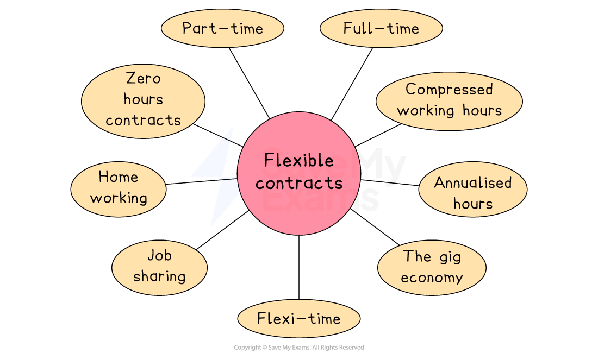

# Approaches to Human Resource Management (HRM)

## The difference between ‘hard’ and ‘soft’ HRM

> **Spec point** — `spcpt_5Vv8tM97fKWtc6Yg`

## The difference between ‘hard’ and ‘soft’ HRM

- Businesses use different approaches to meet their HR objectives. These are typically grouped into **soft** and **hard** human resource management (HRM) strategies:

  - **Soft HRM**
  
    - Focuses on employees as valuable long-term assets
    - Emphasises motivation, engagement, and development
    - Often linked to higher ***staff retention*** and job satisfaction
    
      - E.g. The **John Lewis Partnership** applies soft HRM by giving employees a stake in the company and a voice in key decisions
  - **Hard HRM**
  
    - Treats employees more like a resource to control and minimise costs
    - Focuses on efficiency, short-term contracts, and minimal employee involvement
    - Often linked to lower labour costs but higher ***labour turnover***
    
      - E.g.* ***Sports Direct** has been criticised for using ***zero-hour ***contracts, a hallmark of hard HRM
- Most businesses combine elements of both approaches depending on their strategy, budget, and industry

## Flexible working contracts

> **Spec point** — `spcpt_yN8jVgHJ7jTGbfnS`

## Flexible working contracts

- Flexible working contracts include those that allow employees to choose when, where, or how they work to better suit their needs and lifestyle

*Flexible working can include part-time, flexi-time and job sharing contracts*

### Full-time contracts

- A full-time employment contract requires the employee to work the number of hours per week set by the company

  - In the UK, full-time employees are classified as those who **work 35 hours a week** or more
  - At **Save My Exams**, a full-time employee works 40 hours each week

| Advantages | Disadvantages |
|---|---|
| - Staff are available every working day, so planning and teamwork are straightforward - Lower recruitment and training cost per hour than hiring many part-timers | - Fixed wage bill even when demand is low - Less flexibility, so overtime may be needed to cover sudden peaks in demand |

### Part-time contracts

- Employees who work **part-time** may only work two or three days a week

  - Part-time employment may be **more flexible** and can be adjusted subject to employee availability and employer requirements
  
    - Part-time employees at the US company **Costco** work between 24 and 40 hours per week

| Advantages | Disadvantages |
|---|---|
| - Easy to match staff numbers to busy and quiet times, cutting labour costs - Attracts new workers, such as parents or students, who bring fresh ideas and skills | - More people to schedule and train, which takes extra time - Communication gaps can arise when some staff are off-duty |

### Annualised hours

- An **annualised hours contract** sets the employee’s working time as a total number of hours to be completed over the whole year, rather than a fixed number each week

  - Wages are usually spread evenly, so employees receive the same salary each month even though weekly hours may rise or fall

| Advantages | Disadvantages |
|---|---|
| - Total hours are agreed, so labour cost follows seasonal demand without large overtime bills - Steady monthly salary helps retain staff during quiet periods | - Planning and tracking each employee’s yearly hours can be complex - If demand is underestimated, the firm may still be short-staffed in peak months |

### Compressed working hours

- A **compressed hours arrangement** means an employee works their normal total hours for a period, but squeezes them into fewer, longer working days

  - E.g. Government offices in **Australia** allow staff to compress fortnightly hours into eight longer days, freeing every ninth and tenth day

| Advantages | Disadvantages |
|---|---|
| - Longer shifts give longer daily coverage without extra overtime pay - Fewer working days can lower utility and facility costs | - Productivity may fall towards the end of very long days - Harder to arrange meetings when employees’ free days differ |

### Shift working

- This  involves **working different periods at different times**, usually on a ***rota***
- It usually refers to anything outside of the standard Monday-Friday working week

  - Some warehouse employees might need to work an early shift to ensure deliveries are ready to go
  - In many care homes, night shifts are a regular part of the job

| Advantages | Disadvantages |
|---|---|
| - Enables 24/7 production or service, maximising the use of equipment - Allows the firm to serve customers in different time zones. | - Night and weekend shifts often atract premium pay and extra supervision - Health and safety risks can rise, leading to absenteeism or higher insurance costs |

### Flexi-time

- Flexi-time allow employees to** schedule working hours around their individual needs **and accommodate their commitments outside of work
- It usually involves **working some set hours**, with the remainder of hours organised according to the employees' needs

  - E.g. An employee may be expected to be at work between the hours of 10am and 2pm, but can choose when they complete the rest of their working hours

| Advantages | Disadvantages |
|---|---|
| - Higher staff morale and retention because employees control their hours - Less lateness and fewer absences, as workers avoid rush-hour travel | - Ensuring cover at all times can be difficult, harming customer service - The firm needs reliable systems to record and monitor hours worked |

### Home working

- **Advances in communication technology** have enabled a larger proportion of workers than ever before to work from home

  - Employees use tools such as **email**, **instant messaging**, **collaborative software**, **scheduling apps** and **videoconferencing **to carry out work remotely

| **Advantages** | **Disadvantages** |
|---|---|
| - Smaller or fewer premises may be required,** reducing costs** - Workers may be **more productive** if they work in isolation, away from distractions | - The cost of equipping workers with technology to work remotely may be significant - There may be** less opportunity for collaboration **between workers, reducing innovation |

### Job sharing

- Job sharing is where **two or more employees divide a job** between them to cover one full-time role

  - Pay, benefits and leave entitlement for job sharing are allocated on a proportional basis

| **Advantages** | **Disadvantages** |
|---|---|
| - Keeps two experienced people, so absences are covered and skills stay in-house - Can raise morale and loyalty because staff have a better work–life balance | - Extra admin time is needed for hand-overs and payroll for two people instead of one - Risk of missed or duplicated tasks if communication between sharers is poor |

### Zero hours contracts

- This is where an employee agrees to be available for work as and when required, with no particular number of hours or times of work specified

  - In the UK, zero-hour contracts are controversial
  
    - Trade unions and the media have accused businesses, such as **Sports Direct**, of using them to exploit workers
    - In 2015, UK employers were banned from offering zero-hour contracts that prevented employees from working for another employer at the same time

| **Advantages** | **Disadvantages** |
|---|---|
| - Labour costs match demand exactly; if workers do not work, they are not paid - It is easy to bring in staff quickly to cover unexpected peaks in demand | - Workers may feel insecure and be less committed or leave at short notice - Negative publicity and legal scrutiny can damage the firm’s image |

### The gig economy

- This is where people earn money by completing short, on-demand tasks instead of holding traditional, permanent jobs

  - E.g. In India and Southeast Asia the rapid expansion of ride-hailing and food-delivery apps such as **Gojek **and **Swiggy **has created many jobs in the gig economy

| **Advantages** | **Disadvantages** |
|---|---|
| - Businesses have quick access to a large pool of worldwide freelancers at low cost - Output can be scaled up or down rapidly without long-term employment obligations | - It can be harder to control quality and protect confidential data - Regulations and tax rules for gig workers can change, adding uncertainty and  risk |

## Management by Objectives (MBO)

> **Spec point** — `spcpt_TbfVcfCJtdxQh8FH`

## Management by Objectives (MBO)

- Management by objectives involves managers and employees jointly setting clear, measurable goals that link each job to the organisation’s overall aims

  - Performance is then judged on the results achieved

### How MBO is implemented

- **Set organisational goals**

  - Senior management define a set of strategic targets
- **Cascade and agree individual objectives**

  - Each manager works with team members to translate these targets into personal SMART goals
- **Action plans, monitoring and feedback**

  - Resources and deadlines are agreed, progress is tracked, and regular check-ins provide guidance
- **Appraisal and reward**

  - At the review stage, achievement of the agreed objectives informs performance ratings, pay rises and further development plans

### Usefulness of MBO to a business

- **Focus and alignment**

  - Everyone understands exactly what is expected and how their work supports corporate goals, reducing wasted effort
- **Motivation and engagement**

  - Because employees help set their own targets, they feel ownership, leading to higher commitment, better communication and stronger job satisfaction
- **Fair, data-based management**

  - Clear, quantifiable objectives give managers unbiased criteria for appraisal, feedback and rewards, cutting disputes and making decisions more transparent
- **Broader benefits**

  - Goal-setting encourages forward planning, highlights training needs, and can improve overall company performance by linking day-to-day tasks to long-term strategy
