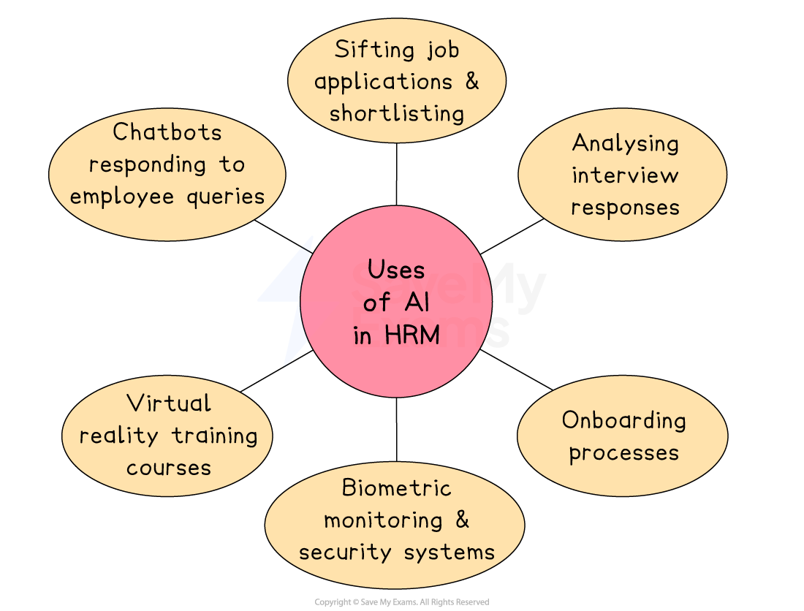

# Information Technology and Artificial Intelligence in HRM

## The use of IT in HRM

> **Spec point** — `spcpt_cMWHTZmwhfyNVdHX`

## The use of IT in HRM

- Information technology (IT) is increasingly used to automate processes in HRM such as:

  - **Record keeping**
  
    - Keeping employee details
    - Holding training and appraisal documents
    - Storing tax and pension records
  - **Scheduling**
  
    - Planning shifts
    - Monitoring periods of leave
    - Prioritising tasks
  - **Recruitment**
  
    - Online job advertisements, including the use of social media
    - Electronic application submission
  - **Training**
  
    - E-learning training modules
    - Online assessments
    - Remote training sessions using videoconferencing software
  - **Performance management**
  
    - Performance capture using monitoring software
    - Online appraisal meetings
    - Email distribution of performance targets

#### Implications of using IT in HRM processes

| **Implication** | **Explanation** |
|---|---|
| **Saves time** | - Automating standard processes such as work schedules and document storage can **free up managers' time** to focus on more complex issues - Using IT increases **convenience**, as processes can be completed at any time    - E.g. An online job application can be submitted at any time |
| **Employee concerns** | - Collecting data on employee performance using automated systems can cause disquiet amongst staff, who may **feel that they are being watched** - Some employees may be concerned about the **security **of personal and performance data being held in IT systems |
| **Communication between managers and subordinates** | - Workers may feel **remote from their managers** when contact is largely conducted online, possibly leading to a ***them and us*** culture to develop - Less two-way discussion may limit the opportunity for employees to **share ideas, concerns and queries **with managers |

## The use of Artificial Intelligence in HRM

> **Spec point** — `spcpt_7zy2NNmt978TZNCG`

## The use of artificial intelligence in HRM

- **Artificial intelligence** (AI) is the ability of a **computer or robot **to perform tasks commonly carried out by human beings due to their complexity
- AI is expected to have a **significant impact on HRM processes**

  - Recent research suggests that in larger businesses AI is already widely used in HRM processes, including **employee records management, *****payroll*** **processing, recruitment,** ***performance management*** and ***onboarding***** new employees**

#### The use of AI in HRM processes

*Artificial intelligence is being used in a variety of ways to automate HRM processes, such as recruitment, selection, onboarding and employee training*

### Sifting job applications and shortlisting

- AI can be used to swiftly **review the contents of job applications** and determine which meet the requirements of the ***job description*** and ***person specification*** without bias and determine which candidates should be invited to an interview

### Analysing interview responses

- Recordings of responses to interview questions can be analysed using AI to determine which are **aligned most closely** with business values
- In real time, AI can even be used to **suggest suitable follow-up questions** within an interview

### Onboarding

- AI can be used to automate processes **before a successful candidate begins working** for a business, such as

  - Responding to employee questions
  - Verifying employee documents
  - Handling administrative tasks such as providing IDs and access to company hardware and software
  - Conducting induction training

### Biometric monitoring and security systems

- Tools such as fingerprint scanning and facial recognition can be used alongside AI tools to control processes such as access to physical premises and IT equipment as well as monitoring attendance

### Virtual reality training

- Virtual reality software uses AI to **create environments that respond to trainee actions and choices**, providing realistic and tailored interactive training

### Chatbots responding to employee queries

- Chatbots that** respond to frequently-asked questions** related to aspects such as pay, paid leave and employee benefits can increase the amount of time HR managers have to spend on strategic elements of their role

> **Exam Hint**
> You will not be required to demonstrate extensive knowledge of specific IT or AI tools used by HRM
> 
> However, you may be required to analyse the impact of the increased use of these developments on those who work in HRM, or on workers interacting with automated processes

### Future developments in IT and AI in HRM

- **Sharper forecasting**

  - More accurate models will predict skill gaps and ideal training paths years ahead
- **Ethical AI controls**

  - New regulations will require transparent explanations of AI decisions and regular bias checks
- **Well-being analytics**

  - Real-time monitoring of workload and feedback could identify stress and burnout before absence levels rise
- **Generative-AI learning coaches**

  - On-demand micro-lessons tailored to each employee’s questions
- **HR 'super-apps'**

  - A single mobile platform for payslips, rota swaps, feedback, coaching and mental-health support
- **Virtual-reality induction**

  - Immersive tours and simulated practice tasks for new starters before their contract begins
