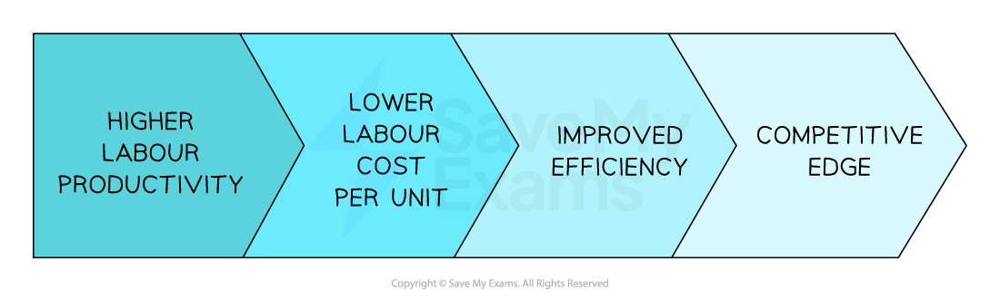
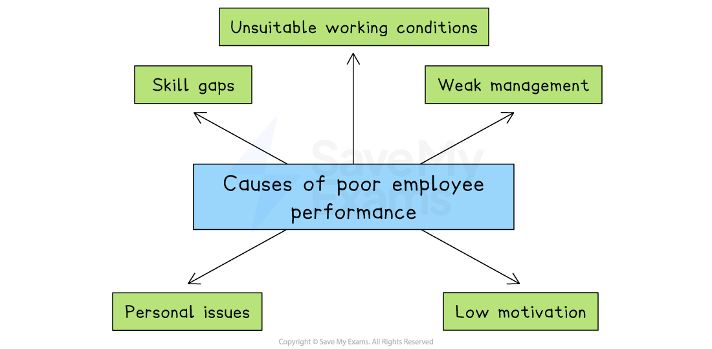

# Managing Employee Performance

## Measurement of employee performance

> **Spec point** — `spcpt_Dmr8GkbhzSgTR6cB`

## Measurement of employee performance

- The effectiveness of a business's workforce can be measured in a number of ways, including

  - Labour productivity
  - Absenteeism
  - Employee costs as a percentage of turnover
- These metrics are compared over time, between *functional areas*, branches or outlets, or against competitors
- They can provide the basis for workforce planning and performance management

### 1. Labour productivity

- **Labour productivity** measures** output per worker** during a specified period of time

  - It is expressed as a number of units and calculated using the formula

$\mathrm{Labour} \mathrm{turnover}=\frac{\mathrm{Number} \mathrm{of} \mathrm{staff} \mathrm{leaving}\times100}{\mathrm{Average} \mathrm{number} \mathrm{of} \mathrm{staff}}$

- Businesses aim to **increase the level** of labour productivity to **improve competitiveness**

#### The link between high labour productivity and competitive edge

*Higher labour productivity improves businesses competitiveness*

> **Worked Example**
> The table shows the number of pairs of luxury wool socks produced by StrumpMani* *in 2023 and 2024
> 
> | **Year** | **Units Produced** |
> |---|---|
> | 2023 | 46,000 |
> | 2024 | 69,000 |
> 
> In 2023 StrumpMani*  *employed 50 staff. In 2024 the number of staff employed by the business increased by 20%
> 
> **Calculate **the percentage change in labour productivity between 2021 and 2022.
> 
> [4]
> 
> **Step 1 - Calculate labour productivity for 2023**
> 
> $=\frac{46,000\mathrm{units}}{50\mathrm{workers}}\,\,=920\mathrm{units} \mathrm{per} \mathrm{worker}$    **(1)**
> 
> ** Step 2 - Calculate labour productivity for 2024**
> 
> $=\frac{69,000\mathrm{units}}{60\mathrm{workers}}\,\,=1,150\mathrm{units} \mathrm{per} \mathrm{worker}$    **(1)**
> 
> **Step 3 - Calculate the percentage difference between the two years ((new-old) / old)**
> 
> `equals space fraction numerator space 1 comma 150 space minus space 920 space units over denominator 920 space units end fraction space space space cross times space space space space space 100 space space space
> 
> equals space 25 space percent sign space`    **(1)**
> 
> **Step 4 - Identify whether the percentage difference is an increase or decrease**
> 
> - Labour productivity has **increased by 25% **    (1 mark)

### 2. Absenteeism

- The absenteeism rate is a measure of the **proportion of staff were absent from work** during a **specific period of time** (e.g. a day, week or month)
- It is expressed as a percentage and is calculated using the formula

$\mathrm{Absenteeism} \mathrm{rate}=\frac{\mathrm{Number} \mathrm{of} \mathrm{staff} \mathrm{absent}}{\mathrm{Number} \mathrm{of} \mathrm{staff} \mathrm{employed}}\times100$

- **High levels **of absenteeism can cause several problems for a business, including

  - Absence due to illness requires sick pay to be paid
  - Hiring temporary staff to cover for those absent **increases costs**
  - Output is likely to be temporarily reduced if staff are key to production process
  - Other staff may become **demotivated** if they have to constantly cover for absent workers
  - A wider** culture of absenteeism** may develop

> **Worked Example**
> On January 16th twenty-two of *Belling Stoneworks Ltd's *189 employees were absent.
> 
> Calculate Belling Stoneworks Limited's absenteeism rate on January 16th.
> 
> (2)
> 
> **Step 1: Substitute the values into the formula**
> 
> `equals space 22 over 189 space cross times space 100
> 
> equals space 11.64 percent sign`      **(2)**

### 3. Employee costs as a percentage of turnover

- This metric shows how much of a business’s revenue is spent on paying employees

  - It helps assess how efficiently the workforce is being used
- It is calculated using the formula:

`Employee space costs space as space percent sign space of space turnover equals space fraction numerator Employee space costs over denominator Turnover end fraction space straight x space 100`

> **Worked Example**
> In the 2022–2023 financial year, Tesla had:
> 
> - Revenue = £5,297 million
> - Employee costs = £2,894 million
> 
> **Calculate **the employee costs as a % of turnover between 2022 and 2023.
> 
> [2]
> 
> **Step 1 - Substitute the values into the formula**
> 
> `equals fraction numerator space 2 comma 894 space million over denominator 5 comma 297 space million end fraction space straight x space 100
> 
> equals space 54.6 percent sign`          **(1)**
> 
> **Step 2 - Present the final answer**
> 
> - **54.6%** of turnover was spent paying staff          **(1)**

## Causes and consequences of poor employee performance

> **Spec point** — `spcpt_dbRgV627xDYNjzsC`

## Causes and consequences of poor employee performance

#### Causes of poor employee performance

*Skills gaps, low motivation, weak management and poor working conditions can affect employee performance*

- **Skills gaps**

  - Weak recruitment or training means staff lack the skills or knowledge to do a job properly
- **Low motivation**

  - Poor pay, little recognition or limited career prospects may cause employees to make less effort with their work
- **Weak management**

  - Unclear goals, poor communication or inconsistent feedback can confuse staff, reducing their productivity
- **Unsuitable working conditions**

  - Unsafe, uncomfortable or poorly equipped workplaces can reduce output
- **Personal issues**

  - Health, stress or family problems can distract employees from work

#### Consequences of poor employee performance

| **Consequence** | **Impact** | **Example** |
|---|---|---|
| Falling productivity | - Unit costs rise, so prices become less competitive | - A car-assembly plant with outdated training builds fewer cars per hour than rivals in Japan, forcing it to charge higher prices |
| Quality errors | - More defects and complaints harm the firm’s reputation | - A smartphone maker in China ships handsets with faulty cameras, leading to negative online reviews and returns |
| Missed deadlines and lost sales | - Late deliveries drive customers towards rivals | - An online fashion retailer in Germany misses pre-Christmas shipping dates; shoppers switch to a competitor with guaranteed delivery |
| Higher absenteeism and turnover | - Extra spending on recruiting and training replacement staff | - A fast-food chain in Brazil sees many staff call in sick or quit, so managers spend time and money hiring and retraining new crew members |
| Low team morale | - Poor performers drag down colleagues, weakening the business's culture | - In an Indian call centre, constant errors by a few agents frustrate co-workers, lowering overall enthusiasm and service quality |

## Strategies for improving employee performance

> **Spec point** — `spcpt_43H5HjXFgqq2GW3v`

## Strategies for improving employee performance

- Key HR objectives include

  - Raising labour productivity, as this lowers labour cost per unit, improving business competitiveness
  - Reducing absenteeism, as this can reduce training costs and overtime payments, and can build a positive team spirit
  - Reducing labour costs as a proportion of revenue, as this increases efficiency and lowers unit costs

### Ways to improve employee performance

#### Financial rewards

- Paying workers more or sharing profits may **increase commitment **and effort, leading to **higher output and productivity**

- Bonuses and commissions are only paid when they have been earned or if **targets have been met**
- Attendance and loyalty rewards may improve the intrinsic **motivation** of workers as they feel valued

#### Employee share ownership

- Rewarding senior executives and managers with shares may increase their **commitment to achieving objectives**
- Employees who own shares in the business may **work harder and take less time off **as they have a **financial stake** in the success of the business

#### Consultation

- Consultation involves managers **obtaining the views of employees** when making decisions
- Workers are likely to feel **more involved** within the business and work hard, and may be **less likely to take days off** work

#### Empowerment

- Providing employees with **autonomy **and **responsibility** to make their own decisions and work on their own behalf encourages them to use **knowledge** and **experience** and develop their own **solutions**
- Workers must be **properly trained** and equipped with the **necessary resources** to be properly empowered
- Leaders need to be **prepared to hand over authority** and focus on providing encouragement, praise and **feedback**
