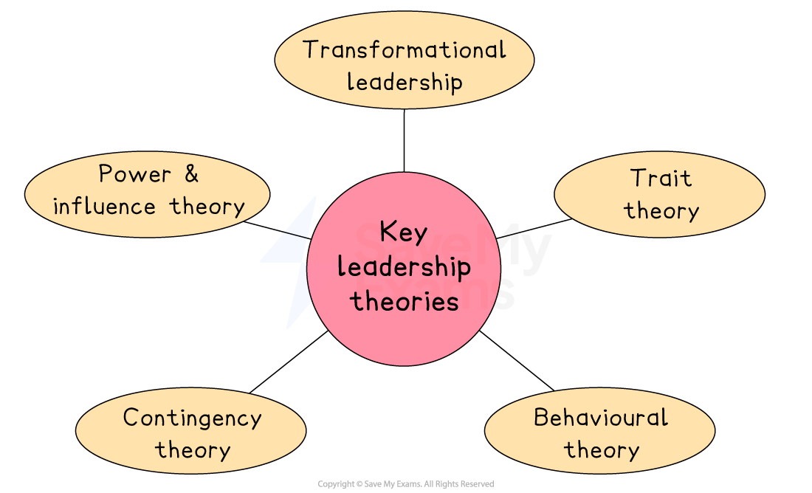

# Leadership Theories

## An introduction to leadership theory

> **Spec point** — `spcpt_VJNJHWhBw5SfB5Tq`

## An introduction to leadership theory

- Leadership theories explain **how some people become great leaders** and **why some leadership styles are effective**

  - They focus on** shared traits, characteristics and behaviours** of successful leaders and the circumstances that have produced them

#### Key leadership theories

*Leadership theories attempt to explain what makes great leaders, focusing on their traits, characteristics, behaviours and the circumstances in which they lead*

## Trait theory

> **Spec point** — `spcpt_wJSkTVRmZhRmdc4s`

## Trait theory

- **Trait theory** suggests that **great leaders are born, not made**

  - Studies of **great historical leaders** investigated both their personality and physical traits
  
    - Certain traits were observed in leaders across time, in different cultures and in diverse locations
- Studies found that some people are simply **born with the personality traits and physical attributes that set them apart** from others and give them the **potential to demonstrate great leadership skills**

  - Despite being present at birth, these natural talents **must be developed** and the individual must **learn to apply leadership techniques** to be successful
  - In business, leaders including Microsoft's **Bill Gates**, Sony's **Akio Morita** and Italy's **Enzo Ferrari **possess these traits

- Some of the **natural qualities** of a successful leader identified include

  - ***Charisma***
  - A drive to achieve
  - The desire to lead
  - ***Integrity***
  - Confidence
  - Intellect
  - Effective political skills
  - Business knowledge
  - Emotional maturity

- Trait theory** also emphasises typically masculine characteristics**, such as height and appearance and, as a result, is **now seen as dated**

## Behavioural theory

> **Spec point** — `spcpt_RvdBCsSdHJKZmQDp`

## Behavioural theory

- **Behavioural theory **suggests that individuals can** learn behaviours** that make them effective leaders

  - Research focused on studies of ***CEOs***, project managers and other leaders across diverse industries as they responded to situations
  
    - Successful leaders **pursued actions in a consistent way** and had **developed behaviours **that were key to business success
  - These behaviours **don't come naturally to everyone**, but can be learned and strengthened with **effort, observation and experience**
- Three particular types of skills, all of which can be developed over time, are important for effective leadership

  - **Human skills** such as communication and ***empathy***
  - **Conceptual skills **such as problem-solving or spotting opportunities
  - **Technical skills** such as ***budgeting*** or people management
- The best leaders **use these skills** and** adapt their behaviour** according to the **context **in which they find themselves

## Contingency theory

> **Spec point** — `spcpt_vrZJqHdXzjyfXTP5`

## Contingency theory

- **Contingency theory** suggests that effective leadership **depends on the specific situation**

  - A leader can be effective in one situation and ineffective in another, depending on whether their **leadership style fits** the given situation

#### Factors determining leader effectiveness

| **Factor** | **Explanation** |
|---|---|
| **The task or project** | - **Complex** or ***safety-critical*** tasks may require an ***autocratic*** approach - **Creative projects** may be led more effectively by a more ***participative*** leader |
| **The leader's personality** | - Some leaders may find it** difficult to adapt their style** or have ingrained opinions of how a leader should manage and behave - Leaders who have developed** close working relationships** with subordinates may find it easier to operate as a team player |
| **The size and composition of the team** | - Large teams may require greater supervision and direction than smaller teams - Highly-skilled teams may benefit from a less formal leadership approach |
| **Resources available and deadlines** | - Tight budgets and deadlines may require close supervision to ensure that targets are met |

- Contingency theory emphasises the importance of **finding the right leader for the given circumstances**

  - Leaders who are willing and able to adapt their leadership style to the situation are highly valued
  
    - New Zealand's former prime minister, **Jacinda Ardern,** was praised for her ability to adapt her leadership style during her term of office

## Power and influence theories

> **Spec point** — `spcpt_YQyBgdFc3WkWjDDm`

## Power and influence theories

- **Power and influence theories** suggest that leaders hold **personal power over subordinates** as a result of their

  - Expert knowledge
  - Personal charm
  - Formal ***hierarchical*** position
- If leaders have one or more of these sources of power, they are in a **position to influence subordinates** to **follow them and act on their directions**
- **Transactional leaders** use a** **system of rewards and punishments as motivators to maximise team performance

  - The personality and capabilities of the leader are less important than the strength of the system and how well employees adhere to it
  - The leader's main focus is likely to involve assessing employees' performance, distributing rewards or implementing punishments

## Transformational leadership

> **Spec point** — `spcpt_6nyXRtN24VNvgm6c`

## Transformational leadership

- **Transformational leadership** is most appropriate when businesses are undergoing **periods of change**

  - These leaders focus on **cultural change** and the 'bigger picture' rather than day-to-day management of workers, including
  
    - Influencing and encouraging subordinates
    - Being an inspiration to others and 'selling' the business ***vision***
    - Providing new challenges and developing employees' ambitions
  - Recent examples of transformation leaders include
  
    - Virgin's **Richard Branson**, whose transformative leadership style focuses on keeping employees happy so they perform better as a group
    
      - Branson has learned to take risks and, importantly, to treat all workers with respect
    - Target's **Gregg Stienhafel** took over at a company that had failed to change in the face of challenges from online rivals
    
      - He made rapid changes to build a strong online presence, alongside a renewed network of physical stores across the US.

> **Exam Hint**
> When evaluating different approaches to leadership, you should avoid suggesting that there is one single correct way to lead. The best leaders can adapt their leadership style depending on the context, the people they are leading and the circumstances in which they are operating.
