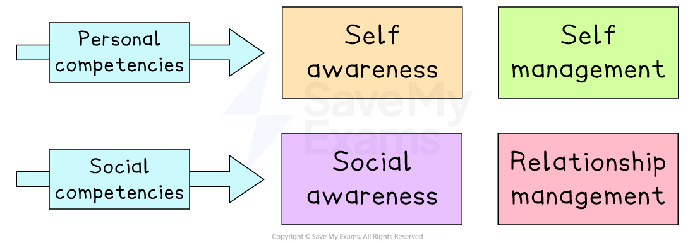

# The Importance of Leadership

## The purpose of leadership

> **Spec point** — `spcpt_56RTWHZNnjxHNkwR`

## The purpose of leadership

- Leadership is about having a **vision**, sharing that vision with others and **providing direction**

  - Leaders **inspire **and **motivate **others to **work towards a common goal**
  
    - This contributes to the **meeting of aims and objectives** and supports the **development of a motivated workforce**
- Leaders must also be prepared to **pursue a new direction** or even **step aside** when **circumstances change**
- While **some managers may be good leaders**, **not all leaders have a management role**

  - Employees will follow a manager's direction but may not be **truly inspired** to support the manager in achieving ambitious business goals
- Leadership is necessary in many **different contexts**

  - A leader in sport could be the captain of a national football or basketball team
  - A political leader could be a president, leader of a political group or ***trade union***

## Leadership roles in business

> **Spec point** — `spcpt_FpBjmkbXpRMHPn7g`

## Leadership roles in business

- Leaders in a business are often, though not exclusively, employed in management roles

  - **Directors** are senior managers, elected to their posts by shareholders at the ***annual general meeting***
  - **Managers **are employed to organise resources and make decisions relating to people and operations within their area of responsibility
  - **Supervisors **are directed by managers and lead the day-to-day performance of a team to achieve its goals
  - **Employee representatives** are chosen by their peers to act on their behalf when holding discussions or raising concerns with managers
- **Informal leaders **with significant influence often emerge in businesses

  - Informal leaders could be popular,** trusted colleagues**, experienced or **long-standing members of staff **or individuals with **strong, persuasive personalities**
  - In some cases, informal leaders are** appointed to management positions** to capture and utilise their influence
  - Otherwise, taking steps to **involve and reassure informal leaders** can persuade them to support business objectives
  
    - This can be a powerful way to gain trust and ***buy-in*** of employees

## The Qualities of a good Leader

> **Spec point** — `spcpt_YnQjQDWyyR7Y4wjc`

## The qualities of a good leader

- Good leaders commonly have a range of talents

  - They are likely to have **context-specific skills** and a **broad understanding of business issues**
  - They will have suitable **experience **and** expertise**
  - They will possess personal characteristics such as **honesty,** ***ethical***** standards **and** patience** when dealing with others
  - They will be **excellent communicators**, able to inform, persuade and inspire others
- **Leaders aren’t born with these capabilities**

  - Leadership qualities cannot be taught; rather, they are learned from experiences and facing ***adversity***
  - They tend to have** intentionally **put themselves in situations where they have to **learn, adapt **and **grow** a range of important qualities

#### Qualities of good leaders

| **Authenticity** | **Curiosity** | **Ability to analyse** | **Adaptability** |
|---|---|---|---|
| - Good leaders are **highly effective** and **capable of motivating and inspiring** those around them | - Good leaders are **open to new experiences **and able to look at situations from the **point of view of other** ***stakeholders*** | - Good leaders are **data-informed** and can **break down complex problems**, identify their root causes and develop fresh solutions | - Good leaders **respond swiftly to change**, **amend their course** when needed and **embrace new opportunities** and challenges |
| **Creativity** | **Comfort with ambiguity** | **Resilience** | **Empathy** |
| - Good leaders establish an **environment that nurtures creativity** in others and that may embrace** learning from failure** | - Good leaders **understand how things are connected** and can balance **opposing ideas** in the face of** uncertainty** | - Good leaders **keep trying**, even when they have experienced failure - They have the confidence to get** input from others** and **regroup** if necessary | - Good leaders foster **positive working relationships**, build **trust**, and actively **engage with their team members** |

## Goleman's Four Competencies of Emotional Intelligence

> **Spec point** — `spcpt_VDxKZpsqvNJnCzjy`

## Goleman's Four Competencies of Emotional Intelligence

- Emotional intelligence (EI) is an individual's **ability to understand and manage their own emotions and feelings**, **as well as those of others**
- **Goleman**'s framework of **four components that make up emotional intelligence **includes skills that can be developed and improved to **make managers more effective leaders**

#### The Four Competencies of Emotional Intelligence

*Goleman's Four Competencies of EI categorises personal and social skills that can make managers effective leaders*

### Self awareness

- Self awareness is the ability of an individual to **read and understand their emotions and recognise their impact on others**
- Skills that can be developed include emotional **self-awareness**,** self-assessment** and** self-confidence**
- The more leaders are **aware of their feelings**, the easier they are to manage when responding to others

  - **Emotions **can be unintentionally shared with others, through facial expressions and other nonverbal behaviour
  - Positive emotions towards others can influence them to **cooperate** and **work towards shared goals**

### Social awareness

- Social awareness is the ability to accurately **notice the emotions of others and read situations** appropriately
- Skills that can be developed include **empathy, organisational awareness **and **service**
- It involves leaders **sensing what other people are thinking and feeling**, taking into account their perspectives and being ***empathetic***

  - Leaders should be able to **identify others' frustration** with the task at hand and respond in a way that can prevent further negative emotions
  - Strong empathy skills also help leaders **get along better with others** who see things differently from them to** avoid misunderstandings and conflict**

### Self management

- Self management is the ability of a leader to** manage their actions, thoughts, and feelings in flexible ways** to achieve goals
- Skills that can be developed include **self-control, transparency **and **optimism**
- It contributes to a sense of **well-being, confidence** and a sense of **connectedness to others**

  - Effective leaders can** cope effectively** even in the most challenging of working relationships
  - They can **concentrate on the task at hand** rather than being distracted by negative thoughts or emotions

### Relationship management

- Relationship management is the ability of a leader to **take their own emotions, the emotions of others and the context **to manage interactions with others successfully
- Skills that can be developed include **bond building, conflict management **and** teamwork**

  - Leaders **sense other’s reactions** to the situation and **fine-tune** their response to move in a positive direction
  - In this way, leaders **influence those around them **to make a good decision that is** accepted by all**

> **Exam Hint**
> Strong analysis can be developed by using relevant theories to support your points. Management and leadership theories provide an excellent theoretical basis, which, alongside the use of relevant points from the case study, can help you to make a strong argument.
