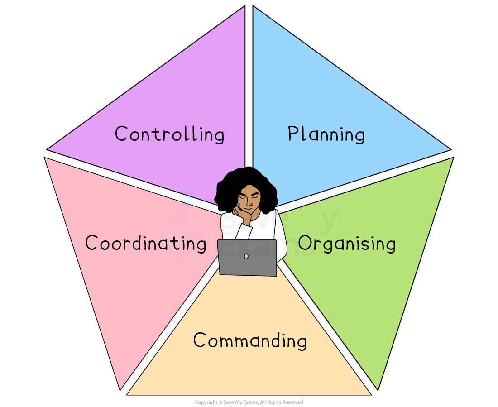
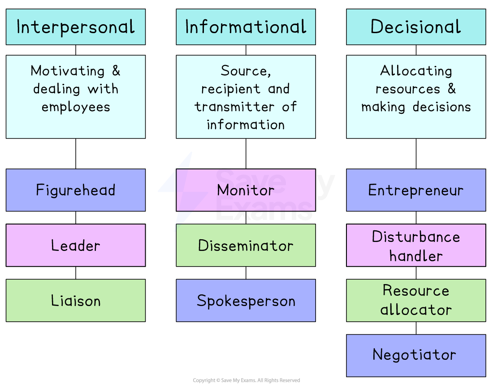

# Management Functions

## Traditional management functions

> **Spec point** — `spcpt_3ky4crMCr3qV8ygv`

## Traditional management functions

- A manager is an individual within an organisation who is responsible for **overseeing a team **or **a specific function**
- Large businesses usually have several layers of management with distinct responsibilities

  - ***Directors**** *or owners establish the business’s **overall goals **and set** long-term targets** for the business
  
    - They are ultimately responsible for business performance
  - **Senior managers** work to **achieve the targets** set by the owners or directors
  
    - They are often **responsible for a function** within the business, e.g. marketing or finance
  - **Supervisors** and** team leaders** support senior managers to achieve their targets
  
    - They **report problems** and pass on instructions
    - They may make** simple decisions,** such as allocating jobs among different employees

#### Managerial functions

| **Planning** | **Organising** |
|---|---|
| - Senior managers **set overall business aims** and ***corporate objectives*** which determine ***functional objectives*** - They decide on **strategies to be pursued** and determine **timescales** | - Managers ensure **resources** such as equipment, workers, supervision and ***logistics*** are in place |
| **Directing** | **Controlling** |
| - Managers** lead and motivate** others, **communicate** clear expectations and focus ***human resources*** on tasks | - Managers** track progress **and make appropriate changes to **ensure objectives are met** - They implement ***contingency*** plans or engage in ***crisis management*** when required |

## The role of managers: Fayol

> **Spec point** — `spcpt_V67PvPwfCcFqv6hy`

## The role of managers: Fayol

- Fayol identified **five** **functions **of management** **that provide a framework to help managers determine how to best allocate their time

#### Fayol's five functions of management

*Henri Fayol's five functions of management outline the way managers should allocate their time*

1. **Planning**

  - Managers assess the future and make sure the organisation is prepared for it
  - They should develop flexible ***business plans*** that consider available resources and future market trends
2. **Organising**

  - Managers define team members' roles and responsibilities and make sure that everyone understands what is expected of them
  - They should hire, train and allocate staff so that every role is covered
3. **Commanding**

  - Managers get the most from their staff
  - They should be familiar with team members' strengths and ***delegate*** tasks that match them
  - They should also set a good example by "walking the talk" to build a strong and dependable team
4. **Coordinating**

  - Managers ensure that every department understands its responsibilities and knows what other teams need from them
  - They should aim to create a smooth workflow, prevent disruptions and solve problems
5. **Controlling**

  - Managers regularly check that everything is running as it should be
  - They should be prepared to amend rules, plans and processes if necessary
  - They should always be alert for areas for growth and improvement

### Evaluation of Fayol's five functions

- Fayol's ideas **promote skills such as teamwork **and **agility**, which are important in modern workplaces
- However, some have criticised his ideas for being** too inhuman for modern management**

  - **One man's observations** cannot possibly apply to all organisations

## The role of managers: Mintzberg

> **Spec point** — `spcpt_dzXCvvykbGG43ZKb`

## The role of managers: Mintzberg

- Henry Mintzberg argued that Fayol's five functions do not fully describe the **activities that managers undertake** in their roles
- He identified **ten roles** that are common to all managers, categorised into** three groups**

  - **Interpersonal **roles
  - **Informational** roles
  - **Decisional **roles

#### Mintzberg's ten managerial roles

*Minzberg outlined ten management roles within three distinct groups: interpersonal roles, informational roles and decisional roles*

### Interpersonal roles

- A manager's interpersonal roles are those which focus on ***motivation*** **and dealing with employees** and, sometimes, other external ***stakeholder*** groups
- The three roles are

  - Acting as a **figurehead**
  
    - E.g. Appearing in press conferences, hosting product launches and being the 'face' of the business
  - Being a **leader** and enthusing others
  
    - E.g. Be available to meet staff, encourage and praise employees
  - **Liaison** with others inside and outside of the business
  
    - E.g. Communicate with stakeholders, participate in events, respond to complaints

### Informational roles

- These roles involve the **collection, communication and presentation of information** within and outside of the business
- The three roles are

  - Being a **monitor** and collector of information relevant to business circumstances
  
    - E.g. Attend conferences, keep up-to-date with industry research
  - Acting as a **disseminator **of information to both subordinates and other key stakeholder groups
  
    - E.g. Share key developments with staff, calm fears and communicate positively
  - Being the business **spokesperson**
  
    - E.g. Lead seminars, communicate with the media and government

### Decisional roles

- These roles are focused on **making decisions** and **organising resources** so that business objectives can be met
- The four roles are

  - Being an **entrepreneur **on behalf of the business
  
    - E.g. Bring new ideas and ***empower*** others to become intrapreneurs
  - Acting as a **disturbance handler **during periods of upheaval or change
  
    - E.g. Determine rapid responses in crisis situations, act as a key point of contact
  - Being a **resource allocator** to ensure adequate financial and physical resources are available
  
    - E.g. Determine ***budgets*** and source finance, staff and equipment
  - Representing the business as a **negotiator **with external stakeholders
  
    - E.g. make deals with significant suppliers and customers, network with key business allies

### Evaluation of Mintzberg's ten managerial roles

- Mintzberg emphasises the **importance of interpersonal roles** in effective management, which Fayol's five functions overlook
- However, his informational and decisional roles are largely the same as those identified by Fayol, albeit **more defined **and of **more practical use **to managers

## The contribution of managers to business performance

> **Spec point** — `spcpt_tPQ3HX5zyZFNZ9dB`

## The contribution of managers to business performance

- Managers contribute to business performance by **planning**, **leading**, **organising, **and **making appropriate decisions**

  - Good managers help businesses run smoothly, adapt to change and meet objectives effectively
  - Poor management can lead to confusion, low *morale* and missed opportunities

> **Case Study**
> **Better management at Café Verde**
> 
> *Café Verde* is a small chain of eco-friendly coffee shops in South Africa.
> 
> 
> 
> When the business began struggling with high staff turnover and inconsistent customer service, the owner promoted Lindiwe, an experienced *team leader*, to the role of operations manager.
> 
> Lindiwe introduced several key changes:
> 
> - She reorganised staff rotas to ensure each shift had a good mix of experienced and new employees
> - She arranged training sessions to improve customer service skills and product knowledge
> - Lindiwe held weekly team meetings to gather feedback and set targets for quality and service
> - She also introduced a bonus scheme linked to customer satisfaction scores
> 
> **Outcomes**
> 
> - Within three months, customer complaints fell by 40%, staff morale improved and *staff turnover* reduced significantly
> - Sales increased as more customers returned and left positive reviews online
