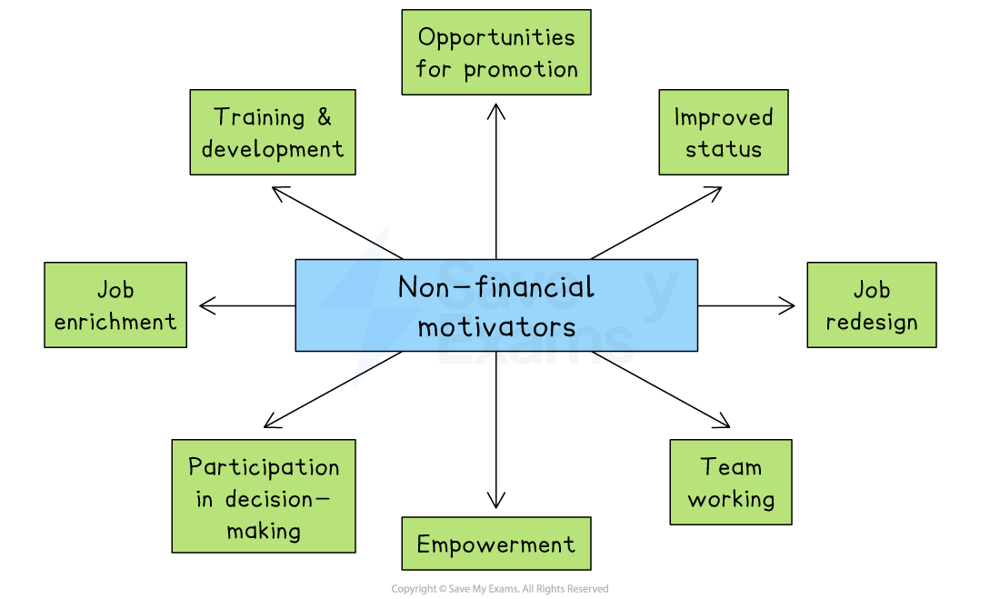

# Motivation Methods in Practice

## Financial motivators

> **Spec point** — `spcpt_9ZqbfZBbHQqRmPck`

## Financial motivators

- Financial incentives are rewards or payments given to employees in return for their labour or improved performance

#### Financial incentives and motivation theory

| Financial incentive | **Explanation** | **Link to motivation theory** |
|---|---|---|
| **Piece rate** | - Employees are paid according to the number of units or pieces they produce - Commonly used in manufacturing or *assembly line *settings to encourage workers to produce more | - **Taylor’s Scientific Management** - Focused on output and financial reward as the main motivator |
| **Time rate** | - Employees are paid based on the number of hours they work, often at an hourly wage - This method values time over output | - A **hygiene Factor in Herzberg’s Theory** - Provides financial security but doesn't directly motivate higher performance |
| **Salary** | - A fixed monthly or annual payment not based on hours worked or output - Offers stability and is often linked to professional or office-based roles | - A **hygiene Factor in Herzberg’s Theory** - Removes dissatisfaction (e.g. worrying about pay), but does not itself motivate employees to achieve more |
| **Commission** | - A percentage of sales revenue is paid to workers who sell products or services - Commonly used in sales roles and motivates staff to sell more | - A **hygiene factor in Herzberg’s theory** because it provides financial reward but doesn’t always lead to long-term motivation on its own - When combined with public recognition (like 'Salesperson of the Month'), it can meet **esteem needs in Maslow’s hierarchy**, making employees feel valued and respected for their achievements |
| **Bonus** | - An additional payment is given to staff as a reward for achieving specific goals, completing projects on time, or exceeding expectations | - Connects to **Esteem Needs in Maslow’s Hierarchy** (achievement) but **Herzberg** warned using bonuses as main pay can harm motivation and behaviour (e.g. banking crisis example) |
| **Profit share** | - A portion of the company’s profits are shared with employees, encouraging them to work as a team and support the business’s success | - A **motivator in Herzberg’s Theory** - Linked to increased responsibility and recognition (staff feel like part-owners) |
| **Performance-related pay** | - Staff are paid based on how well they meet targets or performance goals - Criticised for being open to *bias *and demotivation if unfair | - A** hygiene Factor in Herzberg’s Theory** - May cause dissatisfaction and is often viewed as unfair, especially if targets are unclear or *subjective* |
| **Fringe benefits** | - Extra non-cash rewards such as company cars, health insurance, gym membership, or staff discounts - Designed to improve employee satisfaction and retention | - A** hygiene Factor in Herzberg’s Theory** - Makes the work environment more comfortable but does not directly motivate improved performance |

### Advantages of using financial motivators

1. **Quickly boosts performance**

  - Financial rewards like bonuses or commissions can lead to an immediate increase in effort and output
2. **Easy to measure and manage**

  - Targets linked to pay, such as volume of sales or units produced, are clear and simple to monitor
3. **Attracts skilled employees**

  - High pay and incentives can help a business compete for top talent in the job market

### Disadvantages of using financial motivators

1. **Can reduce teamwork**

  - If pay is based on individual results, employees may compete instead of working together
2. **Short-term focus**

  - Employees may focus only on rewards and ignore quality, customer service or long-term goals
3. **Costly for the business**

  - Bonuses, commission and other financial rewards can become expensive, especially if not linked to overall profit

## Non-financial motivators

> **Spec point** — `spcpt_5pQYXh9vHYF8pwm4`

## Non-financial motivators

- Many people want challenge, recognition and opportunities for  development from their work
- According to **Herzberg**, motivators like *job enrichment*, *promotion*, and recognition increase job satisfaction by giving responsibility and purpose

  - *Empowerment *and participation in decision-making help employees feel trusted, which boosts motivation
- According to **Maslow**, non-financial rewards meet higher-level needs like belonging, esteem and self-fulfilment

### Examples of non-financial motivators

*Non-financial motivators include improved status, opportunities for promotion and job enrichment*

- **Training and development** help employees improve their skills and grow in confidence, making them feel more capable and valued
- **Opportunities for promotion** encourage employees to work harder by offering a clear path to higher-level roles and responsibilities
- **Improved status** gives employees a higher job title or position, increasing their sense of importance and recognition
- **Job redesign** involves changing job roles to make them more interesting or meaningful, which can reduce boredom and boost motivation
- **Team working** encourages collaboration and a sense of belonging, helping employees feel supported and connected
- **Empowerment** means giving employees the freedom to make decisions, which increases trust, confidence, and motivation
- **Participation in decision-making** involves employees in business decisions, making them feel respected and more committed to the outcomes
- **Job enrichment** adds more challenging or meaningful tasks to a role, giving employees a sense of achievement and purpose

## Motivation theories in practical situations

> **Spec point** — `spcpt_KqZW6bhZpwnDNWCx`

## Motivation theories in practical situations

- Businesses use motivation theories to understand what motivates their staff and then apply these ideas to improve performance, job satisfaction, and staff retention

### Applying Taylor's theory

- Taylor suggested that workers should be given **simple tasks** and** paid based on how much they produce**
- Businesses may use ***performance-based pay*** systems

  - For example, factory workers are paid per unit made
  - Tasks are often simplified and repeated to improve speed and efficiency
  - Close supervision and clear instructions are given to employees

> **Case Study**
> Dhaka Stitchworks Ltd is a clothing manufacturer based in Bangladesh that supplies T-shirts to international fashion brands
> 
> 
> 
> The business employs over 200 factory workers and follows a piece-rate payment system, where each worker is paid £2 for every completed T-shirt
> 
> This system encourages workers to sew as many garments as possible each day, as their earnings depend on how much they produce
> 
> Supervisors monitor the production line closely and give clear instructions, in line with Frederick Taylor’s idea that efficiency improves when tasks are simple and output is rewarded
> 
> The factory has achieved high productivity levels using this approach. However, some workers feel their work is repetitive and physically tiring. A few have left the job due to the lack of variety and long hours

### Applying Herzberg's two-factor theory

- Businesses make sure basic *hygiene factors*, such as fair pay and a clean and safe environment, are in place
- Then they focus on* motivators* by giving employees responsibility, chances for promotion or by recognising achievements

> **Case Study**
> KrakSoft Technologies is a software company based in Kraków, Poland, specialising in developing mobile apps and digital solutions for clients across Europe. The business employs over 80 software developers, designers and project managers
> 
> 
> 
> **Hygiene factors**
> 
> - Employees receive competitive salaries and enjoy modern, comfortable offices
> - They also benefit from flexible working arrangements and remote work options
> 
> **Motivators**
> 
> - Staff are regularly praised for achievements, with monthly recognition awards and performance bonuses
> - They are encouraged to lead projects and attend international technology conferences
> - They also take part in career development programmes tailored to their goals
> 
> **Outcomes**
> 
> - Employees are engaged, creative and willing to take on responsibility
> - Staff turnover is low, and the work environment is known for being both productive and positive

## Employee participation

> **Spec point** — `spcpt_FcMkPS8VgDGvdCY6`

## Employee participation

- Employee participation means **involving workers in decisions** that affect the running of the business
- This can lead to greater motivation, better communication and improved performance

  - However, it may slow decision-making, and managers must be open to listening and acting on employee input

#### Ways employees participate

| **Method** | **Explanation** |
|---|---|
| **Team meetings** | - Regular meetings allow employees to share ideas, give feedback and stay informed about business goals |
| **Suggestion schemes** | - Employees are encouraged to submit ideas for improvements - Good suggestions may be rewarded |
| **Works councils or staff forums** | - Groups of employee representatives meet with management to discuss workplace issues and policies |
| **Trade unions** | - Represent employees' interests in discussions with management, especially on pay and working conditions |
| **Surveys and feedback tools** | - Employees give their views on the workplace, helping managers understand staff concerns and suggestions |
| **Project groups or task forces** | - Employees join temporary teams to work on specific projects or solve problems collaboratively |
| **Quality circles** | - Small groups of workers meet regularly to suggest improvements in production or service quality |
| **Shared ownership or *****profit-sharing***** schemes** | - Employees feel like part-owners of the business and are more likely to support long-term success |
