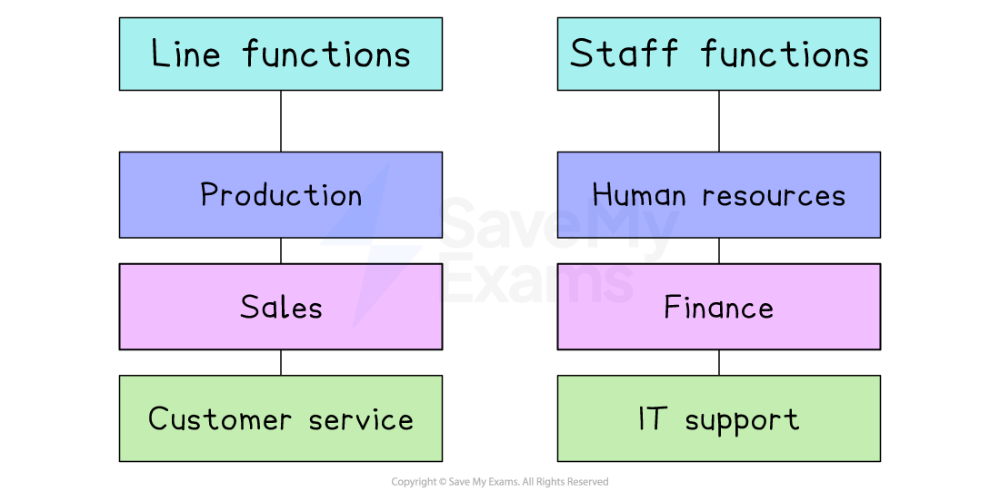

# Line & Staff Functions

## Line and staff functions

> **Spec point** — `spcpt_9DhD9wcfYyW5gGD3`

## Line and staff functions

- A **line function** is a department or role that is directly involved in achieving the core objectives of the business — typically related to production, sales, or operations

  - These roles have direct responsibility for performance and decision-making in the core areas of producing goods or delivering services
  
    - E.g. In a car manufacturing company, the **production manager **who oversees vehicle assembly is in a line function because they are directly involved in making the product

- A **staff function** is a department or role that provides **advice, support, or specialist services** to the line departments — but is **not directly involved** in core operations

  - Staff functions usually include **human resources, finance, IT **and **marketing**
  
    - E.g. The**  HR manager **who organises training and recruitment for the factory workers is in a staff function because they don’t make cars but help those who do

#### Examples of line and staff functions

*Line functions focus on core business activities, while staff functions support them*

### Conflicts between line and staff functions

- Both line and staff functions are essential

  - Line functions **drive** the business, and staff functions **enable** it to run smoothly
- However, conflicts sometimes arise between them

  - This conflict can arise due to **differences in perspective**,** poor communication **or** unclear roles**
  - Managing these conflicts well helps a business stay productive and efficient

#### Examples of conflicts between line and staff functions

| **Reason for conflict** | **Explanation** | **Example** |
|---|---|---|
| **Advice versus authority** | - Staff functions, like HR or finance, may give advice, but line managers may ignore it if they prefer to act on their own judgement | - An HR advisor recommends hiring a candidate based on skill tests, but the line manager chooses someone else based on experience |
| **Lack of understanding** | - Staff may not fully understand the practical challenges of production or *customer-facing roles*, leading to unrealistic suggestions | - A finance team sets strict budget limits without understanding urgent production needs on the factory floor |
| **Communication breakdown** | - Poor communication between staff and line departments can lead to confusion or delays | - The IT department changes a system without informing sales staff, disrupting their ability to serve customers |
| **Conflicting priorities** | - Line functions focus on immediate results, while staff functions may focus on long-term *strategy* or *legal compliance* | - A sales manager wants to launch a new offer quickly, but the legal team delays it while they carry out contract checks |
| **Perceived interference** | - Line managers may feel that staff departments are interfering in their responsibilities | - A production manager resents the HR department stepping in to handle disciplinary issues in their team |
