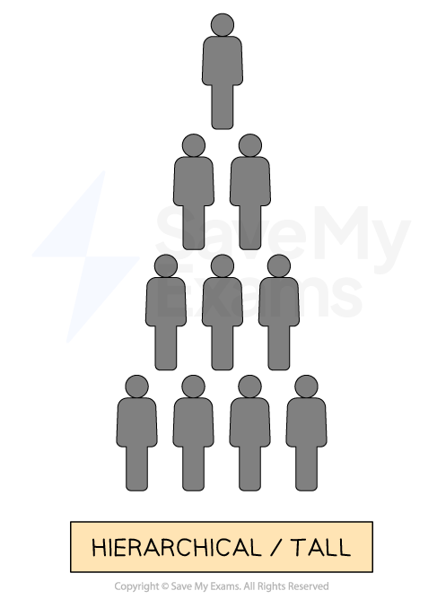
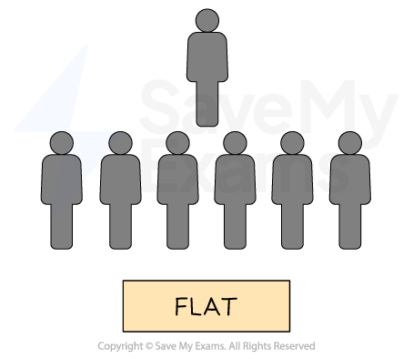
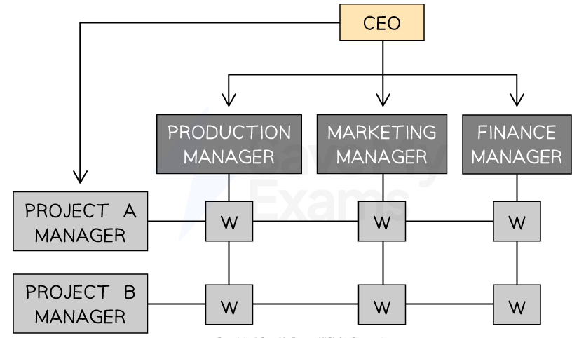
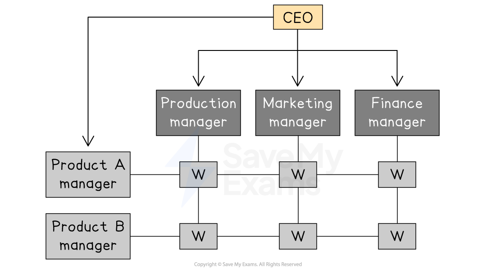

# Types of Organisational Structure

## Features of a formal organisational structure

> **Spec point** — `spcpt_gMrT9dgzb5pvcZ9C`

## Features of a formal organisational structure

- Organisational structure is the** way a business is arranged** to carry out its work effectively
- It shows **how employees are grouped**, how **authority **flows, and how **tasks are divided** across the organisation

### Terminology used in organisational structures

| **Term** | **Definition** | **Explanation** |
|---|---|---|
| **Hierarchy** | - The number of layers of management and supervision within an organisation | - It shows how many steps there are from the top (senior management) to the bottom (operational staff) - A tall structure has many levels, while a flat structure has few, which affects communication, control and decision-making speed |
| **Chain of command** | - The chain of command is the formal line of authority that flows down from the top management to lower-level employees | - It defines who reports to whom and who is responsible for making decisions - The chain of command helps establish a clear communication channel and helps maintain *accountability *within the business |
| **Span of control** | - Span of control refers to the number of employees that a manager or *supervisor *effectively manages | - It is based on the principle that a manager can only effectively manage a limited number of employees - A narrower span of control means more layers of management - A wider span of control means fewer layers |
| **Centralised** | - Decision-making authority is concentrated at the top of the organisation | - Senior management make most of the key decisions - Centralisation can promote *consistency *and control |
| **Decentralised** | - Decision-making is distributed throughout the organisation | - Lower-level employees have more decision-making power - Decentralisation can promote flexibility and innovation |
| **Authority** | - Authority is the official power given to a person to make decisions and give orders | - It flows down the organisational hierarchy and allows managers to direct others, allocate resources and take responsibility for decisions |
| **Delegation** | - Delegation is the process of passing authority from a manager to a *subordinate* | - A manager gives responsibility for a task to someone else but remains responsible for the outcome - It helps develop staff and reduce the manager's workload |
| **Accountability** | - Accountability is the requirement to explain and take responsibility for actions or decisions | - Even when tasks are delegated, managers are still accountable for results - Clear accountability ensures people are held responsible for their performance |

## Functional structure

> **Spec point** — `spcpt_rgQzTbwbkVHBWnRq`

## Functional structure

- Employees are arranged into different *functions *that fulfil particular roles, such as finance, human resources or marketing

  - Employees are **arranged according to their expertise**, bringing appropriate skills, experience and qualifications to a particular area of the business
  - There is a danger that functional areas **focus only on their own area** of responsibility and lose touch with the *objectives *of the business as a whole

*Organisation by function involves grouping workers according to the section of the business in which they work*

#### Evaluation of functional structures

| **Advantages** | **Disadvantages** |
|---|---|
| - **Specialisation**    - Employees develop expertise by working in specific departments such as marketing or finance | - **Lack of coordination**    - Departments may focus only on their own goals, not those of the whole business |
| - **Efficiency**    - Tasks are clearly divided, making it easier to train staff and manage performance | - **Slow decision making**    - Decisions may take longer as communication must go through several layers |
| - **Clear chain of command**    - Everyone knows who they report to and what their responsibilities are | - **Limited flexibility**    - Employees may not easily adapt to changes or work outside their department |
| - **Accountability**    - Managers are responsible for the performance of their department | - **Poor communication between departments**    - Can lead to misunderstandings or duplicated work |

## Hierarchical structure

> **Spec point** — `spcpt_hthSQPB8C6ZWPDcy`

## Hierarchical structure

- Functional organisation structures are typically either tall or flat

### Tall organisational structures

- Tall structures are common in large organisations with complex operations, such as government agencies and universities
- They are characterised by

  - **Multiple levels of management**
  - A more **centralised **decision making** **process
  - A **long** **chain of command **and **narrow spans of control**

*A tall - or hierarchical - structure with a long chain of command and narrow span of control*

#### Evaluation of tall structures

| **Advantages** | **Disadvantages** |
|---|---|
| - Provides a **clear hierarchy** of authority and defined roles and responsibilities - **Promotes specialisation** and expertise within each department or function - Offers **opportunities for *****career advancement***** **within the organisation - All of the above increases efficiency and motivation | - Can create **communication barriers** between the upper and lower levels of the hierarchy - **Decision-making can be slow** as information must pass through multiple layers of management - This can lead to ***bureaucracy**** *and excessive levels of management - All of the above reduce efficiency and motivation |

### Flat organisational structures

- Flat structures are common in small organisations or start-ups
- They are characterised by

  - Fewer levels of management
  - A **more decentralised decision-making process**
  - A** short chain of command **and **wide spans of control**

*A flat organisational structure with a short chain of command and wide span of control*

#### Evaluation of flat structures

| **Advantages** | **Disadvantages** |
|---|---|
| - Promotes ***collaboration**** *and open communication - Decision-making can be **faster and more efficient** - Encourages **creativity **and **innovation** as employees have more autonomy and flexibility - All of the above increases efficiency and motivation | - This can lead to ***role ambiguity*** and a lack of a clear hierarchy - May not provide clear opportunities for **career advancement** or promotion - This may require employees to take on **multiple roles** and responsibilities,** leading to *****burnout**** *and overwhelm - All of the above reduce efficiency and motivation |

## Matrix structure

> **Spec point** — `spcpt_5xh3y2vp3g9gw4vP`

## Matrix structure

- Matrix structures are usually **built around specific products** or projects

  - e.g. KitKat has its own team within Nestlé
- They combine the **functional areas** of a business with a** specialist team** that operates inside the business

#### A matrix organisational structure

*A matrix structure built around specific projects*

#### Evaluation of matrix structures

| **Advantages** | **Disadvantages** |
|---|---|
| - Promotes **cross-functional collaboration** and communication - Allows for ***specialisation *****and expertise** within each functional area - Enables efficient allocation of resources and **coordination of multiple projects** - All of the above increases efficiency and motivation | - This can lead to **conflicts over priorities and resources** - This can create **confusion over roles** and responsibilities, particularly when multiple managers are involved - **Requires a high degree of communication** and coordination, which can be challenging - All of the above reduce efficiency and motivation |

## Organisational structure by product, function or geographical area

> **Spec point** — `spcpt_JMgS4srskJvX9dPw`

## Organisational structure by product or geographical area

- As businesses grow, especially large or *multinational firms*, they may choose to structure themselves **by product** or **by region** instead of using a simple functional structure
- This helps them manage the growing complexity of operations and respond to specific customer or market needs

## Product-based organisational design

- The business is split into **divisions **based on individual products or product lines

  - Each division handles its own marketing, operations and finances
  
    - E.g.** Unilever **has a product-based structure, with teams dedicated to categories like personal care, home care, and food and drink brands
- It combines the **functional areas of a business** (HR, finance, marketing, sales) **with a specialist team** that operates inside the business

  - Each division handles its own marketing, operations, and finances

#### A product based structure

*An example of a project or product based structure where workers are grouped according to the project on which they are employed*

#### Evaluating a product based structure

| **Advantages** | **Disadvantages** |
|---|---|
| - Focuses on specific products or product lines, allowing** tailored strategies** to meet customer needs | - Can lead to** duplication of resources**, such as separate marketing teams for each product |
| - Encourages **accountability** as each product team is responsible for its own performance | - Risk of **internal competition** between product divisions, which may harm overall company goals |
| - Enhances **flexibility **and responsiveness to changes in product markets | - May result in **inconsistent** company-wide policies and standards |
| - Improves **decision-making speed**, as product managers can act quickly without needing to consult other departments | - Requires **more managers and skilled staff**, which can increase costs |
| - Easier to **measure performance** and profitability by product | - **Coordination **between products and company-wide strategy can be difficult |

## Regional organisational design

- This structure is commonly found in businesses that are located in **several different geographical locations - **either national or international

  - Regional management and structures allow a business to **respond effectively to the needs of customers** in diverse locations

#### Organisation by region

*Organisation by region involves grouping workers according to their location*

#### Evaluating a regional structure

| **Advantages** | **Disadvantages** |
|---|---|
| - Allows decisions to be made closer to **local markets**, improving customer satisfaction | - Can lead to **duplication of roles** and resources across regions |
| - Helps the business **respond quickly** to local trends, laws and competition | - **Increases costs** due to the need for multiple regional offices and management teams |
| - Encourages stronger **relationships with local stakeholders**, such as suppliers and governments | - May cause **inconsistent messaging** or branding between regions |
| - Employees can develop **expertise **in regional markets and cultures | - **Communication **and **coordination** between regions and headquarters can be challenging |
| - Enables **tailored marketing** and product strategies to suit local preferences | - Risk of regional teams **prioritising local goals **over global company objectives |

## Reasons and ways structures change

> **Spec point** — `spcpt_HnN53nbgPtPSHTpn`

## Reasons and ways structures change

- As a business grows or faces new challenges, it may need to change its organisational structure to stay efficient, competitive and focused on its goals

#### Reasons for changing organisational structure

| **Reason** | **Explanation** |
|---|---|
| **Business growth** | - As a company expands, more departments, roles and levels of management may be needed to handle increased complexity |
| **Delayering** | - Removing layers of management to make the business structure flatter - This can reduce costs and improve communication |
| **Retrenchment** | - A business may shrink its structure due to falling profits, so functions or jobs are removed to cut costs |
| **Entering new markets** | - Expanding into new regions or countries may require a regional structure to manage operations more effectively |
| **Introducing new technology** | - Automation or new systems may reduce the need for some roles or change how teams are structured |
| **Mergers or acquisitions** | - When two businesses combine, the structure must be reorganised to bring people and processes together |

> **Case Study**
> Zenta Electronics is a mid-sized consumer electronics company based in Malaysia. It has experienced rapid growth due to high demand for its smart home devices. Its original functional structure became slow and difficult to manage.
> 
> 
> 
> **Changes**
> 
> - Zenta moved to a product-based structure, creating separate divisions for smart lighting, home security and audio products
> - Each division had its own marketing, design and sales teams
> - The company also delayered, removing one layer of middle management to speed up communication and reduce salary costs
> 
> **Outcome**
> 
> - The business became more responsive to customer needs and innovation improved in each product division
> - Employee morale rose due to clearer roles and faster decision-making
> - Profits increased by 15% within a year
