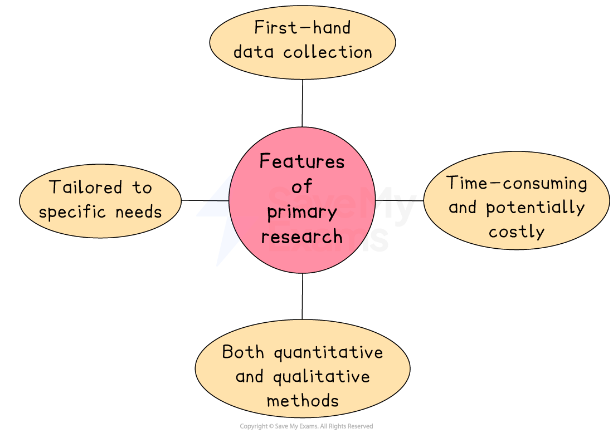
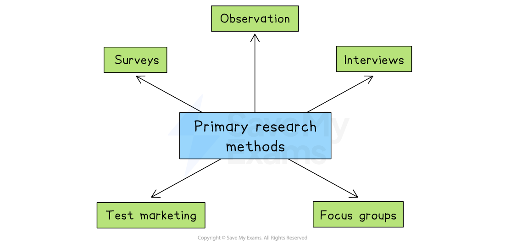
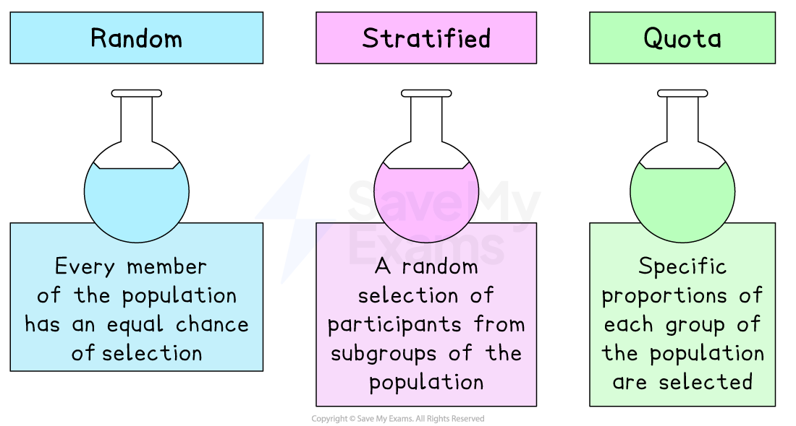

# Primary Research and Secondary Research

## The features of primary and secondary research

> **Spec point** — `spcpt_qsGGFgRrYBpZtwxc`

## The features of primary and secondary research

### Primary research

- **Primary research** is the process of gathering information **directly from consumers** in the target market using field research methods such as surveys and interviews

#### Common features of primary research

*Primary research data is first-hand and tailored to specific needs*

- **First-hand data collection**

  - Primary research involves gathering new information directly from people, rather than using existing sources
- **Tailored to specific needs**

  - The questions and methods are designed to collect information that is directly relevant to the business’s goals
  
    - *E.g. A restaurant could ask customers what new dishes they’d like added to the menu*
- **Time-consuming and potentially costly**

  - Collecting and analysing primary data takes time, money, and effort, especially for large samples
  
    - *E.g. Organising focus groups or conducting interviews may require trained staff and payment to participants*
- **Includes both quantitative and qualitative methods**

  - Primary research can gather numerical data (quantitative) or opinions and attitudes (qualitative)
  
    - *E.g. A business may run a questionnaire with rating scales and follow-up interviews for deeper insight*

### Secondary research

- **Secondary research **involves the collection, compilation and analysis of data that **already exists**

  - It is likely to have been collected for a **broad purpose** by another organisation, such as the government or a research specialist
  - Since the data is already available, it’s usually **faster **and often **cheaper **to access than primary research
  
    - *E.g. downloading a report on consumer habits from a trade organisation's website may be free or low-cost*

## Usefulness of primary market research data

> **Spec point** — `spcpt_dbJDdXbrsxvzh6tR`

## Usefulness of primary market research data

- Businesses can choose from a **range of primary marketing research methods** and may combine a selection of methods to obtain comprehensive first-hand data

*Primary research methods include surveys, observation, interviews, test marketing and focus groups*

### Surveys

- The most widely used method for gathering primary research data is [sampling](https://www.savemyexams.com/dp/business-management/sl/24/revision-notes/4-marketing/4-3-market-research/4-3-2-sampling-methods/) through surveys

  - A series of questions are posed to a certain number of people **(respondents)**
  - The results from the "sample" are used to make ***inferences***, which tare **extrapolated** to be true for the wider population

| **Advantages** | **Disadvantages** |
|---|---|
| - A **large amount **of data can be collected relatively **quickly** - Well-designed surveys can be **completed easily by the respondents**, especially online surveys | - Poorly designed and conducted surveys will result in poor results - Poor response rates are typical, especially when a ***random sampling*** method is used |

### Observation

- This involves hiring someone to stand in an appropriate location and **study consumer behaviour** in a store or perhaps judge the potential consumer traffic at a particular location

  - Researchers may observe the impact of packaging or the particular **placement of a product** in a store on consumer choice

| **Advantages** | **Disadvantages** |
|---|---|
| - A useful method to capture data on **human behaviour** - **Large numbers** can be observed in a **short period of time** | - Observation needs to be **combined with other primary research methods** to understand the causes of behaviour |

### Interviews

- The questions may be set up in a very similar way to a survey; however, an interviewer asks the questions
- This method** takes longer**, but it does allow the interviewee to ask **follow-up questions** and gather information that might easily be missed when conducting surveys

| **Advantages** | **Disadvantages** |
|---|---|
| - In-depth question elicit **detailed opinions and perceptions** from participants - **High response** rates can be achieved | - A **time-consuming** process, as interviews are carried out one-on-one - Interviewer ***bias ***can affect the validity of results |

### Test marketing

- Free samples are provided to the target market for a limited period to **gauge their response to the product**
- Adjustments to the product or other elements of the*** marketing mix*** can be made following feedback

| **Advantages** | **Disadvantages** |
|---|---|
| - Perceptions and opinions can be gathered **prior** **to a full product launch** - Can attract **early attention **from potential customers | - Producing and distributing free samples can be **expensive** - **Competitors may become aware **of new products to be launched |

### Focus groups

- A marketing specialist leads free-form discussions to collect** detailed feedback **from the target market on all aspects of the **marketing mix**
- Usually limited to a small group of 12–15 people
- The group typically meets for 90 minutes to 3 hours

| **Advantages** | **Disadvantages** |
|---|---|
| - **Detailed information** on opinions and perceptions can be gathered - Small groups make focus groups relatively **easy **and **inexpensive** to organise | - Participants may be **reluctant to share their true opinions** in a group situation - Rewards for participation make focus groups **more expensive than other methods** such as surveys or observation |

- Businesses must choose a primary marketing research method that allows them to **capture the correct form of data** that can support decision-making

  - Each method has a range of advantages and disadvantages, which must be considered when making this choice

#### Evaluation of primary marketing research

| **Advantages** | **Disadvantages** |
|---|---|
| - Information gathering is **focused on the needs of the business **and will not be available to its rivals | - **The sample size may be too small** and unrepresentative of all of the customers, leading to unreliable results |
| - The business can get **in-depth information **from respondents, e.g. reasons behind certain behaviour | - **Bias** may mean that researchers can guide respondents to **answer questions in a particular way**    - Similarly, respondents may be influenced by the responses of others or not provide accurate information |
| - Primary marketing research is **more up-to-date **and** **can be used to **ask specific questions**, making it more relevant | - A business** may need to hire a specialist marketing research agency **to help, which can be an **expensive and time-consuming **process |

## Sampling

> **Spec point** — `spcpt_XF8XpMZ8qW8rrg9N`

## Sampling

- Sampling involves **getting opinions from a selected group of people** in order to find out about the market as a whole

  - It is **expensive** and **time-consuming** to collect data from all customers in a market
  - Marketing researchers use carefully designed sampling methods from which **conclusions can be drawn about the market as a whole**
  - In general, the** larger the sample size**, the more likely that results from marketing research activities will **reflect the market as a whole**

#### The main sampling methods: random, stratified and quota

*Sampling methods include random, stratified and quota*

### Random sampling

- This method ensures that **every member of the population has an equal chance** of selection

  - E.g. a survey of gym members may be sent to a random selection of customers taken from the membership database

### Stratified sampling

- This method involves the **random selection of participants from subgroups** of the population, such as age, gender, income level or education groups

  - E.g. a survey of school pupils may be carried out only on Year 10 girls

### Quota sampling

- This method obtains a **representative sample** by determining **specific proportions of each group of the population** upon which to carry out research

  - E.g. a researcher conducting a survey for a family car manufacturer may seek to interview a sample comprising 25% of individuals aged 18–24, 50% aged 25–45 and 25% aged 46 and above

### The choice of sampling method

- The choice of sampling method will depend upon a wide range of factors

  1. **Time available**
  
    - Where **little time is available **to carry out marketing research, a **random sample** may be most appropriate, as it is usually very quick and straightforward to organise
  2. **Knowledge of the target population**
  
    - Where a business has **good knowledge of the target population,** a **quota sample** should provide a set of research data that lacks bias
  3. **Skills of researchers***** ***
  
    - Where researchers **lack experience or expertise** in marketing research, a focused **stratified sample **is likely to provide a useful set of data that can be easily interpreted

### Limitations of sampling

- The sample** might not reflect the views of the whole target market**

  - If the group chosen for the research is too small or not *diverse* enough, the results may not represent the wider population
  - This can lead to incorrect assumptions about customer preferences or behaviour
  
    - E.g. If a sportswear company only surveys customers in one city, it may miss preferences in other regions
- Sampling can be **biased** if certain groups are over- or under-represented

  - When the sample includes too many people from one group and too few from another, the results become unbalanced
  - This kind of bias can happen by mistake or due to poor sampling methods
  
    - E.g. If a technology company surveys only younger people online, it may ignore the views of older customers who shop in-store
- **Human error **can reduce the reliability of the findings

  - Mistakes in how the sample is selected, how questions are asked, or how responses are recorded can affect the accuracy of the research
  
    - E.g. An interviewer may ask leading questions, or a poorly designed questionnaire might confuse participants

> **Exam Hint**
> A research population refers to the group of people in whom the business has an interest when conducting marketing research — a common mistake is to assume that research focuses on, say, the whole population of a country or region.

## Usefulness of secondary market research data

> **Spec point** — `spcpt_sBGQbnrwWDfFWBzS`

## Usefulness of secondary market research data

#### Sources of secondary research

*Businesses can consult a wide range of secondary sources to gather marketing research data*

| **Source** | **Explanation** |
|---|---|
| **Government publications** | - National governments and ***trading blocs*** such as the **EU** publish reports and statistics on the economy, demographics, industry trends and consumer behaviour* * |
| **Academic institutions** | - Universities conduct studies and publish research papers that provide insights and data on specific industries, consumer behaviour and market trends - For example, **Stanford University** is a globally significant research centre for engineering and medicine |
| **Industry associations** | - Trade and industry associations provide detailed information about specific sectors, including market size, growth rates and industry ***benchmarks*** - E.g. the** International Organisation of Motor Vehicle Manufacturers **conducts and collates research on production and sales statistics |
| **Marketing research reports** | - Companies specialising in marketing research produce and sell in-depth reports on industries, markets and consumer trends - E.g. **Mintel **is one of the leading private companies supplying marketing research information |
| **Financial reports** | - Public limited companies publish annual reports that can provide valuable information about a company's performance, market position and future plans |
| **Media sources** | - Newspapers, magazines and online forums publish opinion pieces and investigative reports that offer insights into market trends, consumer behaviour and industry developments - E.g. the **Financial Times **and **The Wall Street Journal ** |

#### Advantages of secondary marketing research

- Information is **already available **and** **is** quicker to collect** than primary research, thereby saving time
- Information is often free (e.g. government websites and internet sources such as Statista) or **cheap to collect**,** **leading to **lower costs **compared to primary research
- Suitable for a **small business** that lacks a large marketing ***budget*** and/or expertise

#### Disadvantages of secondary marketing research

- Information has been collected for other purposes, so it **may lack relevance **or may** not be** factually correct, e.g. Wikipedia
- Can be **expensive** to purchase market-specific secondary data from specialist companies, e.g. Mintel reports
- **Information may be out of date**, especially in ***dynamic*** markets
