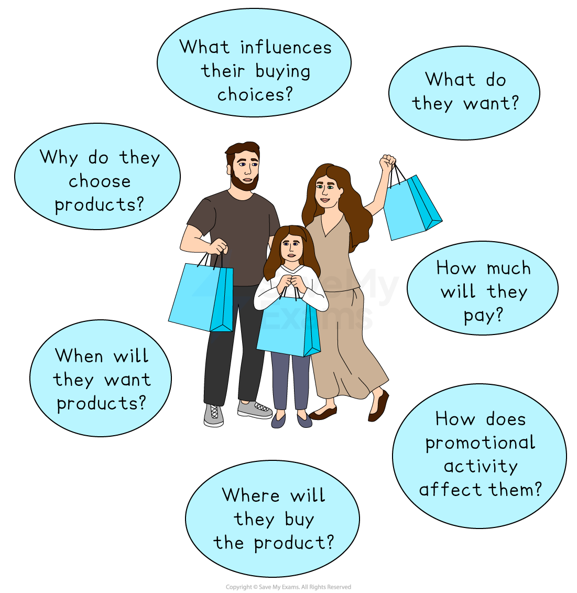

# The Purposes of Market Research

## The main features of a market

> **Spec point** — `spcpt_mrqYXQwHmvQtqbw3`

## The main features of a market

### Market size

- **Market size** is the **value or volume of sales of all businesses** within a market

  - It can be measured by **sales volume **or **sales value**
  
    - E.g. in 2024, the UK vinyl record market was worth £159m, with 5.9m units sold, the highest annual level since 1990
- The total size of a market will be a key factor in determining whether it is worth a business entering and competing within it

  - A larger market size suggests** more potential customers**, which means greater opportunities to sell products and earn revenue
  - Knowing the size of the market helps businesses judge whether there is **room to grow** or if the market is already *saturated*
  - Investors are more likely to support a business operating in a large or growing market, as it promises** better returns**

### Market growth

- The speed of growth of a market is another key factor to consider when weighing up whether to enter and compete within it

  - More customers are entering the market, which makes it easier for new or smaller businesses to **gain sales **without taking customers from rivals
  - When demand is rising, **competition tends to be less aggressive** because most firms can grow at the same time
  
    - This reduces the pressure to lower prices or fight over *market share*
  - A growing market is a sign that it has **long-term potential**
  
    - Businesses can plan for future expansion, build customer loyalty early and benefit from rising demand
- Market growth is expressed as a percentage and calculated using the formula

$\frac{Market \text{size} \text{this} \text{year} - \text{Market} \text{size} \text{last} year}{Market \text{size} \text{last} \text{year} } ​ \times 100$

> **Worked Example**
> Supermarket sales data shows shoppers are putting more plant-based milk in their baskets. In the year to February 2025, market sales were up 2.1%. Oat milk sales have grown particularly strongly. Annual sales reached £275m in 2024, up from £155m in 2020.
> 
> **Calculate **the percentage increase in the size of the UK oat milk market since 2020.
> 
> **[2]**
> 
> **Step 1: Subtract 2020 sales from 2024 sales to determine the increase**
> 
> $= \pounds 275 \mathrm{m} - \pounds 155 \mathrm{m} 
> 
> = \pounds 120 \mathrm{m}$**   (1)**
> 
> **Step 2: Divide the difference by 2020 sales**
> 
> $= \pounds 120 \mathrm{m} \div \pounds 155 \mathrm{m} 
> 
> = 0.7742$
> 
> **Step 3: Multiply the outcome by 100 to determine market growth**
> 
> $= 0.7742 \times 100
> 
> = 77.42 \%$**   (1)**

### Competitors

- The number and nature of rivals in a market is a key consideration for a business looking to enter and compete within a market

  - The level of competition affects pricing and profitability
  
    - If there are **many competitors**, prices are often lower because businesses compete to attract customers. This can reduce profit margins.
    
      - E.g. A new café in a street full of other cafés might struggle to charge higher prices or attract loyal customers.
  - Many rivals makes It harder to stand out
  
    - In markets with many similar businesses, it can be difficult to offer something different or unique.
    
      - E.g. A new clothing brand may find it difficult to stand out in the fast fashion market unless it offers something distinctive, like sustainable materials or custom designs
  - Strong, well-established competitors are hard to challenge
  
    - If existing businesses have **strong brands, loyal customers **or ***economies of scale***, it can be difficult for new firms to compete.
    
      - E.g. A small soft drink company would find it very hard to take market share from Coca-Cola or Pepsi

## Market research, customer characteristics, profiles, wants and needs

> **Spec point** — `spcpt_f9hBtm9djcVnz4RR`

## Market research, customer characteristics, profiles, wants and needs

- **Marketing research** is the process of finding out information about the market in which a business operates by **collecting**, **presenting **and **analysing information** about **customer characteristics**, their **profiles** and their **wants and needs**

### Market research, consumer characteristics and profiles

- **Market research gathers data directly from potential and existing customers** using methods such as surveys, interviews, focus groups, and observation

  - This helps businesses learn about who their customers are and what they want.
- It can identify **consumer characteristics** such as:

  - Age
  - Gender
  - Income level
  - Occupation
  - Location
  - Lifestyle, tastes and preferences
- This information is then used to create **customer profiles**, which are detailed descriptions of target customers

  - E.g. A customer profile might describe a typical buyer as a 30-year-old, urban, environmentally conscious professional who shops online and prefers sustainable products

#### The importance of identifying consumer characteristics and profiles

| Benefit | Explanation |
|---|---|
| **Improves targeting and promotion** | - By understanding who the customer is, businesses can design marketing messages that are more likely to appeal to them |
| **Helps design better products and services** | - Knowing what customers value enables businesses to develop products that match their needs more closely |
| **Supports *****market segmentation*** | - Customer profiles help divide the market into meaningful groups, making it easier to meet the needs of each segment effectively |
| **Increases customer satisfaction and loyalty** | - When customers feel understood and valued, they are more likely to return and recommend the brand to others |
| **Reduces marketing waste** | - Targeting the right people avoids spending money on those who are unlikely to buy the product. |

### Market research and understanding customer needs and wants

- Effective research can help a business **understand customer needs and wants**

  - They can then ensure that the products, as well as the price and location at which they are sold, closely match what customers want to buy

#### What market research can discover

*Marketing research can provide insights on customer behaviour*

| **Insight** | **Example** |
|---|---|
| **What do they want?** | - **Cadbury **tracked Facebook groups and YouTube comments where thousands of fans begged for the old *Wispa* bar - Seeing a clear demand, Cadbury relaunched **Wispa** in 2008 — and sold 20m bars in the first seven weeks |
| **How much will they pay?** | - A 2023 UK study found that **Netflix **subscribers would still stay if fees rose a little, showing that *price elasticity* was very low |
| **How does promotional activity affect them?** | - **Aldi **measured weekly sales and social media feedback during its 2023  “Kevin the Carrot” Christmas advertising campaign - The data showed a sharp jump in festive food sales and a gain in market share, proving that the cartoon character encourages shoppers into stores |
| **Where will they buy the product?** | - Office for National Statistics (ONS) data shows online now makes up around 26% of UK retail sales - Grocers such as **Morrisons **have adjusted by adding more home‑delivery slots. |
| **When will they want products** | - **Starbucks **tracks autumn demand data and now launches its Pumpkin Spice Latte in late August because sales jump immediately |
| **Why do they choose products?** | - A 2023 UK survey found 82% of shoppers will pay more for **eco-friendly packaging**, encouraging brands towards greener materials |
| **What influences their buying choices?** | - A 2023 UK report by **Traakr **found that social media influencers now sway buying choices for half of 18–34-year-olds |
