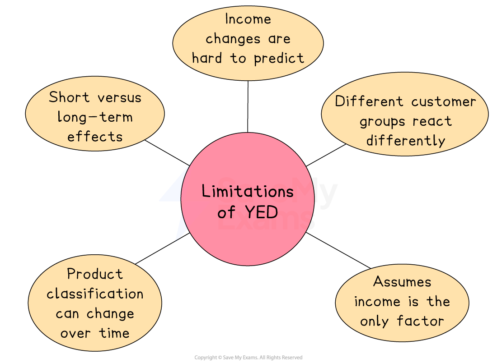

# Income Elasticity of Demand

## The concept of income elasticity of demand

> **Spec point** — `spcpt_J72gHRQrfbB5kqp3`

## The concept of income elasticity of demand

- **Income elasticity of demand (YED) **measures the **responsiveness** of demand for a product to a change in **income levels**

  - Businesses are interested **in how much** the **quantity demanded will change **for different products
- When household incomes change, spending on goods and services will **either increase or decrease,** depending on the type of good or service it is

  - **Normal good:** A good where demand rises when income increases, e.g. restaurant meals or new clothes
  - **Inferior good:** A good where demand falls when income increases, e.g. instant noodles or bus travel
  - **Luxury good:** A good where demand increases more than proportionally as income increases, e.g. designer handbags or sports cars

## Calculating and interpreting income elasticity of demand

> **Spec point** — `spcpt_ydHHPJz4mRrx8gwc`

## Calculating and interpreting income elasticity of demand

- The YED value can be **positive or negative,** and the value is important in determining the type of good

  - A good with a **positive YED** value is considered to be a **normal good**
  
    - Normal goods can be classified as **necessities** or **luxuries**
  - A good with a **negative YED** value is considered to be an** inferior good**
- YED is calculated using the formula

$\text{YED = } \frac{\% \text{Change} \text{in} \text{quantity} demanded}{\% \text{Change} \text{in} income} = \frac{\% \Delta \text{in} QD}{\% \Delta \text{in} \mathrm{Y} }$

> **Worked Example**
> An individual’s income falls from £450 to £405 per week. As a result, their demand for takeaway meals falls from 50 to 30 per week.
> 
> **Calculate **the income elasticity of demand (YED) for takeaway meals.
> 
> [4]
> 
> **Step 1: State the YED formula**
> 
> $\text{YED} = \frac{\% \text{change} \text{in} QD}{\% \text{change} \text{in} \mathrm{Y} }$     **(1)**
> 
> **Step 1: Calculate the % change in QD**
> 
> $\% \text{change} \text{in} \text{QD} = \frac{50 - 30}{50} \times 100
> 
> = - 40 \%$      **(1)**
> 
> **Step 2: Calculate the % change in Y**
> 
> $\% \text{change} \text{in} \mathrm{Y} = \frac{\pounds 450 - \pounds 405}{\pounds 450} 
> 
> = - 10 \%$**    **  **(1)**
> 
> **Step 3: Insert the above values in the YED formula**
> 
> $\text{YED} = \frac{- 40 \%}{- 10 \%} 
> 
> = 4$**       (1)**

### Influences on YED

- YED is influenced by **many factors in an economy** that **change the wages of workers**

  - During a ***recession*****,** wages usually fall and demand for** inferior goods** rises while demand for **luxury goods** falls
  - During a period of **economic growth** and rising wages, demand for luxury goods increases while demand for inferior goods decreases
  - Other influences on income include ***minimum wage***** legislation**, **taxation **and** increased international trade**
- Understanding the income elasticity of demand is useful to businesses, as it can** help** them **plan their production and products**

  - Planning in this way will help them generate higher profits and be less exposed to economic downturns

### Interpreting YED values

#### YED is more than 1 and positive

- **Normal good**

  - Examples: cars, foreign holidays, cinema visits and branded goods
  - Demand rises when income rises
  - Demand falls when income falls
  - Demand is responsive to a change in income (income elastic)

#### YED is between 0 and 1 and positive

- **Necessity good**

  - Examples: bread, milk,  fuel, toothpaste
  - Demand rises slightly as income rises
  - Demand falls slightly as incomes fall
  - Demand is not very responsive to a change in income (income inelastic)

#### YED is negative

- **Inferior good**

  - Examples: public transport, domestic holidays, canned foods, own-label goods
  - Demand rises when income falls
  - Demand falls when income rises
  - Negative income elasticity

## The impact of income elasticity of demand on decisions

> **Spec point** — `spcpt_25Jg8JTXZJnzfQPW`

## The impact of income elasticity of demand on decisions

### Pricing and promotion

- **Firms can anticipate changes in demand** when incomes rise or fall:

  - Products with **high positive YED** (luxury goods) will see demand increase more than proportionally as income rises
  - During a downturn, demand for such products may **fall sharply**, so businesses may need to **lower prices or offer discounts**
  - For **necessities** (low YED, close to zero), demand is **less sensitive to income**, so businesses can maintain prices even in economic downturns

### Product and capacity planning

- **Positive income elasticity** signals a non-necessity or luxury item, where sales rise as incomes rise

  - **Burberry** enjoys strong growth when wages improve, so the firm expands its high‑end ranges and store space
- **Negative income elasticity** identifies inferior goods

  - Supermarket "value" noodles sold more during the 2022–23 cost‑of‑living squeeze, so factories increased night shifts to cope
  - **Oatly**’s premium oat milk drink saw fast UK sales growth as incomes recovered in 2024, so the brand invested in a new Peterborough packing facility

### Marketing objectives

- Firms set objectives using elasticity estimates

  - **B&Q** identified that spending on DIY products is income elastic, so it continued to add products to its *portfolio* during the recent economic downturn

### Inventory and production schedules

- Knowing that Pumpkin Spice Lattes have a high positive PED but a strong seasonal YED, **Starbucks** launches them every August and adjusts its coffee bean orders months ahead

### Risk management

- Airlines such as **Ryanair **use *dynamic pricing* models built on PED estimates

  - If a flight is 80% full, prices rise sharply because late bookers are less price‑sensitive

> **Exam Hint**
> If you're using PED or YED data, don’t stop at calculating it
> 
> Always say how it affects pricing or sales decisions

## Limitations of income elasticity of demand

> **Spec point** — `spcpt_Xwz6yGJPw86BXfXd`

## Limitations of income elasticity of demand

- Income elasticity of demand helps businesses understand if their product is a luxury, necessity or inferior good
- However, just like with PED, there are limits to how useful YED is when making  business decisions

#### Key limitations of YED

*Limitations of YED include the different reactions of customer groups and the assumption that income is the only factor affecting demand*

- **Income changes are hard to predict**

  - It’s difficult to know exactly when or how much people’s income will rise or fall
  
    - E.g. A sudden cost-of-living crisis could reduce incomes and demand for luxury items faster than expected
- **Different customer groups react differently**

  - Not everyone’s income changes in the same way, so demand might not shift evenly
  
    - E.g. A business may target high earners, but average YED data includes lower-income groups too
- **Assumes income is the only factor**

  - YED focuses on income changes but ignores other factors like trends, advertising or substitutes
  
    - E.g. A healthy food company may see demand rise due to a trend, not just because incomes have increased
- **Product classification can change over time**

  - A product that is seen as a luxury today might become a necessity tomorrow
  
    - E.g. Smartphones were once luxuries, but now they are widely considered to be essential
- **Short-term versus long-term effects**

  - Demand might react slowly to income changes, especially if customers delay spending
  
    - E.g. After getting a pay rise, an individual may not upgrade their car straight away
