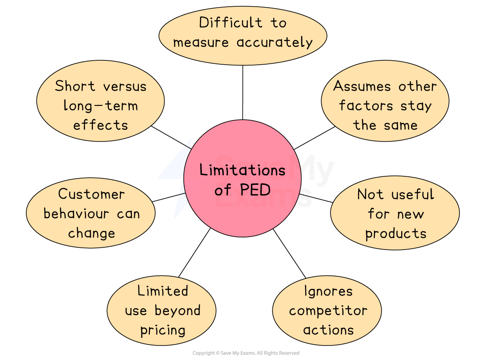

# Price Elasticity of Demand

## The concept of price elasticity of demand

> **Spec point** — `spcpt_tGf4zJY5JB49YsZ5`

## The concept of price elasticity of demand

- **Price elasticity of demand (PED) **measures how **responsive ***demand* for a product is to a change in **price**

  - In general,
  
    - when the price for a product increases, demand falls
    - when the price for a product decreases, demand rises
  - PED answers the question: **By how much **will** **demand change?

## Calculating and interpreting price elasticity of demand

> **Spec point** — `spcpt_qt3P4ZrxSPBjn9Wg`

## Calculating price elasticity of demand

- PED will always be a **negative value **due to the** inverse relationship** between price and quantity

  - If the price goes up, the quantity demanded goes down
  - If the price goes down, the quantity demanded goes up
- **PED can be calculated** using the formula

`text PED =  end text fraction numerator percent sign space Change space in space quantity space demanded over denominator percent sign space Change space in space price end fraction space equals space fraction numerator percent sign triangle space in thin space QD over denominator percent sign triangle in space straight P end fraction`

- **To calculate a % change**, use the formula

`percent sign space Change space equals space fraction numerator New space value space minus space Old space value over denominator Old space value end fraction space cross times space 100`

> **Worked Example**
> Helsinki Hurricanes sells team shirts for \$24. In 2024 it sold 3,240 shirts at this price. Due to increased costs, the team manager has decided to increase the price to \$30 per shirt from 2025. She expects demand to fall by 12%.
> 
> **Calculate **the price elasticity of demand for Helsinki Hurricanes team shirts.
> 
> (2)
> 
> **Step 1: Calculate the percentage change in price**
> 
> `equals space fraction numerator $ 30 space minus space $ 24 over denominator $ 24 end fraction space cross times space 100
> 
> equals space 25 percent sign`      ** [1]**
> 
> **Step 2: Divide the percentage change in demand by the percentage change in price**
> 
> `equals space fraction numerator negative 12 percent sign over denominator 25 percent sign end fraction
> 
> equals space minus 0.48`     ** [1]**

- In some cases, you may be required to calculate the percentage change in price or demand
- This involves rearranging the PED formula

> **Worked Example**
> The price elasticity of demand for popcorn at the cinema is –0.8. The current price of a box of popcorn is \$5.
> 
> Using the data, **calculate **the percentage change in quantity demanded following a \$1 increase in the price of a box of popcorn. You are advised to show your work.
> 
> **[4]**
> 
> **Step 1: **State the PED formula
> 
> `text PED  end text space equals space fraction numerator percent sign space Change space in thin space demand over denominator percent sign space Change space in space price end fraction`   ** ****(1 )**
> 
> **Step 2: **Calculate the percentage change in price
> 
> `equals space fraction numerator $ 6 space minus space $ 5 over denominator $ 5 end fraction space cross times space 100 space
> 
> equals space 20 percent sign space increase`    ** ****(1 )**
> 
> **Step 3: **Insert the data you have been given into the formula
> 
> `negative 0.8 space equals space fraction numerator straight x over denominator 20 percent sign end fraction`      ** ****(1 )**
> 
> **Step 4: **Rearrange and solve for x
> 
> `x space equals space minus 0.8 space cross times space 20
> 
> x space equals space minus 16 percent sign`           ** ****(1 )**
> 
> **Step 5: **Present the final answer
> 
> - The quantity demanded **falls **by **16%** **(4)**

> **Exam Hint**
> Remember the key facts:
> 
> - If price decreases, demand increases
> - If price increases, demand decreases
> 
> In the example above, price increases, so demand must fall

### Interpreting price elasticity of demand

#### 1. Price elastic demand

- PED value lower than -1 (e.g -1.2)
- Demand is **more responsive to a change in price**

  - For every 1% change in price, demand will change by more than 1%
- An increase in price will lead to a fall in revenue; a decrease in price will lead to an increase in revenue

  - Examples include** luxury products **such as cars, smartwatches, foreign holidays, cinema visits, jewellery and branded goods

#### 2. Price inelastic demand

- PED value is between 0 and -1 (e.g -0.7)
- Demand is** less responsive to a change in price**

  - For every 1% change in price, demand will change by less than 1%
- An increase in price will lead to an increase in revenue; a decrease in price will lead to an decrease in revenue

  - Examples include **necessities** such as bread, milk, eggs and potatoes; fuel; rent; toothpaste
  
    - Also **addictive products **such as cigarettes and sugary foods

> **Exam Hint**
> Focus on the **size** of the number
> 
> −1.2 is price elastic, −0.5 is price inelastic. Always link what that means for the business revenue when the price changes

## The impact of price elasticity of demand on decisions

> **Spec point** — `spcpt_vNhxNSrFRqKvgGG2`

## The impact of price elasticity of demand on pricing decisions

- If businesses can **determine the price elasticity of demand** for their products, they can adjust **pricing strategy** to **maximise revenue**
- If demand for their products is relatively **price inelastic (between 0 and -1),** raising the price will lead to an **increase in total revenue**
- However, lowering the price will lead to a **fall in total revenue**

  - ***Price skimming strategies*** are best employed for products that are price inelastic in demand
- If demand for their products is relatively **price elastic (PED > -1),** raising the price will lead to a **fall in total revenue**
- However, lowering the price will lead to a **rise in total revenue**

  - ***Competitive pricing strategies*** are best employed for products that are price elastic in demand

### Price elasticity of demand and total revenue

#### Price elastic demand

*Price elastic demand*

- PED is **greater than 1**
- An increase in selling price reduces the total amount of revenue generated from sales
- A reduction in selling price increases the total amount of revenue generated from sales

#### Price inelastic demand

*Price inelastic demand*

- PED is **between 0 and 1**
- An increase in selling price increases the total amount of revenue generated from sales
- A reduction in selling price reduces the total amount of revenue generated from sales

## Limitations of price elasticity of demand

> **Spec point** — `spcpt_DDm5QW655SS4Zv5G`

## Limitations of price elasticity of demand

- **Price elasticity of demand (PED)** can help businesses decide how much to charge for their products by showing how sensitive customers are to price changes
- However, relying too much on PED when making decisions can lead to problems, especially if the data is wrong or if other important factors are ignored

*Limitations of PED include the difficulty of measuring demand change accurately and its limited use beyond pricing*

- **Difficult to measure accurately**

  - PED calculations need reliable data on how demand changes with price, which can be hard to collect
  
    - E.g. A business may not know exactly how much demand will fall if it raises prices by 10%
- **Assumes other factors stay the same**

  - PED only looks at price and demand, but things like income, trends or marketing also affect sales
  
    - E.g. A fashion brand may raise prices expecting little change in demand, but a trend shift makes the item less popular
- **Not useful for new products**

  - Without past data, it’s hard to estimate PED for products that haven’t been sold before
  
    - E.g. A tech company launching a new gadget can’t predict how price changes will affect demand
- **Ignores competitor actions**

  - PED doesn’t consider how rival businesses might respond to a price change
  
    - E.g. A supermarket lowers prices to boost sales, but rivals do the same, so demand stays unchanged
- **Customer behaviour can change**

  - PED is not fixed – it can change as customer preferences or incomes change
  
    - E.g.  Petrol demand may become more elastic as electric cars become more common
- **Limited use beyond pricing**

  - PED mainly helps with pricing decisions, not choices like product design, location or hiring
  - However, it can give clues about brand strength or customer loyalty, which may influence other areas
- **Short versus long-term effects**

  - Demand might be inelastic in the short term but more elastic in the long term as customers adjust
  - E.g. A mobile network raises prices and sees little change at first, but over time people switch providers
