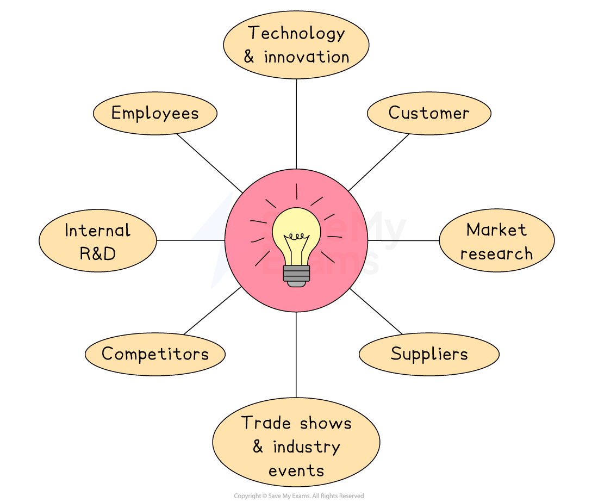

# Product Development

## The process of product development

> **Spec point** — `spcpt_9FxVZnps7NWV8bK9`

## The process of product development

- One way to stay ahead of the competition is by **developing new products** and** ***innovating* **existing ones**
- New product development can be **valuable **for a number of reasons

  - A successful launch opens up a **new income stream**
  
    - **Nintendo**'s launch of its Switch console in 2017 turned falling sales into record profits
  - **Tastes change**, so fresh products keep a business in fashion
  
    - **Skechers Slip Ins** are easy to put on, making them a comfortable alternative to lace-up shoes that align well with less formal working lives
  - Novel features create a **competitive advantage** over rivals
  
    - The** Samsung Galaxy Z Fold** offers a folding screen that mainstream phones lack
  - Extra product lines **spread risk **across different segments
  
    - The **LEGO Botanical Collection** targets adult hobbyists, not just children, *diversifying* sales
  - Regular innovation can improve brand image
  
    - **Unilever’s Dove** refillable deodorant pods underline its sustainability credentials

#### Key factors that influence new product development

| Factor | Why it shapes the new product plan | Example |
|---|---|---|
| **Market demand and insight** | - Real customer problems or gaps in the market can prompt profitable ideas | - The trend for flexitarian diets led **Burger King** to create the plant‑based Whopper |
| **Technology advances** | - New technology unlocks features that were impossible before | - Wider 5G networks encouraged **Qualcomm** to design faster chips for gaming consoles and computers |
| **Competitor activity** | - A rival’s move can force a business to respond rapidly | - **Microsoft** added haptic feedback to its Elite gaming controllers after Sony’s success with its DualSense product |
| **Resources and *****R&D***** budget** | - Innovation requires time, talent and cash | - **Pfizer** channelled major R&D funds into mRNA tech, enabling it to develop its COVID-19 vaccine quickly |

### The product development process

- There are several steps in the product development process

*The new product development process*

1. **Generate ideas**

  - Product concepts are discussed and brainstormed using customer suggestions, ideas from competitors’ products, employees’ ideas and information collected through market and technical research
2. **Select the best idea**

  - Ideas are compared, with some being dropped and others chosen for further research
  - This decision relates closely to** costs** and likely **demand**
  - Research includes looking into forecast sales, size of market share and cost-benefit analysis for each product idea
3. **Develop a *****prototype***

  - This allows the operations department to see how the product can be manufactured, any problems or difficulties arising from its production and how to fix them
  - Computer simulations are often used to produce 3D prototypes on screen
4. **Test launch**

  - The developed product is sold on a small scale to a limited market to see how well it sells before its full launch
  - Changes may be needed prior to an expensive, large-scale launch
  - Digital products such as apps and software run beta versions, which is a method of test-launching
5. **Full launch of the product**

  - The finalised version of the product is launched to the entire target market

## Sources of ideas for product development

> **Spec point** — `spcpt_kPc9x6nkpSgsmDg5`

## Sources of ideas for product development

- Product development is important for helping a business stay competitive, grow and meet changing customer needs
- Before creating a new product, a business will explore different sources to get ideas and understand what customers might want

*Ideas can be generated by employees, from customer feedback and through market research*

- **Customers**

  - Feedback, complaints, reviews or suggestions can highlight what people want or need
- **Employees**

  - Staff working in sales, customer service or production often notice problems or spot opportunities for new ideas
- **Competitors**

  - Looking at what rivals are offering can inspire new ideas or show gaps in the market
- **Market research**

  - Surveys, focus groups and trends analysis help businesses understand customer needs and spot new opportunities
- **Technology and innovation**

  - New inventions or improvements in technology can lead to better or completely new products
- **Suppliers**

  - A supplier might offer new materials or production methods that help create a new product
- **Trade shows and industry events**

  - These can show off the latest trends and generate ideas for new products
- **Internal research and development (R&D)**

  - Some businesses invest in their own R&D teams to create new products or improve existing ones

## The importance of research and development

> **Spec point** — `spcpt_vdSF3tTphKKW2Gw2`

## The importance of research and development

- **Product development** is a key part of business success, as it supports growth and helps a business compete and meet customer needs

### Key benefits of product development

- **It helps a business stay competitive**

  - Developing new products allows a business to keep up with changes in customer preferences and technology
  
    - E.g. **Apple **regularly updates its iPhone models to stay ahead of rival smartphone brands
- **It supports business growth**

  - New products can open up new markets or increase sales, helping the business grow in size and profits
  
    - E.g. **Greggs **launched vegan options to attract new customers and grow its market share
- **It builds customer loyalty and strengthens the brand**

  - Offering fresh and useful products shows customers that the business listens and adapts to their needs
  
    - E.g.** Coca-Cola** released zero-sugar versions of its drinks to meet health concerns and keep loyal customers
