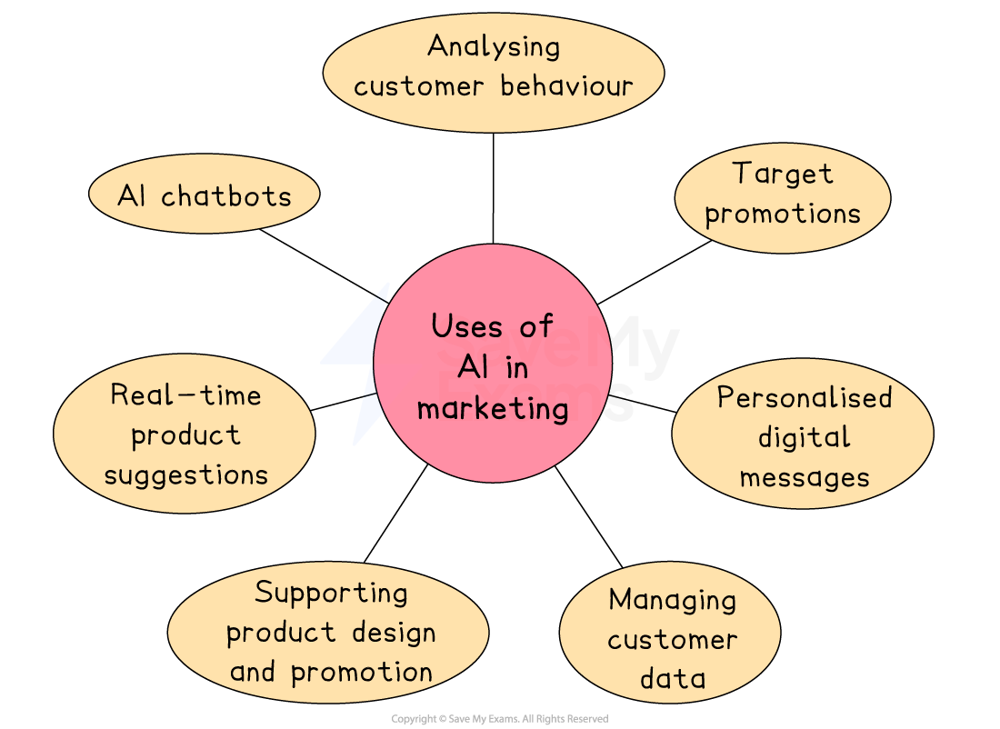

# Approaches to Marketing Strategy

## Consistency of the marketing strategy

> **Spec point** — `spcpt_y2v5dcTT6pQdzM4b`

## Consistency of the marketing strategy

- Marketing strategies need to be **consistent **and **coordinated **carefully to ensure that they are fully **focused on achieving *****marketing objectives***

#### Features of an effective marketing strategy

| **Consistent** | **Coordinated** | **Focused** |
|---|---|---|
| - Marketing strategies reflect and reinforce **business **and** brand values** - They are **appropriate for the product** to which they are applied - They are **suitable for the intended *****target market*** such as ***mass*** or ***niche*** markets | - Marketing **budgets**, the **marketing mix **and the **promotional mix **must be tied together - The cooperation of relevant ***functional managers*** is vital - Mixed messages need to be avoided to ensure customers fully ***buy in*** to the product | - Strategies must be **focused** on achieving the business's** specific marketing objectives** - They should be **adapted when objectives chang**e and **regularly reviewed** to ensure they retain this focus - Unfocused strategies should **be discarded** |

### The importance of consistency

- Consistency in marketing means that all parts of a business’s marketing plan and activities work together in a unified and coordinated way
- Messages, branding, pricing, and customer experience** feel the same across all platforms** and over time
- This builds trust, strengthens the brand, and avoids confusion

#### How do businesses achieve consistency?

| **Method** | **Explanation** |
|---|---|
| **Clear marketing objectives** | - All strategies and actions are based on shared goals such as growing *market share* |
| **Strong brand identity** | - Using the same logos, colours, tone of voice and design across all marketing materials |
| **Integrated marketing mix** | - Making sure product, price, place, and promotion all send the same message to customers |
| **Communication** | - Ensuring all employees understand and follow the brand and marketing strategy in interactions with customers |

> **Case Study**
> **Apple's consistent marketing strategy**
> 
> - Apple has built a strong brand based on design, *innovation*, and simplicity
> - These ideas influence how the company creates its products, advertises them, and treats its customers
> 
>   - **Branding**
>   
>     - Whether a customer is looking at a product, a store, or a website, the clean and modern Apple style is always the same
>   - **Product design**
>   
>     - Apple focuses on high-quality, simple design across its whole range, from iPhones to MacBooks
>   - **Promotion**
>   
>     - Apple uses minimalistic advertising with strong emotional appeal
>     - The same tone and style are used globally
>   - **Customer experience**
>   
>     - In Apple Stores around the world, the layout, service and atmosphere are consistent
> - Because of this consistency, customers trust Apple and feel confident in their products
> - This helps maintain customer loyalty and enables *premium pricing*

## Coordinated marketing strategy

> **Spec point** — `spcpt_WjmmhS5KCptrScWR`

## Coordinated marketing strategy

- A **coordinated marketing strategy** means **all parts of the marketing plan** work together smoothly
- This involves making sure that every department involved, such as sales, product design, advertising, and customer service, is aligned with the overall marketing goals
- Good coordination avoids mixed messages and improves efficiency

#### How do businesses achieve coordination?

| **Method** | **Explanation** |
|---|---|
| **Shared objectives** | - All departments follow the same goals, such as increasing sales or launching a new product |
| **Cross-department teamwork** | - Marketing teams work closely with other departments like production, finance and customer service |
| **Planning meetings** | - Regular communication helps keep everyone informed and pulling in the same direction |
| **Consistent marketing mix** | - The 4Ps all support the same overall strategy |

> **Case Study**
> **Well-coordinated marketing strategy at Coca-Cola**
> 
> - **Coca-Cola** shows excellent coordination across its global marketing activity
> - This coordination helps Coca-Cola stay as one of the world’s most recognisable and successful brands.
> 
> 
> 
> - **Product**
> 
>   - Taste, packaging, and quality are consistent worldwide
> - **Promotion**
> 
>   - Advertising campaigns, such as "Share a Coke", are used across many countries with local adaptations
> - **Sales and distribution**
> 
>   - Coca-Cola works closely with retailers, restaurants, and vending machine suppliers to ensure availability
> - **Customer service**
> 
>   - Support teams know the marketing campaigns and *brand message* to create a consistent customer experience

## Marketing strategy and its focus on objectives

> **Spec point** — `spcpt_4wNcHWbSkjFFkysH`

## Marketing strategy and its focus on objectives

- A **marketing strategy focused on objectives** ensures that every marketing decision is aimed at achieving clear, specific goals

  - These objectives may include increasing sales, building brand awareness or entering a new market
  - When marketing activities are aligned with these goals, the business is more likely to succeed

#### How businesses ensure focus on objectives

| **Method** | **Explanation** |
|---|---|
| **Setting SMART objectives** | - Goals should be Specific, Measurable, Achievable, Realistic, and Time-bound |
| **Performance tracking** | - Businesses regularly check progress using sales data, customer feedback, and market research |
| **Strategic planning** | - Every part of the marketing plan, including the 4Ps, supports key objectives |
| **Regular reviews** | - Businesses adjust their strategy if the objectives aren’t being met |

> **Case Study**
> **Nike's focused marketing strategy**
> 
> - **Nike** is a good example of a company that keeps its marketing focused on clear objectives
> - With this clear focus, Nike remains competitive and keeps growing its customer base worldwide
> 
> - **Objective**
> 
>   - Strengthen customer loyalty and grow global market share among young, active consumers
> - **Strategies**
> 
>   - Use high-profile athletes and inspirational advertising to build emotional connections
>   - Launch targeted campaigns like *“Just Do It”* that support its brand message and appeal to its audience
>   - Track performance through sales figures, social media engagement, and customer surveys

## Information technology in marketing

> **Spec point** — `spcpt_MYfvmVqsBprdjjwD`

## Information technology in marketing

- Information technology (IT) tools and applications are extensively used in marketing for a variety of purposes

### Where are IT tools and applications used in marketing?

#### Social media

- Businesses use platforms like Instagram, TikTok and YouTube to build and maintain a presence
- Regular posts link products to trends, creating modern *word-of-mouth promotion*
- Social media enables fast, interactive communication using video and sound
- Customer comments and reviews can support market research

  - E.g. **Forever 21 **uses Instagram to share images and short videos promoting new products and events

#### Websites

- Most firms use a website, sales platform, or both
- These allow online selling and quick sharing of company info like press releases
- *Blogs* and *vlogs* help drive traffic to sales platforms.

  - **Zalando**, based in Germany, is an online mall for top European fashion brands and own labels like Kickz

#### Email

- Businesses create *databases* of customers who opt in to email updates
- These emails share news of new products, offers and events quickly and cheaply

#### Mobile

- Many businesses use mobile apps for browsing and purchases
- Text messages can promote offers, share links and gather feedback

#### In-store

- Technology in stores attracts and engages customers
- Digital signage promotes offers and ranges while enhancing store ambience
- Custom systems give live updates on stock to staff and shoppers

## Artificial intelligence in marketing

> **Spec point** — `spcpt_6TJgVvxZttwBbQmw`

## Artificial intelligence in marketing

- It is argued that marketing is the business function where **artificial intelligence (AI) has significant potential **to make a positive impact

#### Current uses of AI in marketing

*AI can be used to analyse customer behaviour, personalise digital messages, make real-time product suggestions and support customer service*

**Analysing customer behaviour**

- AI can study huge amounts of data from sources like social media, smart speakers, online shopping and product reviews
- This helps businesses understand what customers like, how they shop and what influences their decisions

**Targeted promotions**

- Using real-time data, AI can quickly send the right adverts or offers to the right customers
- This makes marketing more effective and personalised

**Personalised digital messages**

- AI can create and send custom messages to individuals based on their interests, shopping history and past interactions with the business

**Managing customer data**

- AI helps organise and analyse customer profiles by combining information from various devices and apps
- This gives businesses a clearer picture of their audience

**Supporting product design and promotion**

- AI gives product designers and marketers detailed insights into what customers want
- This helps them create and promote products that are more likely to succeed

**Real-time product suggestions**

- While a customer is shopping online, AI can recommend products based on their past or current activity
- This can influence what the customer chooses to buy

**AI chatbots**

- Many businesses use AI-powered *chatbots* to answer customer questions automatically
- These bots are available 24/7 and help improve customer service without needing human staff at all times

#### AI in marketing: key concerns

| **Consumer resistance** | **Capital investment requirements** | **Careful human supervision is required** |
|---|---|---|
| - Many consumers are **unhappy about the large-scale collection of data** - The use of AI in marketing can increase the possibility of ***discrimination**** *and the** misuse of information**    - E.g., a customer's ***credit rating*** is reduced because AI determines that others who shopped where he shopped had a poor repayment history | - AI systems require a significant investment in **hardware**,** processing power**,** software**,** highly skilled employees **such as programmers and **training** - These high costs increase ***barriers to entry*** for small firms and increase the ***competitive advantage*** of already-powerful firms - This may have the effect of **reducing competition** and **choice** for customers | - AI systems require close supervision to ensure that **programming errors** are identified and corrected swiftly - AI systems** lack the creativity and imagination of humans,** so output may be perfected by human touch - Ensuring that AI-generated promotional activity is** focused on marketing objectives** is a judgement best made by a human |
