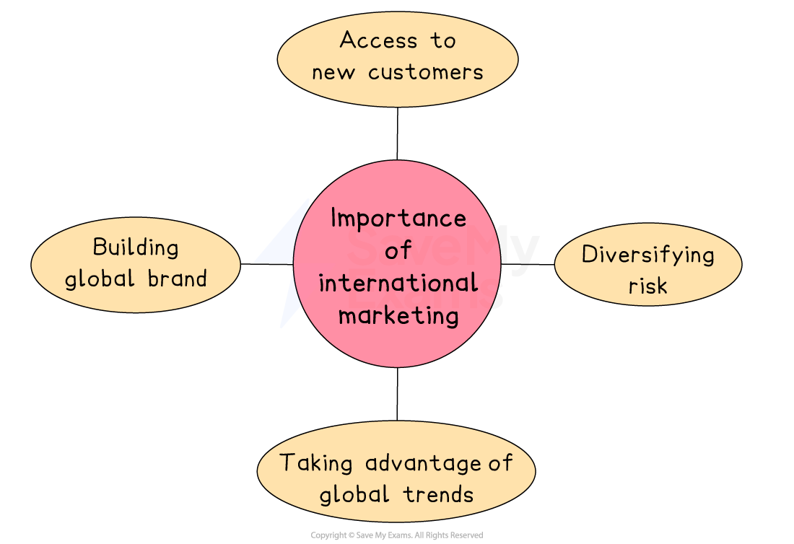
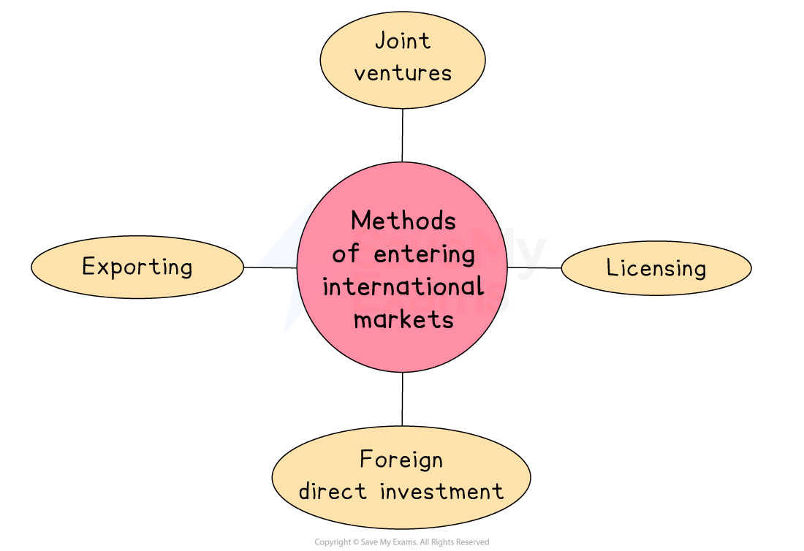

# Strategies for International Marketing

## Globalisation, economic collaboration and marketing

> **Spec point** — `spcpt_VPjbJZVtRXZbgkmg`

## Globalisation, economic collaboration and marketing

- **Globalisation** is the increasing connection and interdependence of countries through trade, communication, transport and technology

  - It allows businesses to operate and compete in international markets more than ever before
- **Economic collaboration** is when countries or regions work together to support trade and economic growth

  - This includes *trade agreements*, shared markets, such as the EU, and international organisations, like the World Trade Organisation

#### Implications for marketing

| **Implication** | **Explanation** |
|---|---|
| **Access to larger markets** | - Globalisation allows businesses to sell in many countries - Marketing must be adapted for different cultures, languages and customer needs |
| **Increased competition** | - International trade increases competition - Businesses must improve their marketing, offer better prices and be more creative with promotions and *branding* |
| **Need for local adaptation** | - Products can be sold globally, but marketing messages often need to match local tastes and values - This is called **glocalisation** - developing global brands with local appeal |
| **Joint marketing opportunities** | - Countries working together can create shared marketing campaigns and promote across borders more easily - E.g. in the **EU**, firms face fewer legal or language barriers |

## The importance of international marketing

> **Spec point** — `spcpt_mQp7jyTYC7vzKv3M`

## The importance of international marketing

- **International marketing** is when a business promotes and sells its products in more than one country
- It plays a key role in helping businesses grow, increase profits and compete globally

#### Why international marketing is important

*International marketing provides access to new customer, diversifies risk, takes advantage of global trends and helps build a global brand*

- **Access to new customers**

  - By marketing products in other countries, businesses can reach millions of new potential customers
  
    - E.g. **Netflix** expanded from the US to over 190 countries, gaining millions of new subscribers through localised marketing and content
- **Spreading risk**

  - Selling in different countries helps reduce risk
  - If sales fall in one country, sales in other regions may still grow
  
    - E.g. **Toyota** sells vehicles across Asia, North America and Europe, which helps balance profits even if one region performs poorly
- **Taking advantage of global trends**

  - International marketing allows businesses to respond quickly to global fashion, technology or lifestyle trends
  
    - E.g. **Zara** uses fast-fashion marketing strategies across global cities to catch and promote trends in real time
- **Building a global brand**

  - International marketing helps businesses build strong global brands that are recognised and trusted around the world
  
    - E.g. **Samsung** has become one of the world’s leading technology brands by using consistent marketing messages and high-quality advertising across Asia, Europe, and the Americas

## Identifying and selecting suitable international markets

> **Spec point** — `spcpt_8PS9H3vnz857g9pj`

## Identifying and selecting suitable international markets

- Before entering a new country, a business must carefully research and choose the right market
- Picking the wrong market can lead to wasted investment, while choosing wisely can bring growth and long-term success

#### Key factors in choosing an international market

| **Factor** | **Explanation** | **Example** |
|---|---|---|
| **Market size and growth** | - Businesses look for large or fast-growing markets to increase sales opportunities | - Many global brands have entered **India** and **Vietnam** due to their large, young populations and rising incomes |
| **Customer needs and preferences** | - Firms must ensure the product is wanted and may need to adapt it for local tastes, culture, or values | - **McDonald’s** changes its menu in different countries—e.g. vegetarian burgers in **India** |
| **Level of competition** | - Entering a crowded market can be difficult, so businesses may look for places with fewer rivals | - A **skincare company** may enter an emerging market with fewer global beauty brands |
| **Legal and political environment** | - Some countries have strict laws or unstable governments that make entry risky | - Companies may avoid markets with frequent government changes or **trade restrictions** |
| **Costs and *****infrastructure*** | - Businesses consider transport, marketing and setup costs - Good infrastructure supports smooth operations | - **Shopee** expanded in Southeast Asia due to better internet access and delivery networks |

> **Case Study**
> GreenSip Ltd makes stylish, eco-friendly water bottles aimed at environmentally conscious consumers
> 
> 
> 
> The business already sells successfully across the UK and now wants to grow by entering a new international market, either in Brazil or in Sweden
> 
> #### Market comparison of Brazil and Sweden
> 
> | **Factor** | **Brazil** | **Sweden** |
> |---|---|---|
> | **Market size and growth** | - Population over 200 million with a growing middle class - Strong potential for long-term sales growth | - Smaller population (approx. 10 million) - High income levels and strong consumer spending |
> | **Customer preferences** | - Sustainability awareness is increasing, but reusable products are still a new trend in many areas | - Consumers are already eco-conscious and likely to support GreenSip’s sustainability message |
> | **Competition** | - Fewer established eco-brands, which could give GreenSip a *competitive advantage* | - Many strong local and international eco-brands already exist, making it more competitive |
> | **Challenges and ease of entry** | - High import taxes and less reliable delivery infrastructure - Branding may need cultural adaptation | - Easy entry due to strong infrastructure - EU membership (low *trade barriers*) - Reliable digital payment systems. |
> 
> - GreenSip Ltd. chose to enter **Sweden** as its first international expansion market
> 
>   - Although Brazil offered more long-term growth potential, the management team decided that Sweden was a safer first step
>   - The strong match between Swedish consumer values and GreenSip’s eco-friendly brand made it easier to launch with minimal changes to product design or marketing
>   - Additionally, as part of the EU, Sweden allowed for lower costs, faster delivery and fewer legal barriers

## Entering international markets

> **Spec point** — `spcpt_7NYj5pbZZRpnSrdr`

## Entering international markets

- When expanding into a new country, businesses must decide **how** to enter and **how to market** their products

### Strategies for entering international markets

#### Pan-global strategy

- A **pan-global strategy** is where a  business uses the same product and marketing approach in all countries

  - Branding, packaging and promotion stay the same
  - This approach is best used when customer preferences are similar worldwide, such as in technology or fashion where global trends dominate
- **Advantages**

  - Saves money through *economies of scale*
  
    - Using the same adverts, packaging and branding worldwide reduces costs
  - Strong, consistent global brand image
  
    - Customers recognise and trust the brand across all markets
- **Disadvantages**

  - May not suit local tastes or culture
  
    - What appeals in one country may not work in another
  - Risk of marketing failure
  
    - The message might not connect with customers in certain regions

#### Local strategy

- A **local strategy **is where** **a business changes parts of its product or marketing to suit local tastes, culture, language or laws
- This approach is best used when markets are culturally, legally or economically different, such as in food, healthcare or personal care industries

- **Advantages**

  - Matches local customer needs better
  
    - Products and marketing can reflect local tastes, language and culture
  - More likely to connect with target market
  
    - Customers feel the business understands them, which can increase loyalty
- **Disadvantages**

  - Higher costs due to adaptation
  
    - Creating different versions of adverts, packaging or products for each country can be expensive
  - More complex to manage
  
    - Coordinating different strategies across markets requires more time, staff and control

## Strategies to develop a global market

> **Spec point** — `spcpt_KZ4rS4k8Vbp6Nfdm`

## Strategies to develop a global market

- When expanding globally, businesses must choose strategies that match their **goals**, **resources**, and the **markets** they are entering
- Key factors businesses consider include

  - **Target market analysis**
  
    - Businesses study customer needs, cultural values, income levels and *demand*
    - Helps decide whether to use a pan-global or localised marketing approach
  - **Product type**
  
    - Some products (e.g. technology, luxury goods) may work globally with little change
    - Others (e.g. food, personal care) often need local adaptation to suit customer preferences or laws
  - **Resources and budget**
  
    - Larger businesses may invest in ***FDI*** or *joint ventures*
    - Smaller firms may start with ***exporting*** or ***licensing*** due to lower risk and cost
  - **Level of risk**
  
    - Political stability, economic conditions and ease of doing business affect strategy choice
    - Higher-risk markets may be entered through partnerships with local businesses rather than full ownership
  - **Competitive environment**
  
    - Businesses assess the strength and number of competitors
    - In highly competitive markets, *differentiation* and strong branding are essential

> **Case Study**
> **Global expansion strategy – Eco Brew Ltd**
> 
> - Eco Brew Ltd is a Ireland-based business that sells organic, fair-trade coffee in eco-friendly packaging
> 
> 
> 
> - After strong growth in the domestic market, the company is now looking to expand internationally
> - The management team must decide which strategy to use to successfully enter and compete in a global market
> 
> **Step 1: Target market research**
> 
> - Eco Brew’s research team investigated several countries and narrowed the options to **Canada** and **South Korea**
> - Both had strong coffee cultures, but preferences and market conditions differed
> 
>   - Canada had a high demand for ethical, organic products and a shared language and culture with Ireland
>   - South Korea had a fast-growing premium coffee market, but stronger local competition and cultural differences
> - Eco Brew chose Canada as its first global market due to easier cultural fit, high sustainability awareness and lower risk
> 
> **Step 2: Choosing a marketing strategy**
> 
> - Eco Brew considered whether to use a pan-global strategy or a local adaptation strategy
> - Since Canadian consumers value eco-packaging and fair trade, just like Irish customers, Eco Brew decided to keep its branding and product consistent
> - Only minor adaptations were made, such as using bilingual (English/French) labelling and adjusting promotions to local festivals
> 
> **Step 3: Selecting a market entry method**
> 
> - Eco Brew considered four main entry options: exporting, licensing, joint venture, and foreign direct investment (FDI)
> - As a small but growing business, Eco Brew had limited *capital*
> - It chose exporting with a trusted Canadian distributor to test the market while keeping risk and cost low.

## Factors influencing the method of entry into international markets

> **Spec point** — `spcpt_3GgJBbZvnDpNhcFy`

## Methods of entry into international markets

- When a business wants to expand into another country, it must decide **how to enter that market**
- The method chosen can affect the level of **risk, cost, control and speed** of entry

  - Some businesses may prefer low-risk options like exporting, while others may invest heavily to set up operations abroad
- The best choice depends on the business’s goals, resources and the nature of the market it’s entering

*Entering international markets can involve exporting, licensing, joint ventures or FDI*

#### 1. Exporting

- The product is made in the home country and sold overseas, either directly or through agents or distributors

#### 2. Licensing

- A local business is allowed to produce and sell the product under the brand name

#### 3. Joint ventures

- The business works with a local partner to enter the market, sharing risks, costs and local knowledge

#### 4. Foreign direct investment (FDI)

- The business sets up its own operations in the new country by opening a factory, store, distribution facilities or offices

### Evaluating each method

| **Approach** | **Advantage** | **Disadvantage** |
|---|---|---|
| **Exporting** | - Low risk and low investment cost, as the business doesn’t need to set up operations abroad | - Less control over how the product is marketed or sold in the foreign country |
| **Licensing** | - Quick market entry with limited cost, as the local partner handles production and distribution | - Risk of losing control over brand quality or misuse of intellectual property |
| **Joint ventures** | - Combines local expertise with business resources, which is useful for navigating cultural or legal issues | - Profits must be shared and potential disagreements can arise between partners |
| **Foreign direct investment (FDI)** | - Full control over operations, branding and quality, which is good for long-term growth | - Very high cost and risk, as it involves major investment and commitment |
