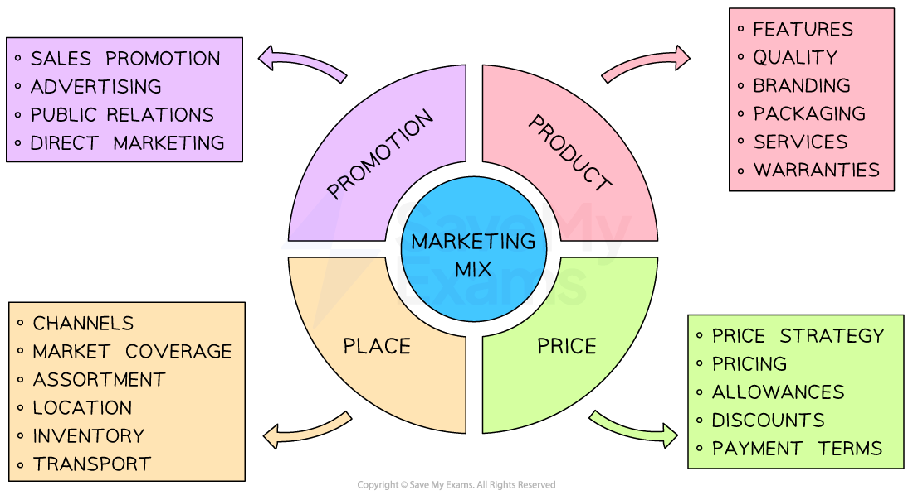

# The Elements of the Marketing Mix

## An introduction to the 4 Ps

> **Spec point** — `spcpt_N5x9zzBBBdbB7FCj`

## An introduction to the 4 Ps

- The **marketing mix **(4Ps of marketing) provides a framework for businesses to create and implement** successful marketing strategies**
- The 4Ps are

  - **P**roduct
  - **P**rice
  - **P**lace
  - **P**romotion
- These four components work together to satisfy the **needs and want of a target market **while achieving the company's objectives

  - By understanding and manipulating the marketing mix, businesses can ***differentiate *****themselves** from competitors

#### The marketing mix

*Each business combines the different elements of the marketing mix in unique ways to maximize their profitability*

### The importance of an integrated marketing mix

- An **integrated marketing mix** means that all elements of the marketing mix **work together** to support a business's marketing goals

  - Each 'P' must match and support the others to ensure a clear, consistent message for customers that meets their expectations
  - If the elements are not aligned, it can confuse customers, weaken the brand and reduce sales

#### Product

- The product must meet the needs of the *target market* in terms of quality, design, features, and reliability
- It should match what customers want and expect from the brand.

  - E.g. A luxury skincare brand must ensure its product feels premium, with elegant packaging and high-quality ingredients

#### Price

- The price must reflect the value customers place on the product, but it also needs to fit the overall strategy
- Pricing must match the product's image

  - E.g. A budget airline needs low pricing to match its no-frills service, while a luxury airline must justify higher prices with excellent service and comfort

#### Place

- Place refers to where and how the product is sold
- The choice of *distribution channel *must suit the product and customer preferences

  - E.g. A youth fashion brand might focus on selling online and through social media platforms, while a specialist tool company may focus on professional trade retailers

#### Promotion

- Promotion must support the brand message and reach the target audience in a relevant way
- Methods and tone used must suit the product and pricing level.

  - E.g. A premium watch brand might use magazine adverts and *sponsorships*, while a soft drink brand might focus on fun, colourful adverts on TikTok.
