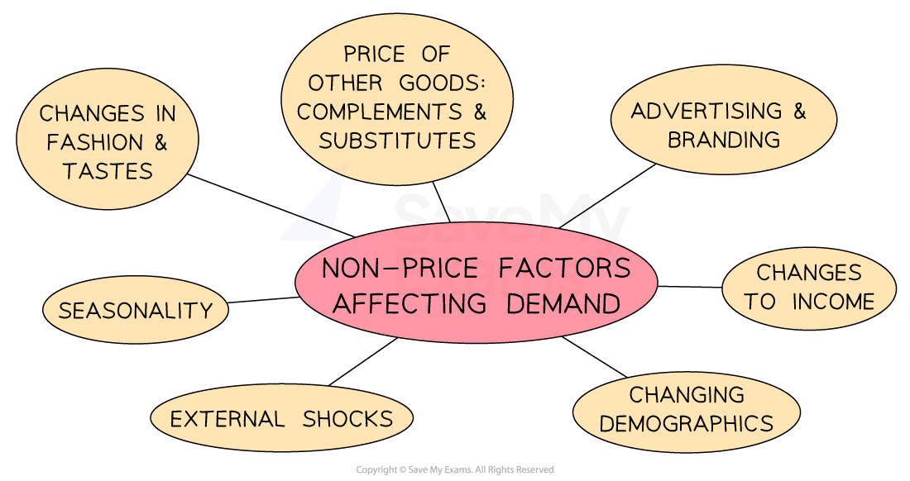
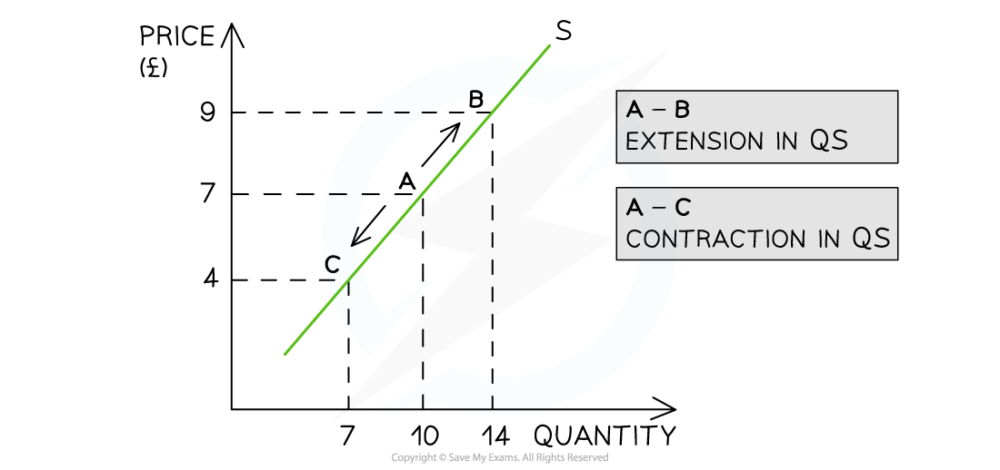
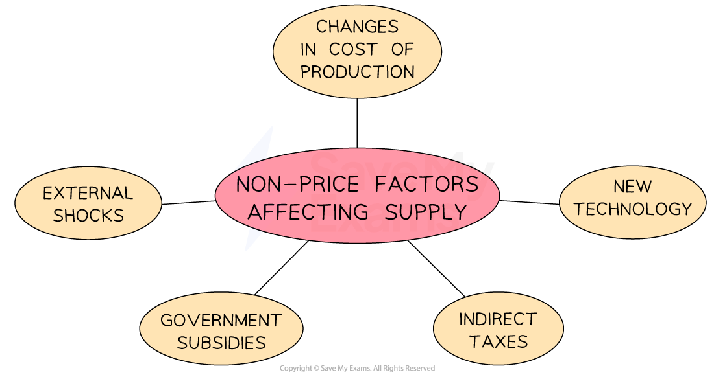
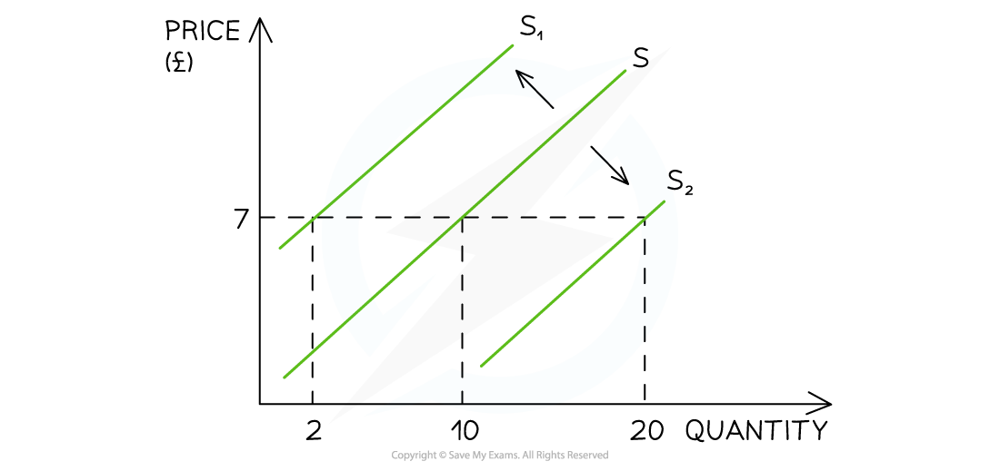
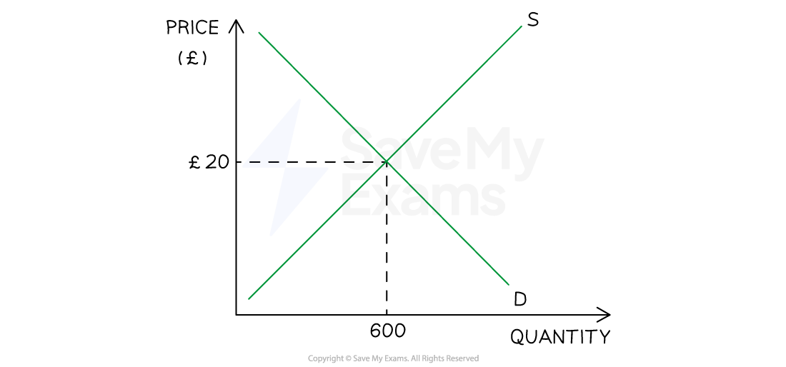
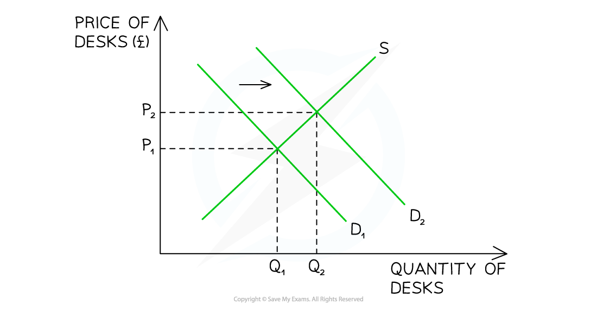
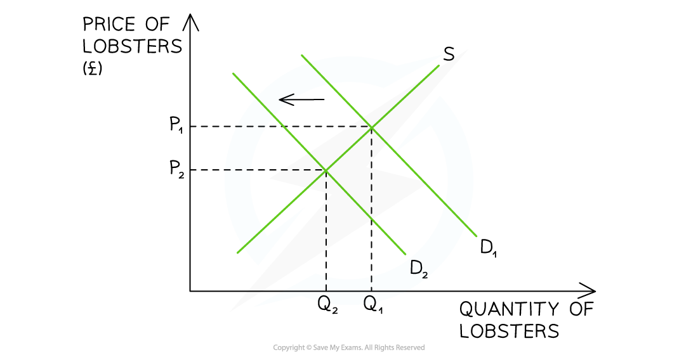

# Demand and Supply

## Factors influencing demand and supply

> **Spec point** — `spcpt_M4JPDj4sPKWbCmJH`

## Factors influencing demand

- Demand refers to the **number of goods or services customers are willing and able to buy** at a given price

- There is an **inverse relationship **between** **the quantity demanded by customers and price

  - As price increases, the quantity demanded decreases
  - As **price decreases, the quantity demanded increases**
  - Hence the **demand curve slopes downwards** from left to right
- This is illustrated in the diagram below

#### A simple demand curve

*A demand curve showing how a change in price will lead to a change in quantity demanded (QD)*

- An **increase** in price from £10 to £15 leads to a movement **up** the demand curve from point A to B

  - Due to the **increase** in price, the quantity demanded (QD) has** fallen** from 10 to 7 units
- A **decrease **in price from £10 to £5 leads to a movement **down** the demand curve from point A to point C

  - Due to the **decrease** in price, the QD has **increased** from 10 to 15 units

### Factors leading to a change in demand

- A change in price leads to a **movement along the demand curve**
- However, a change in any other factors affecting demand will** shift the entire demand curve **to the** left or right**

  - These are called** non-price factors affecting demand**

#### Non-price factors affecting demand

*The non-price factors affecting demand result in a shift of the entire demand curve *

- For example, if a firm **increases** its **Instagram advertising**, there will be an** increase in demand** as more consumers become aware of the product

  - This is a **shift in demand **from D to D1. The price remains unchanged at £7 but the **demand has increased** from 15 to 25 units

#### Illustreating changes in non-price factors

*A change in any non-price factor will lead to a change in the position of the demand curve*

- The initial demand curve is seen at D

  - At a price of £7, 15 units are demanded
- If **price remains constant** at £7 **but demand decreases** due to one of the non-price factors of demand (e.g. decreasing incomes), the **entire** **demand curve **shifts to the left from D to D2

  - Demand has** decreased** from 15 units to 5 units
- If **price remains constant** at £10 **but demand increases** due to one of the non-price factors of demand (e.g. increased advertising expenditure), the **entire** **demand curve **shifts to the right from D to D3

  - Demand has** increased** from 15 units to 25 units

#### Non-price factors affecting demand

| **Non-price Factor** | **Explanation** | **Example** |
|---|---|---|
| **Change in the price of substitutes** | - Substitute goods are **replacement goods**, e.g. different brands of car | - If the **price of VW cars increases,** demand for Ford cars might rise - This shifts the demand curve for **Ford cars** to the right |
| **Change in the price of complementary goods ** | - Complementary goods are **goods **that are **consumed together ** | - **Cars and petrol: **if the **price of petrol rises,** the demand for cars may fall - This shifts the demand curve for **cars** to the left |
| **Change in consumer incomes** | - As a **consumer’s income rises**, demand for** *****normal goods***) increases | - **Demand for *****branded *****goods**,** **e.g. Superdry hoodies, tends to increase as **consumer incomes rise** - This shifts the demand curve for **branded goods**  to the right |
| - As a **consumer’s income falls**, demand for ***inferior goods***) increases | - **Demand for *****own label***** products**, e.g. supermarket hoodies,** **tends to rise as **consumer incomes fall** - This shifts the demand curve for **own label goods **to the right |   |
| **Fashions, tastes and preferences** | - If products become more fashionable, demand them increases | - Plant based foods have become **more popular** in recent years - This shifts the demand curve for **plant based foods** to the right |
| **Advertising and branding** | - If more money is spent on advertising or branding, then this increases consumer awareness and brand loyalty | - **Coca Cola **spends an average of** **\$4bn per year on advertising and branding - This shifts Coca Cola's demand curve to the right and makes demand more ***price inelastic*** |
| **Demographics** | - If the **structure or size of a country’s population** changes, then the demand for products will also change | - **A decrease in the number of babies being born** will reduce the demand for baby products - This shifts the demand curve for **baby products** to the left |
| **Seasonality** | - Demand varies at different **times of the year** | - In cold climates, the demand for **gas and electricity** will fall in the summer months - This shifts the demand curve for **energy **to the left |
| **External shocks** | - An **unexpected event** can change the demand | - The outbreak of **Covid-19** lead to panic buying of goods such as toilet rolls - This shifts the demand curve for **toilet rolls **to the right |

## Factors influencing supply

> **Spec point** — `spcpt_vyTsMVPvYsjMjRxS`

## Factors influencing supply

- Supply is the **number of goods or services businesses are willing to sell** at a given price in a specific time period
- There is a direct **relationship between supply and price**

  - As **price increases**, the quantity supplied increases
  - As **price decreases**, the quantity supplied decreases
  - At higher prices, businesses are **incentivised** to supply more of the product
  - Hence the supply curve **slopes upwards** from left to right

#### A simple supply curve

*A supply curve showing how a change in price will lead to a change in the quantity supplied (QS)*

- An **increase** in price from £7 to £9 leads to a move **up** the supply curve from point A to B

  - Due to the **increase** in price, the quantity supplied (QS) has** increased** from 10 to 14 units
- A **decrease **in price from £10 to £7 leads to a movement **down** the supply curve from point A to point C

  - **Due to the decrease in price, the quantity supplied (QS) has decreased from 10 to 7 units**

### Factors leading to a change in supply

- A change in price causes a **movement along the supply curve**
- A change in any other factor affecting supply will **shift the entire supply curve** to the left or right

  - These are called **non-price factors affecting the supply **

#### Non-price factors affecting supply

*Non-price factors include changes in the costs of production, external shocks and indirect taxes*

- E.g. If a firm's **costs of production** increase due to the **increase in the price of a key resource**, then there will be a decrease in supply as the firm is unable to afford to produce as many products
- This causes a **shift in supply **from S to S1. The price remains unchanged at £7 but the **supply has decreased** from 10 to 2 units

#### Changes in non-price factors

*A diagram showing how a change in any non-price factor of supply will shift the entire supply curve left or right  *

- The initial supply curve is seen at S

  - At a price of £7, 10 units are supplied
- If the **price remains constant** at £7 **but supply decreases** due to one of the non-price factors of supply (e.g. worker's wages increase), the **entire** **supply curve **shifts to the left from S to S1

  - Supply has** decreased** from 10 to 2 units
- If the **price remains constant** at £7 **but supply increases** due to one of the non-price factors of supply (e.g. costs of production fall), the **entire** **supply curve **shifts to the right from S to S2

  - Supply has** increased** from 10 to 20 units

#### Non-price factors affecting supply

| **Non-price factor** | **Explanations** | **Examples** |
|---|---|---|
| **Change in the costs of production** | - An **increase in costs of production** makes it **more expensive to produce** each unit and a business will be able to produce less at a given price | - For a **clothing manufacturer**,** **an increase in energy and labour costs will increase the costs of making each item - This shifts the supply curve for **clothing** to the left |
| **New technology ** | - **Advances in technology **will** lead to lower costs of production **and businesses will be** **able to** **produce more at a given price | - **Robots **have replaced many workers in **car factories **and** **this increases ***productivity*** - This shifts the supply curve for** cars** to the **right** |
| **Indirect taxes** | - The government increases indirect taxes on businesses, which causes an **increase in the costs of production **as firms have to pay extra costs | - The rate of ***VAT *****increased from 17.5% to 20% **in the UK in 2011 - This shifts the supply curve** for all businesses to the left** |
| **Government subsidies** | - A ***subsidy*** given by the government to businesses **will reduce the costs of production** | - A subsidy to the largest battery producer in the UK lowers the costs of production for **electric car manufacturers** - This shifts the supply curve** **for **electric vehicles **to the **right** |
| **External shocks** | - An **unexpected event** can change the supply | - The **outbreak of Covid-19** caused many hotels, bars, and restaurants to close down - This shifts the supply curve for **hotels, bars, and restaurants **to the **left** |

## Interactions between demand, supply and price

> **Spec point** — `spcpt_XGvrtJ6jxMpVXGSC`

## Interactions between demand, supply and price

- In a market, prices for goods/services are determined by the **interaction of demand & supply**
- A **market **is any place that brings **buyers** & **sellers** together to trade at an agreed price

  - Markets can be **physical** (e.g. McDonald's) or **virtual** (e.g. eBay)
  - Buyers agree on the price **by purchasing** the good/service
  - If they do not agree on the price then they **do not purchase** the good/service
- Based on this interaction with buyers, **sellers** will gradually **adjust their prices** until there is an **equilibrium price** and **quantity** that works for both parties

  - At the equilibrium price, **sellers** will be satisfied with the **rate/quantity** of sales
  - At the equilibrium price, **buyers are satisfied **that the product provides benefits worth paying for

#### Equilibrium

*A graph showing a market in equilibrium with a market clearing price at P and quantity at Q*

- If the price is set at £20, demand will equal supply and ***equilibrium*** is reached

  - 600 units will be demanded and supplied
  - If the price was set above equilibrium, **supply would be greater** than demand and there would be a surplus
  - If the price was set below equilibrium **demand would be greater** than supply and there would be a shortage

### Dynamic changes in markets

- There are **4 diagrams** that can be used to show the **causes and consequences **of changes to the non-price factors of demand and supply

#### A rise in demand

*Supply and demand graph for desks showing a rightward shift in demand from D1 to D2.*

- The original equilibrium was at P1 and Q1
- A rise in demand causes the demand curve to **shift to the right** from D1→ D2 (perhaps due to an increase in home working)
- At the **original price** of P1, there is **now a shortage** as demand exceeds the supply
- The shortage causes prices to rise from P1 to P2
- A **new equilibrium** develops at a price of P2 and a quantity of Q2 units
- The business revenue (P x Q) has changed from P1Q1 to P2Q2

#### A fall in demand

*Graph showing supply and demand for lobsters, with a leftward demand shift from D1 to D2*

- The original equilibrium was at P1 and Q1
- A fall in demand causes the demand curve to **shift to the left **from D1→ D2 (perhaps due to an external shock)
- At the **original price** ofP1, there is **now a surplus** as supply exceeds demand
- The surplus causes prices to fall from  P1 to P2
- A **new equilibrium** develops at a price of P2 and a quantity of Q2 units
- The business revenue (P x Q) has changed from P1Q1 to P2Q2

#### A rise in supply

*Supply and demand graph for solar panels, showing shift from supply curve S1 to S2*

- The original equilibrium was at P1 and Q1
- A rise in supply causes the supply curve to **shift to the right** from S1→ S2 (perhaps due to an increase in productivity)
- At the **original price** of P1, there is **now a surplus** as supply exceeds demand
- The surplus causes prices to fall from  P1 to P2
- A **new equilibrium** develops at a price of P2 and a quantity of Q2 units
- The business revenue (P x Q) has changed from P1Q1 to P2Q2

#### A fall in supply

*Supply and demand graph for plantains, showing S1 shifting left to S2*

- The original equilibrium was at P1 and Q1
- A fall in supply causes the supply curve to **shift to the left **from S1→ S2 (perhaps due to an increase in the costs of production)
- At the **original price** of P1, there is **now a shortage **as demand exceeds the supply
- The shortage causes prices to rise from P1 to P2
- A **new equilibrium** develops at a price of P2 and a quantity of Q2 units
- The business revenue (P x Q) has changed from P1Q1 to P2Q2

> **Exam Hint**
> When answering questions on changes to markets, remember that a change in the price of the good leads to a movement along the demand or supply curve, not a shift in the demand or supply curve.
> 
> Practice drawing and labelling demand and supply diagrams accurately, describing them step-by-step; this will help you gain analysis marks. You can also use demand and supply diagrams to illustrate changes in total revenue.
