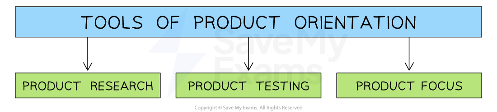

# Markets

## Consumer and industrial markets

> **Spec point** — `spcpt_KRCmbTPhdMpCsgMg`

## Consumer and industrial markets

- An **industrial market** is where businesses sell their products or services to other businesses

  - Goods are not usually for final consumption, but are used to help make other products or to support business operations
  - It is also known as B2B (business-to-business) selling
  
    - E.g. a company that produces steel may sell it to a car manufacturer
- A **consumer market** is where businesses sell products or services directly to individuals for their own personal use

  - It is often called B2C (business-to-consumer) selling
  - These include markets for goods and services such as clothing, smartphones, fast food or video streaming platforms

#### Key differences between consumer and industrial markets

| **Feature** | **Industrial market** | **Consumer market** |
|---|---|---|
| **Target customer** | - Other businesses (B2B – Business to Business) | - Individual consumers (B2C – Business to Consumer) |
| **Purchase purpose** | - For use in production or business activities | - For personal or household use |
| **Purchase volume** | - Usually large (bulk buying) | - Usually small (single or few items) |
| **Product type** | - Often technical or specialised | - General, used in daily life |
| **Sales process** | - Involves negotiation and longer decision-making | - Usually quick with less negotiation |
| **Promotion** | - Personal selling, trade shows, direct contact | - Advertising, promotions, social media |

## Local, national and international markets

> **Spec point** — `spcpt_FnCzvfJtthPpx9Cz`

## Local, national and international markets

- A **local market** is where goods and services are bought and sold within a small geographical area, such as a town or city

  - They serve nearby consumers and are often run by small businesses
  
    - E.g. a local bakery selling fresh bread to people in the same neighbourhood or a hairdresser serving clients in their local town
- A **national market** is where a business operates and sells its products or services across the entire country

  - Customers can come from anywhere within that country, and businesses use websites, advertising and delivery services to reach a wider audience
  
    - E.g. **Ale Hop **sells gifts, stationery and homewares through stores and online across the whole of Spain
- An **international market** is where businesses sell their products or services in more than one country

  - Businesses operating in these markets have to deal with different languages, cultures, laws and currencies
  
    - E.g. **Coca-Cola **sells drinks globally and **Samsung **sells electronics in many different countries

## Product orientation and customer orientation

> **Spec point** — `spcpt_mWfvsZvNfM2z2bxy`

## Product orientation and customer orientation

### Product orientation

- A business with a **product orientation** focuses primarily on **manufacturing a product **rather than the needs of the consumer

  - The emphasis is **on creating a product first **and **then finding a market**
  - Over time, being **too product orientated** means the business may move further and further away from what the market is looking for, thus increasing the risk of business failure
  
    - E.g. **Gillette**'s** **razors can be classified as a **product-orientated business** as the business focuses on the quality of its products and regular innovations aimed at increasing sales

*Product orientation is an approach often used by inventors who research, test and produce a product well before market research has taken place *

#### Benefits of product orientation

- **Focus on quality and innovation**

  - Businesses can develop high-quality or unique products by concentrating on design and production
- **Strong brand image**

  - Offering something distinctive or well-made can build a strong reputation and brand loyalty
- **Less need for constant market research**

  - Product-oriented firms rely more on internal expertise than customer feedback
- **Efficient production**

  - Standardised products allow for* economies of scale* and streamlined processes

### Customer (market) orientation

- **Customer (market) orientation** is a business approach that focuses on the **consumer demand **and designs products that meet customer needs

  - **Consumers** are **at the centre of marketing decisions**
  - Products **are designed to meet consumers' needs**
  
    - E.g. Universities often develop new courses based on the feedback they receive from students and employers

*Tools of customer orientation include market research, market testing and customer focus*

#### Benefits of customer orientation

- **Better customer satisfaction**

  - Products are developed based on what customers actually want and need
- **Stronger customer loyalty**

  - Meeting customer expectations can lead to repeat purchases and positive word-of-mouth
- **Faster response to market changes**

  - Businesses can adapt quickly to changes in tastes, trends, or demand
- **Higher sales potential**

  - Products are more likely to succeed when they’re tailored to the target market

## Market share and market growth

> **Spec point** — `spcpt_5nn7HNQwJZ7XNpZ2`

## Market share and market growth

- **Market share** is the **proportion of the total sales** of a product or service compared to the market as a whole

  - e.g. Tesco has 26% of the UK grocery market
- **Market share** can be calculated using the formula

$\mathrm{Market} \mathrm{share}=\frac{\mathrm{Sales} \mathrm{of}a\mathrm{business} \mathrm{in}a\mathrm{time} \mathrm{period}}{\mathrm{Total} \mathrm{market} \mathrm{sales} \mathrm{in}a\mathrm{time} \mathrm{period}}\times100$

> **Worked Example**
> In 2024, the UK coffee shop market was worth £4.8bn. Sales of Starbucks Coffee were £526m in 2024. Using the data, calculate, to 2 decimal places, the market share of Starbucks Coffee in the coffee shop/café market. You are advised to show your workings.
> 
> (3)
> 
> **Step 1: Identify annual sales of Starbucks Coffee**
> 
> £526m
> 
> **Step 2: Identify total market sales in the coffee shop market**
> 
> £4.8bn
> 
> **Step 3: Substitute figures into the formula**
> 
> **  **`equals space fraction numerator £ 526 straight m over denominator £ 4.8 bn end fraction space cross times space 100
> 
> equals space 10.96 percent sign`**            ** **[3]**

- **Market growth** is the **increase in the overall size, value or volume of a market** over a period of time, usually expressed as a percentage

  - This metric considers the size of the whole market/industry as opposed to a single firm's share of the market
- Some common ways to measure market growth include **sales revenue**, **sales volume** or the** number of customers**
- Market growth is calculated using the formula

$\mathrm{Market} \mathrm{growth}=\frac{\mathrm{This} \mathrm{year}'s\mathrm{market} \mathrm{sales}-\mathrm{Last} \mathrm{year}'s\mathrm{market} \mathrm{sales}}{\mathrm{Last} \mathrm{year}'s\mathrm{market} \mathrm{sales}}x100$

- If the growth rate is **positive**, the market is **getting bigger** (expanding)
- If the growth rate is **negative**, the market is **getting smaller** (contracting)

> **Worked Example**
> In 2023, worldwide sales of plug-in hybrid vehicles was 4.27 million units. By 2024 sales had increased to 6.51 million units.
> 
> Calculate the rate of market growth in the plug-in hybrid vehicles market.
> 
> (2)
> 
> **Step 1 - Deduct 2023's sales from 2024's sales**
> 
> $=6.51\mathrm{million}-4.27\mathrm{million}\,\,=2.24\mathrm{million}$
> 
> **Step 2 - Divide the outcome by 2023's sales**
> 
> $=\frac{2.24\mathrm{million}}{4.27\mathrm{million}}\,\,=0.5246$**            ****[1 mark]**
> 
> **Step 3 - Multiply the outcome by 100 to find the percentage growth rate**
> 
> `equals space 0.5246 space cross times space 100 space
> 
> equals space 52.46 percent sign`            **[1 mark]**

- Market growth provides an incentive** for businesses** looking to expand, increase sales and generate higher revenue
- Businesses are often attracted to the potential of growing markets, and they can **become increasingly competitive** quite rapidly

#### Factors affecting the rate of market growth

| **Factor** | **Explanation** |
|---|---|
| **Economic conditions** | - Growth is usually faster when the economy is strong and people have more money to spend |
| **Consumer trends** | - Changes in lifestyle, fashion or technology can increase demand for certain products |
| **Population growth** | - More people often means more potential customers, leading to a larger market |
| **Level of competition** | - In markets with few rivals, businesses may grow quickly; too much competition can slow growth |
| **Technological innovation** | - New technology can create demand for new products or services, speeding up market growth |
| **Government policies** | - Supportive laws or *subsidies *can help markets grow, while strict regulations may slow growth |
| **Availability of substitutes** | - If there are many alternatives, market growth may be limited as customers have more choice |

## Implications of changes in market share and market growth

> **Spec point** — `spcpt_8KV9cQvm8ZRGqXj8`

## The implications of changes in market share and market growth

### Increasing market share

- **Strong brand recognition and customer trust**

  - As a business gains a larger share of the market, more people become aware of the brand, making it easier to attract and keep loyal customers
- **Greater power over prices, especially in less competitive markets**

  - A business with high market share may be seen as a market leader, giving it the ability to charge higher prices without losing many customers
- **Can benefit from economies of scale**

  - Producing and selling more units often reduces the *cost per unit*, allowing the business to be more efficient and more profitable
- **Attracts more investment and partnerships**

  - Investors and other companies are more likely to work with businesses that dominate the market, as they appear more stable and successful
- **More influence over suppliers and retailers**

  - A larger market share gives the business stronger negotiating power, which can lead to better deals from suppliers and more shelf space in stores

### Falling market share

- **Harder to compete with larger rivals**

  - When a business loses market share, it may struggle to keep up with competitors who have more resources and customer loyalty
- **May need to lower prices to attract customers**

  - To win back customers, the business might have to cut prices, which can reduce *profit margins*
- **Lower profits due to fewer sales and higher costs per unit**

  - Selling fewer products often means each one costs more to make, while total revenue drops, leading to lower profits overall
- **Less visibility in the market**

  - A declining market presence can make the brand less familiar to consumers, reducing interest and trust in the product
- **Might struggle to access good suppliers or distribution channels**

  - Suppliers and retailers may prioritise businesses with higher sales, meaning those with falling market share may get worse terms or less exposure

### Implications of changes in market growth

| **Market condition** | **Implication** | **Explanation** |
|---|---|---|
| **Growing market** | - Increased sales opportunities | - More demand means businesses can sell more products or services |
| - Easier to enter or expand | - New or smaller firms may find it easier to grow as customer demand is rising |   |
| - Potential for higher profits | - With more sales, businesses can increase revenue and reduce costs per unit |   |
| - Attracts investment | - Investors are more willing to support businesses in markets with strong growth |   |
| - Encourages innovation | - Firms compete by creating new or improved products to win market share |   |
| **Contracting market** | - Falling sales | - Overall demand is shrinking, making it harder to maintain sales levels |
| - Increased competition | - Businesses may fight harder over fewer customers, leading to *price wars* |   |
| - Cost-cutting pressure | - Firms might need to reduce *expenses *to stay profitable |   |
| - Risk of redundancy and closures | - Lower demand could force businesses to *downsize *or shut down operations |   |
| - Less investment interest | - Investors may be cautious or reduce investment in declining markets |   |
