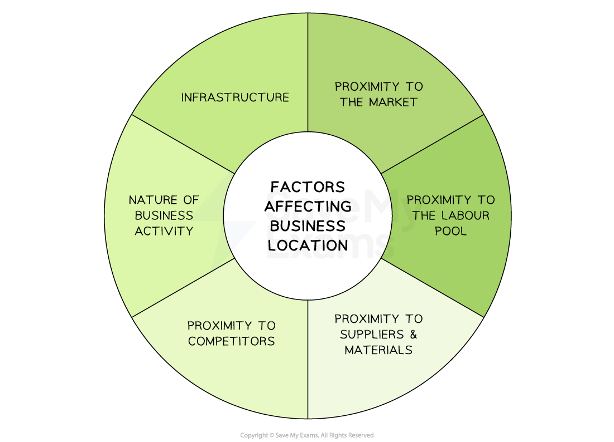
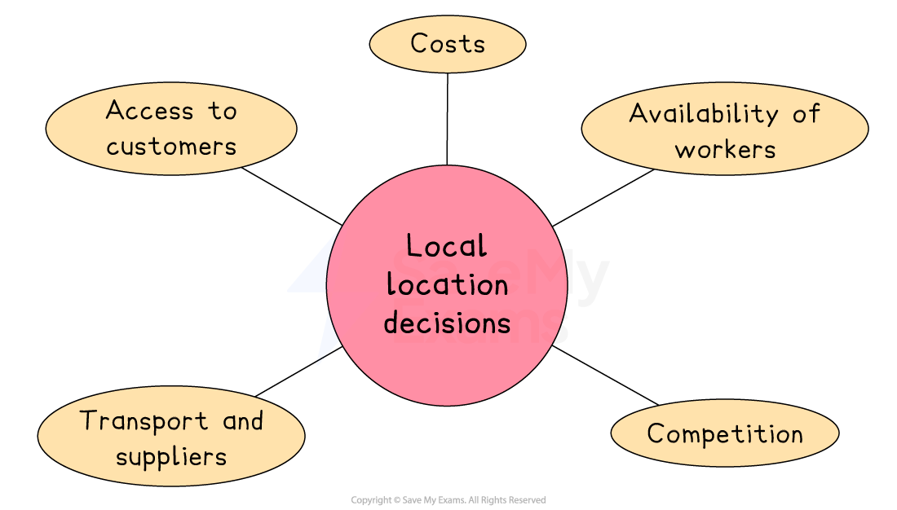
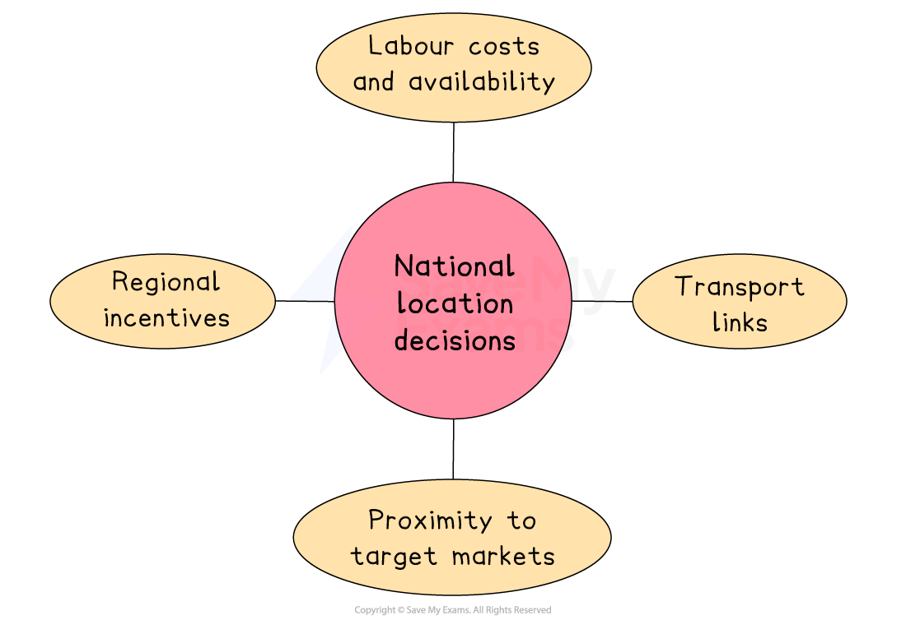
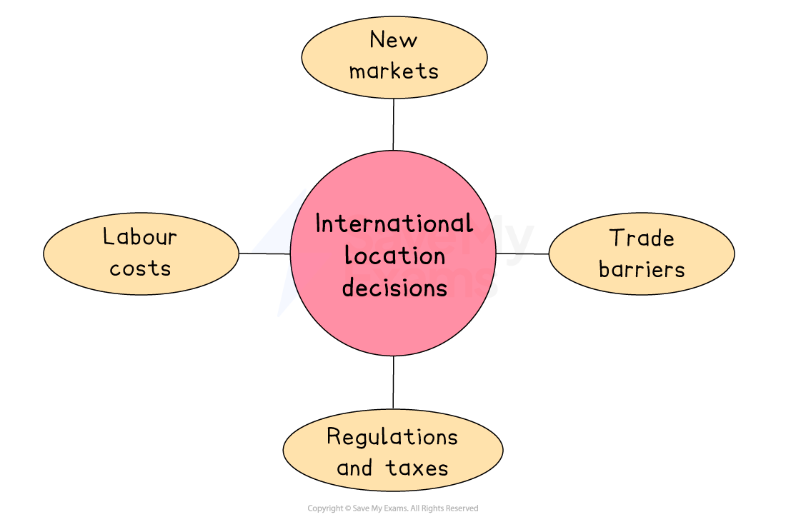
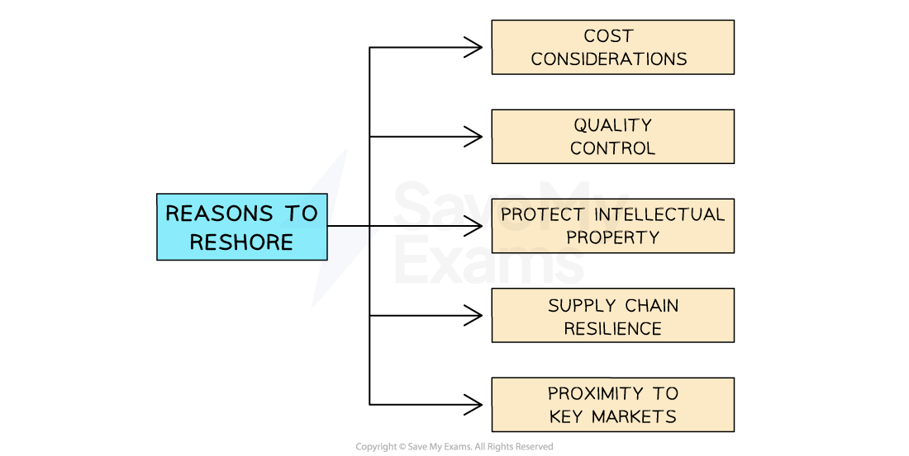

# Location

## Factors determining location and relocation

> **Spec point** — `spcpt_Rvj7brRJFf9H4zSw`

## Factors determining location and relocation

- Choosing a good production location can have **significant impacts on a business**.
- A range of factors influence the location a business chooses for production or where it chooses to *relocate*

#### Factors affecting business location

*Production locations are affected by multiple factors and if a business chooses the wrong location, it can fail*

### Proximity to the market

- This refers to how close the business is to its target customers
- Being near the market can reduce transport costs and make it easier for customers to access the business

### Proximity to labour

- This means being located near areas where skilled and qualified workers are available
- Businesses often choose locations with a strong local workforce to make it easier to *recruit* the right people and run operations efficiently

### Proximity to materials

- This refers to how close a business is to the raw materials or supplies it needs
- Being near materials helps reduce transportation costs and ensures a steady supply

### Proximity to competitors

- Some businesses choose to locate near competitors to attract the same customer base or to offer something different
- Others may avoid locating near competitors to reduce direct competition

### The nature of the business activity

- Different types of businesses have different location needs based on what they do
- For example, a manufacturing plant may need large space and delivery access, while a law firm may need a smaller, more central office

  - E.g. A factory needs room for machinery and deliveries, while a law office needs a professional, easy-to-access location

### Infrastructure

- This includes transport links and electronic networks like internet connections
- Good transport is essential for businesses that deliver physical goods
- Fast and reliable internet access is key for online businesses
- E.g. An online fashion retailer needs a location close to the motorway for quick delivery and fast service, helping it compete in the market

## Local, national and international location decisions

> **Spec point** — `spcpt_Y8tbGthSyDHDhhg9`

## Local, national and international location decisions

- When a business chooses where to locate, the scale of that decision can be local, national or international

### 1. Local location decisions

- Local location decisions involve choosing **where in a particular town or city** to place the business, such as in the city centre, on an *industrial estate* or near transport links

  - E.g. A hair salon might choose a busy high street over a quiet side road to attract walk-in customers

#### Key factors affecting local location decisions

*Local location decisions include considering access to customers, availability of workers and the location of competition*

- **Access to customers**

  - Retail shops often choose high footfall areas like shopping centres to attract more sales
  
    - Major Turkish retail brands, for example, locate their flagship stores on İstiklal Caddesi, a busy shopping street in Istanbul.
- **Availability of workers**

  - Businesses benefit from locating near skilled or affordable labour
  
    - Hi-tech firms choose business parks around MIT in the USA to access a strong pool of computing graduates
- **Costs**

  - Rent and *business rates* can vary widely even within one town or city
  
    - Retail space on Berlin’s Kurfürstendamm is expensive, but nearby Prenzlauer Berg offers more affordable options
- **Competition**

  - Locating near rivals can create a customer hub but may also reduce *market share*
  
    - Hatton Garden in London is home to many high-end jewellery and gold businesses, attracting specialist customers.
- **Transport and suppliers**

  - Good transport links are essential for service and delivery-based businesses
  
    - *Logistics* firms favour northern Calais due to its excellent road, rail and ferry connections.

### 2. National location decisions

- National location decisions involve choosing **which part of a country** to set up or expand a business

  - E.g. A call centre might choose a city in the north of the UK to benefit from lower wages and government support.

#### Key factors affecting national location decisions

*National location decisions involve consideration of regional incentives and transport links*

- **Regional incentives**

  - Governments may offer *grants* or *tax breaks* to attract businesses to poorer areas, aiming to reduce *unemployment* and support local economies
  
    - E.g. The Welsh Government has funded companies locating in places like Cardiff and Swansea
- **Labour costs and availability**

  - Wages and skills vary by region
  - Cities may offer highly skilled workers at higher wages, while *rural* areas may be cheaper but with fewer qualified employees
  
    - E.g. In India, major cities like Bangalore and Delhi have more skilled workers than rural regions
- **Proximity to target markets**

  - Locating near areas with high *demand* helps reduce delivery costs and respond better to local preferences
  
    - E.g. Mexican food firms often base themselves near large cities like Mexico City or Guadalajara to reach more consumers
- **Transport links**

  - Good access to roads, ports, railways or airports helps cut delivery times and transport costs, especially for goods-based businesses
  
    - E.g. The Netherlands attracts many *distribution centres* due to Rotterdam port and a strong road and rail network

### 3. International location decisions

- International location decisions relate to a business considering **moving or expanding to another country**

  - E.g. A European clothing brand  might open a factory in Vietnam to reduce production costs and sell to Asian markets

#### Key factors affecting international location decisions

*International location decisions often involve consideration of regulations and taxes, access to new markets and trade barrier*

- **Labour costs**

  - Businesses may locate in countries where wages are lower to reduce production costs, especially in *labour-intensive* sectors like textiles or electronics
  - However, they must weigh up lower wages against possible lower skill levels, *productivity* and working conditions
  
    - E.g. Zara and H&M outsource production to countries like Bangladesh and Vietnam, where labour is much cheaper than in Europe or North America
- **New markets**

  - Expanding abroad helps businesses access new customers, particularly in growing economies
  - This boosts sales and market share, especially if the home market is *saturated*
  - Being based locally also helps firms better understand customer behaviour and respond quickly to demand
  
    - E.g. McDonald’s has entered Asian and African markets to tap into rising incomes and growing demand for Western food
- **Regulations and taxes**

  - Some countries offer lower tax rates and simpler business laws, making them attractive for international firms
  - These benefits can raise profits but must be balanced with maintaining *ethical standards*
  
    - E.g. Ireland’s low corporate tax and EU access have attracted major tech firms like Google and Facebook
- **Trade barriers**

  - Locating within a country can help businesses avoid *tariffs*, *quotas* or other trade restrictions
  - This is vital for exporters and also improves delivery times and local relationships
  
    - E.g. Toyota has built factories in the US and UK to avoid import tariffs and better serve local markets

## The impact of offshoring and reshoring

> **Spec point** — `spcpt_tF5GShBXxXkDQwSb`

## The impact of offshoring and reshoring

### Offshoring

- **Offshoring **occurs when a business **sets up operations in another country **to carry out certain business processes so as to:

  - Take advantage of lower labour costs
  - Gain access to specialised skills
  - Expand into new markets
- Common examples of offshoring practices include **call centres in foreign countries**, software development teams or manufacturing plants established in countries with **cheaper labour**

#### Evaluating offshoring

| **Advantages** | **Disadvantages** |
|---|---|
| - Labour costs are often lower in offshore locations which reduces costs - Allows businesses to tap into skilled labour that may not be readily available domestically - By offshoring operations to different *time zones*, businesses can **take advantage of 24/7 operations** and provide better customer support - By establishing a presence in a foreign country, businesses can **gain local market insights**, develop relationships with customers and spot new growth opportunities | - Offshoring can present challenges in terms of **communication and language differences** which may result in delays - Maintaining **quality **can be more challenging when operations are moved offshore - Offshoring involves **sharing sensitive information and *****intellectual property*** with external parties which may raise concerns about data security or confidentiality - Offshoring can result in **domestic job losses **as operations are shifted to lower-cost locations |

### Reshoring

- Reshoring occurs when a business **brings back its production activities to its home country** from abroad
- It involves **reversing the previous decision to offshore** **or outsource **those activities to another country
- There are several reasons why a company may choose to reshore its operations

#### Reasons to reshore

*Reasons for a business to reshore its operations *

1. **Cost considerations**

  - The initial cost advantages of offshoring may reduce due to rising labour or transportation costs in the foreign country
2. **Quality control**

  - By reshoring, companies can have better control over the manufacturing processes and ensure higher quality standards, which may lead to improved customer satisfaction
3. **Intellectual property protection**

  - By bringing manufacturing back to their home country, they can reduce the risk of intellectual property theft
4. **Supply chain resilience**

  - The COVID-19 pandemic highlighted the vulnerabilities of *global supply chains*
  - Disruptions to transportation, logistics and international trade led to delays and shortages of critical goods
  - Reshoring reduces dependence on foreign suppliers
5. **Market proximity**

  - Can allow companies to be closer to their target markets, which can lead to faster delivery times, reduced transportation costs and improved responsiveness to customer demands

## Globalisation and location

> **Spec point** — `spcpt_cKRhdqWpbk2Z6MJz`

## Globalisation and location

- **Globalisation** is the growing integration of economies, markets, and people across the world

  - It allows businesses to operate more freely across borders and has a strong influence on where they choose to locate

#### How globalisation impacts business location

| **Factor** | **Explanation** |
|---|---|
| **Access to international markets** | - Businesses may locate in countries where they can directly serve large or fast-growing markets - This reduces transport costs and increases sales potential |
| **Cheaper labour and materials** | - Globalisation allows access to countries with lower wages or material costs - This helps firms reduce expenses and remain competitive |
| **Improved transport and technology** | - Better logistics, communication systems and *infrastructure* make it easier to operate across borders and coordinate global supply chains |
| **Avoiding *****trade barriers*** | - Businesses can avoid tariffs or quotas by locating inside specific countries or *trading blocs* - This gives them easier access to important regional markets |
| **Government incentives** | - Some governments offer tax reductions or grants to attract international businesses, especially in developing areas |
| **Cultural and language factors** | - Understanding local customs and languages is key to operating abroad - Some businesses locate where suitable language skills and cultural understanding exist |
