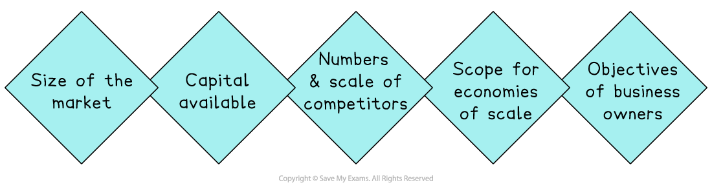
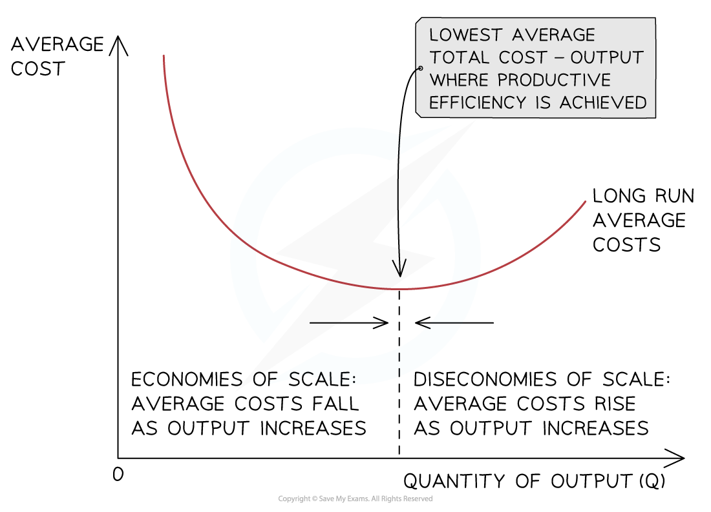

# Scale of Operations

## Factors influencing the scale of business operations

> **Spec point** — `spcpt_yFZQ98Pb8hg54nTX`

## Factors influencing the scale of business operations

- The **scale of operations** refers to the size and extent of a business’s activities, including:

  - how much it produces
  - how widely it sells
  - how many resources it uses
- Businesses do not all grow to the same size, as a range of internal and external factors influence how large they become

### Internal and external factors affecting the scale of operations

*A business's scale of operations is determined by factors including capital available and its owners' objectives*

#### Size of the market

- If the business operates in a large or fast-growing market, it may have more opportunities to grow
- In contrast, *niche* or local markets may limit how large a firm can become

  - Bigger markets = more potential customers
  - Smaller markets = fewer opportunities to expand

#### Capital available

- A firm with access to large amounts of capital, such as *retained profit*, *loans* or *share capital*, is more likely to expand

  - More capital = more investment in equipment, staff or premises
  - Limited finance = restricted growth

#### Number and scale of competitors

- A highly competitive market may force firms to grow quickly to survive
- Too many rivals may prevent growth if it is hard to gain *market share*

  - Fewer competitors = easier to dominate the market
  - Too many competitors = harder to grow profitably

#### Scope for economies of scale

- Businesses that can reduce their average costs as they grow may be more motivated to expand

  - This is common in manufacturing or transport industries
  - Businesses in services may have fewer cost-saving benefits from growing larger

#### Objectives of business owners

- Some owners prefer to keep their businesses small for easier control, better *work-life balance* or to maintain quality
- Some owners prioritise independence or lifestyle
- Others want rapid growth, high profits or global expansion

## Economies of scale

> **Spec point** — `spcpt_2PQz8f4rBPr2TXHW`

## Economies of scale

- As a firm grows, it is able to increase its **scale of output, **generating efficiencies that lower its *average costs* of production

  - These efficiencies are called ***economies of scale***

### Internal economies of scale

- **Internal economies of scale** occur as a result of the growth in the scale of production **within** the firm

#### Types of internal economies of scale

**Financial**

- Large firms often receive lower interest rates on loans than smaller firms, as they are perceived as less risky

**Managerial**

- It occurs when large firms can employ specialist managers who are more efficient at certain tasks
- Managers in small firms often have to fulfil multiple roles and are less specialised

**Marketing**

- Large firms spread the cost of advertising over a large number of sales
- They can also reuse marketing materials in different geographic regions

**Purchasing**

- This occurs when large firms buy raw materials in greater volumes and receive a bulk purchase discount

**Technical**

- Occur as a firm is able to use its machinery at a higher level of capacity due to the increased output, thereby spreading the cost of the machinery over more units

### External economies of scale

- **External economies of scale **occur when there is an increase in the **size of the industry** in which the firm operates

#### Sources of external economies of scale

| **Source** | **Explanation** |
|---|---|
| **Geographic cluster** | - As an industry grows, *ancillary firms* move closer to major manufacturers to cut costs and generate more business |
| **Transport links** | - Improved transport links develop around growing industries to help get people to work and to improve transport logistics |
| **Skilled labour** | - An increase in skilled labour can **lower the cost of skilled labour** - The larger the geographic cluster, the larger the pool of skilled labour |
| **Favourable legislation** ** ** | - Governments support certain industries in order to achieve their wider economic objectives |

## Diseconomies of scale

> **Spec point** — `spcpt_rwVqghwRMZ42hcc7`

## Diseconomies of scale

- **Diseconomies of scale** occur when a business **grows too large**, causing its **average costs per unit to increase** as output rises

  - Diseconomies of scale highlight that it is possible for a business to become so **large that it becomes less and less efficient**
- A business experiencing diseconomies of scale may **reconsider its organisational structure** to improve communication and coordination problems

  - Many very large businesses often **break themselves up into *****autonomous*** **smaller units, **which can communicate more effectively

### The causes of diseconomies of scale

#### Poor communication

- As a business increases in size, more managers and employees join the business
- Communication becomes slower and mistakes may be made, leading to worsening efficiency

#### Weak coordination

- Time-consuming decision-making may make it harder to coordinate workers and physical resources
- The *chain of command* is likely to lengthen, limiting interaction with employees

#### Lack of commitment from employees

- As the business grows, workers may feel less valued as their interaction with management is limited
- Workers may become demotivated, leading to a fall in output

## Unit costs and economies and diseconomies of scale

> **Spec point** — `spcpt_TdJh48T2gb9GxcXw`

## Unit costs and economies and diseconomies of scale

- Economies of scale help large firms **lower their costs of production** beyond what small firms are able to achieve
- They are the reason that firms generate ***increasing returns to scale ***in the long run

#### The long-run average cost curve

* Economies of scale occur when average costs decrease with increasing output, and diseconomies of scale occur when average costs increase with increasing output*

- With relatively low levels of output, average costs are high
- As  output increases, the business begins to benefit from **economies of scale, **which lower the average cost per unit
- At some level of output, the business will **not be able to reduce costs** any further; this point is called **productive efficiency**
- Beyond this level of output, the average cost will begin to rise as a result of **diseconomies of scale**
