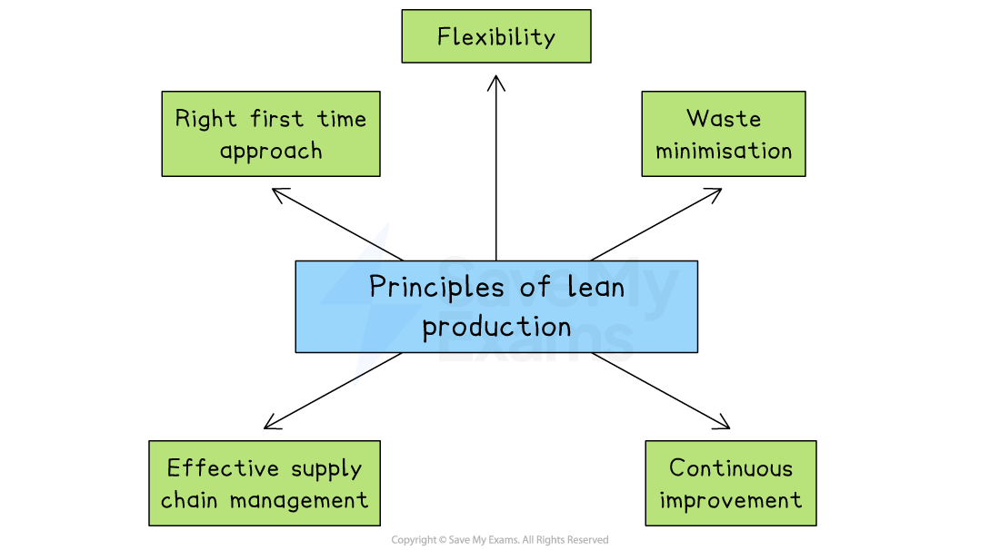
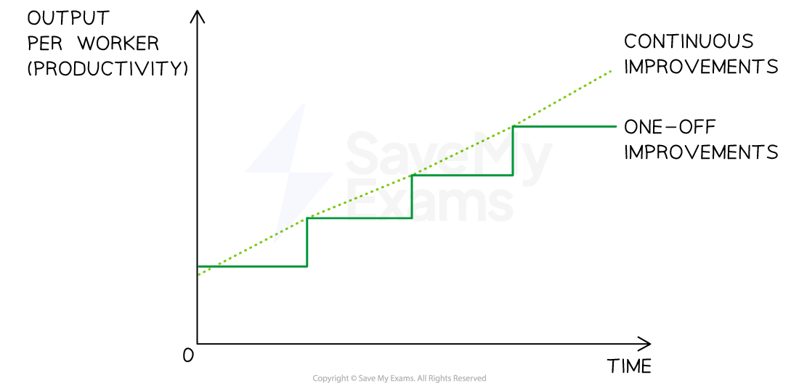
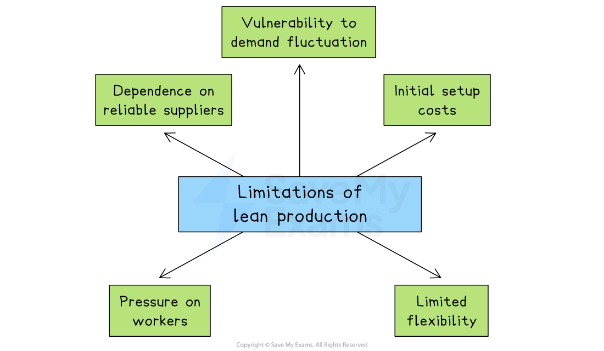

# Lean Production

## The aims and purposes of lean production

> **Spec point** — `spcpt_w3Pr5pVCMCxv5gbT`

## The aims and purposes of lean production

- Lean production is a management philosophy that aims to **maximise value **while** minimising waste**
- It focuses on **maximising efficiency**, **improving quality **and **reducing costs**
- Lean production is likely to lead to a *competitive advantage*

  - Lower  ***unit costs*** ** **are achieved due to minimal wastage so **prices may be lower **than those offered by competitors
  - **Better quality of output** is likely as a result of supplier reliability and carefully managed production processes

### The main principles of lean production

*Lean production involves adopting a right first time approach, flexibility, waste minimisation, effective supply chain management and continuous improvement*

- **Right first time approach**

  - Aim for **zero defects** in output
  - Identify and solve problems as they arise
  - Prevent rather than correct errors
- **Flexibility**

  - Adaptable capital equipment and physical resources
  - Multiskilled staff and team working
  - Flexible management styles
- **Waste minimisation**

  - Remove processes that do not contribute to added value
  - Consume as little as is necessary
  - Rework rather than replace
- **Effective supply chain management**

  - Develop excellent relationships with suppliers
  - Minimal number of suppliers
- **Continuous improvement**

  - Ongoing, small steps
  - All staff involved in improvement

## Lean production strategies

> **Spec point** — `spcpt_shgNM3493Z7vb3MF`

## Lean production strategies

- Businesses that pursue lean production can adopt a range of strategies

### 1. Kaizen

- Kaizen means “continuous improvement” in Japanese
- It involves **small, regular changes** made by employees at all levels

  - Workers are encouraged to suggest ways to improve efficiency, quality and processes
  - These ideas are implemented gradually over time

#### A comparison of Kaizen with one-off improvements

*Kaizen involves small, regular changes made by employees at all levels, implemented continuously over time*

#### Evaluating the use of Kaizen

| **Advantages** | **Disadvantages** |
|---|---|
| - It involves all staff in improving the business - It helps identify problems early - It can boost employee morale and teamwork | - It can be time-consuming to collect and review employee suggestions - Improvements may be small and take time to show results - It requires a long-term commitment from management |

### 2. Quality circles

- Small groups of employees who meet regularly to **discuss work-related problems **and **suggest improvements**
- These groups usually focus on improving quality, safety or productivity and include workers from different levels of the business

#### Evaluating the use of quality circles

| **Advantages** | **Disadvantages** |
|---|---|
| - They encourage teamwork and employee involvement - They generate practical ideas from people who do the job daily - They can improve quality and reduce waste | - They may not be effective without strong leadership willing to implement suggestions - They can be costly in time, training and time away from work - Ideas may not always be implemented or taken seriously |

### 3. Simultaneous engineering

- A production method where **product development stages happen at the same time**, rather than one after another

  - For example, design, engineering and marketing teams work together to reduce the time it takes to launch a new product

#### Evaluating the use of simultaneous engineering

| **Advantages** | **Disadvantages** |
|---|---|
| - It can speed up product development - Design issues can be identified early and rectified quickly - It can provide a *competitive edge* with faster product launches | - It requires strong coordination between departments - Mistakes in one area can affect others more quickly - It can be difficult to manage in very large organisations |

### 4. Cell production

- A method of organising production into **small teams **that complete a whole part of the product process
- Instead of passing work along a production line, each cell is responsible for a complete unit of work, encouraging ownership and teamwork

#### Evaluating the use of cell production

| **Advantages** | **Disadvantages** |
|---|---|
| - It can improve motivation through team responsibility - It may also improve communication between workers - It reduces movement of *part-finished goods* and waste | - The initial setup and employee training can be expensive - It is not suitable for all types of production - Team performance can be affected if members are absent |

### 5. Just-in-time manufacturing

- Where **products are made only when there is demand**, and **each stage of production begins only when needed** by the next stage
- This approach aims to match production with customer demand

  - This minimises waste, speeds up workflows, and reduces the need for warehousing

#### Evaluating the use of just-in-time manufacturing

| **Advantages** | **Disadvantages** |
|---|---|
| - It reduces waste by only producing what is needed - It improves *cash flow* by avoiding overproduction and reduces cash tied up in stock - It increases efficiency by streamlining workflows - It frees up space and reduces *shrinkage*, as goods are not stored between stages | - It is sensitive to disruptions in supply or production stages - It requires very reliable suppliers and accurate forecasting of demand - There is less flexibility to respond to sudden increases in demand - Delays at one stage can halt the entire production process |

### 6. Waste management

- Waste can be anything that does not add value, such as *overproduction*, excess inventory, delays or defects
- Lean waste management aims to simplify processes and reduce costs

#### Evaluating the use of waste management

| **Advantages** | **Disadvantages** |
|---|---|
| - It can reduce costs as resources are used most efficiently - It can help a business reduce its environmental impact - It focuses on value-added activities, improving profitability | - It requires constant monitoring and careful evaluation - Staff may resist changes or fear job losses when it is implemented - It needs a strong culture of improvement to be effective |

## The impact of lean production

> **Spec point** — `spcpt_fPhqfz83KW98M58Q`

## The impact of lean production

- Lean production affects not only how goods are made but also **how people work**, how **quality** is maintained and how** inventory**is managed

#### Lean production impacts

| **Area of Impact** | **Explanation** |
|---|---|
| **Inventory Control** | - Lean production uses systems like *Just-in-Time (JIT)* to reduce the need for large inventories    - This saves space, lowers storage costs and reduces waste   - Businesses rely on accurate demand forecasting and reliable suppliers to avoid delays |
| **Quality** | - Lean production builds **quality into every stage,** not just at the end    - Methods like *Kaizen* and quality circles help staff spot problems early   - This results in consistent products and higher customer satisfaction |
| **Employee roles** | - Employees take an active role, suggesting improvements, working in teams and taking responsibility for quality    - This improves motivation but requires training and trust |
| **Capacity management** | - Lean production helps match output to demand, reducing waste and idle time    - Techniques like *simultaneous engineering* and *cell production* improve responsiveness - However, responding to sudden demand increases can be challenging |
| **Efficiency** | - Lean production systems cut unnecessary steps and reduce delays using methods like flow production, JIT and waste reduction    - This leads to lower costs and faster production, and can allow a business to price products more competitively. |

## Limitations of lean production strategies

> **Spec point** — `spcpt_mh3JrhKZ7zPGzq7B`

## Limitations of lean production strategies

- Lean production can improve efficiency and reduce waste, but it also presents several **challenges and limitations** that businesses must carefully manage

*Limitations of lean production include its initial setup costs and the pressure it can place on workers*

- **Dependence on reliable suppliers**

  - Lean production often relies on just-in-time delivery
  
    - If suppliers are late or unreliable, production may stop entirely because there is little or no stock available
- **Vulnerability to demand fluctuations**

  - Lean systems produce only what is needed
  
    - This makes it difficult to respond quickly to unexpected increases in customer demand, which can result in missed sales and unhappy customers
- **Initial setup costs**

  - Introducing lean production may require investment in new equipment, staff training, and redesigning production processes
  
    - These upfront costs can be very high, especially for small businesses
- **Pressure on workers**

  - Lean production gives employees more responsibility and expects constant improvement
  
    - This can create stress or lower morale if staff feel overloaded or too closely monitored
- **Limited flexibility**

  - Lean strategies work best in high-volume, predictable environments
  
    - They are unlikely to be suitable for businesses with highly customised products or irregular demand
