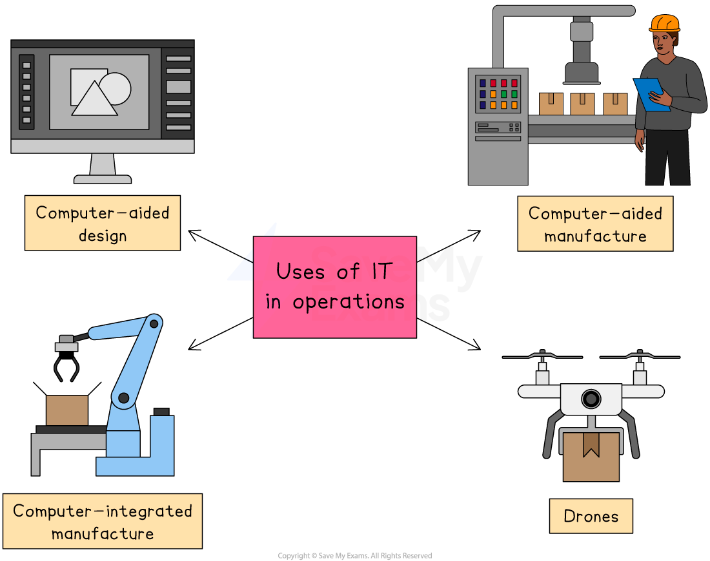

# Operational Decisions

## Resources and operational decisions

> **Spec point** — `spcpt_H32X27zW2CtdxWDQ`

## Resources and operational decisions

- Operational decisions are impacted by, and have an impact on, business resources
- Business resources include:

  - Capital
  - Employees, including ***contractors***
  - Property and land
  - Machinery and equipment, including IT hardware
  - Intellectual property such as ***patents***
  - ***Databases*** and key software and hardware
- When operational decisions are made, care needs to be taken to **ensure that the appropriate resources are in place** or that adequate plans are made to ensure that they will be in place when needed

  - This may involve
  
    - Purchasing new facilities, such as land or property
    - Investing in new production equipment or hardware
    - Hiring new workers or training existing staff
    - Obtaining legal protection for inventions
    - Updating systems to ensure information is up-to-date and complete
- Without the appropriate resources, operations decisions may be** delayed **or require **significant amendment**

  - This may impact on the operations function's ability to achieve its overall targets and limit its contribution to achieving business ***objectives***

## Information technology and operational decisions

> **Spec point** — `spcpt_yd95HX3mbBx3ztf9`

## Information technology and operational decisions

- Businesses are increasingly using a range of technologies to **automate production processes**

*Information technology can be applied to a range of operations processes, including design, manufacture, safety and logistics*

### 1. Computer-aided design (CAD)

- The process of **digitally creating design simulations** of products in 2D or 3D
- It can also include the use of computer software to create **mapping processes** for industrial machinery, e.g. the movements required by a robotic arm in a television factory

#### Evaluating the use of CAD

| **Advantages** | **Disadvantages** |
|---|---|
| - **Lower product design costs** as the need to produce expensive prototypes is eliminated - **High levels of accuracy **reduce the chance of production errors and defects, leading to high **quality** output - **Quicker design development** reduces the time taken to bring a product to market | - **Bespoke or complex design software** is usually very expensive - Design and production employees need **extensive training** to ensure designs are transformed into finished products effectively - Computer processing and storage capacity may need **upgrades** |

### 2. Computer-aided manufacturing (CAM) and Computer-integrated manufacturing (CIM)

- **Computer-aided manufacturing (CAM) **is the use of computers to assist in operations of a manufacturing plant, such as **production** processes, planning, management, transportation and storage

- **Computer-integrated manufacturing (CIM) **is the** complete automation** of a manufacturing plant, with all processes functioning under computer control with digital information tying them together

#### Evaluating the use of CAM and CIM

| **Advantages** | **Disadvantages** |
|---|---|
| - Production can take place with **minimal human input**, reducing labour costs - Often linked directly to CAD systems, it allows for **mass customisation** as changes are be made to work in progress - IT-controlled production systems are usually** highly accurate**, generating high quality output | - High** initial cost** of hi-tech equipment that will need **ongoing maintenance** and upgrades - **Equipment failure** and **breakdowns** can cause significant disruption to production - **Output is only as good as the system's programmer** - if faulty code is not detected and corrected, product quality will be impacted |

### 3. Drones

- Unpiloted aircraft are being used to carry out an increasing range of business tasks, including **package delivery, photography **and **security**

  - E.g. Large agriculture businesses use drones to spot failing crops and areas of concern in large fields, mapping boundaries and even applying pesticides

### Evaluation of IT in operations

- The **installation and maintenance** of IT technology in production is likely to incur **significant costs**

  - Purchasing IT hardware and software may require external finance, such as ***loans*** which will need to be repaid with ***interest***
  - Employees will need training in order to safely and effectively operate technology
  - ***Down time*** as technology is installed and workers are trained, it impacts output levels
- Businesses must be sure that this ***capital expenditure*** **is outweighed by gains in *****productivity*** and **improvements in quality and flexibility**

  - Higher levels of productivity may only be achieved with** high levels of output**
  - Automation usually works best in the manufacture of **standardised products**
  - Flexibility in production refers to how easy it is to install machinery and **switch to different machinery** which is required to manufacture different products (known as retooling)
  
    - The most flexible technology is also likely to be the most **costly**

## Artificial intelligence and operational decisions

> **Spec point** — `spcpt_kJccT4GNCFnJBS6Q`

## Artificial intelligence and operational decisions

- Artificial intelligence can be used in a range of ways to enhance business operations

  - In financial institutions such as **banks and insurance companies**, AI systems can identify customers'  financial and behavioural patterns to identify potential instances of fraud
  - In **grocery retail**, AI systems can be used to monitor and control storage environments, such as freezers, to ensure that products are kept in optimum conditions
  - In **manufacturing**, AI can be used to schedule upgrades and maintenance to reduce the amount of production ***down time***
- **Robots **are programmed to** collect information from their environment** using sensors and use artificial intelligence (AI) to improve production performance

  - E.g. Hotel chain **Yotel** employs ‘robotic staff’ that can move around anywhere in the hotels, carrying guests' luggage, delivering laundry, cleaning rooms and making coffee

### Business uses of robots

- **Manufacturing**

  - In **manufacturing** and assembly lines, robots can increase productivity and accuracy
- **Logistics**

  - Warehouses and** logistics** businesses can use robots to move and transport goods
- **Agriculture**

  - In **agriculture,** tasks such as planting, harvesting and spraying crops can be carried out by robots
- **Medicine**

  - In **medicine** robots can be used in surgical procedures to increase precision and reduce the risk of errors
- **Entertainment**

  - Robots can be sold as toys or used in amusement parks to provide **entertainment**
- **Dangerous tasks**

  - Remote-controlled robots can be programmed to carry out **hazardous testing** and **R&D** processes

  - The use of** robots **in particular presents a range of advantages and disadvantages related to productivity, quality and flexibility

#### Evaluating the use of robots in operations

| **Advantages** | **Disadvantages** |
|---|---|
| - Increased **productivity**, as robots can work continuously without breaks or fatigue - Improved **consistency **and** accuracy**, as robots can perform tasks with a high level of precision and accuracy - Robots can perform tasks that are **dangerous or hazardous** for humans, improving safety - Robots can help **reduce labour costs** in the long run | - High** initial investment** of purchasing and setting up robotic systems - **Maintenance costs**, as robots require regular maintenance and repairs, which can add to the overall cost - **Lack of flexibility**, as robots are programmed for specific tasks and **cannot adapt easily** to new situations or tasks - Increased use of robots can lead to** job losses** in some industries |

## The need for flexibility

> **Spec point** — `spcpt_Rkzmdrts7Tyjj2j6`

## The need for flexibility

- Businesses should have the flexibility to change output volumes, timescales and product specifications for several reasons

  - The level of** demand** can change with little warning
  - **Supplies** may become unavailable
  - Customers may** delay orders** or require **rapid delivery** of orders
  - Customers may demand **variations** to products
- Flexibility can be improved in a number of ways

  - ***Outsourcing*** some production to trusted manufacturers
  - Employing **multi-skilled workers** and investing in their training and development
  - Holding ***buffer stock*** to ensure increased demand can be met
  - Investing in** advanced machinery** that is capable of ***mass customisation***
  - Investing in **buildings and land** to extend production premises

> **Exam Hint**
> You may be asked to analyse the impact of IT and AI on a business. Their contribution to improving flexibility should be one of your key arguments - the case study may give you some ideas on how the business in question could apply them.

## Process innovation

> **Spec point** — `spcpt_nkZyWCRYHGhg67v6`

## Process innovation

- **Process innovation** involves identifying **new ways to organise and carry out production** processes

  - In recent years, organisations have made some notable improvements production processes that have improved productive efficiency

#### Examples of process innovation

| **Amazon** | **IKEA** | **UK Passport and Borders Agency** |
|---|---|---|
| - **Amazon **provides detailed package tracking, allowing its online customers to provide details such as a safe place to leave deliveries, reducing the need to return undelivered items to warehouses | - **IKEA**'s** *****EPOS*** system provides accurate stock availability information on its website, ensuring customers are not disappointed when they travel significant distances to purchase items | - In the public sector, the decision by the **UK Passport Agency** and **Borders Agency** to introduce biometric passports has allowed fast-track lanes at airports to be introduced, reducing queue times for travellers |
