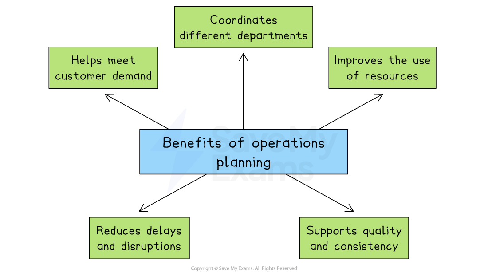
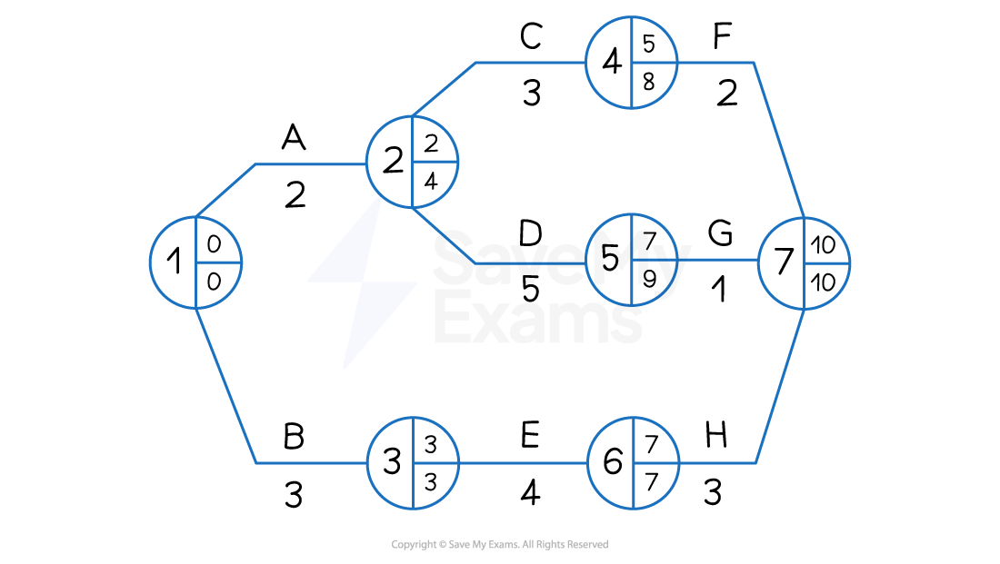
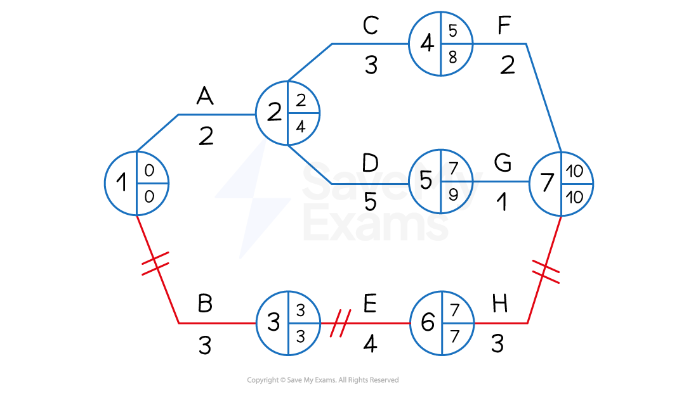
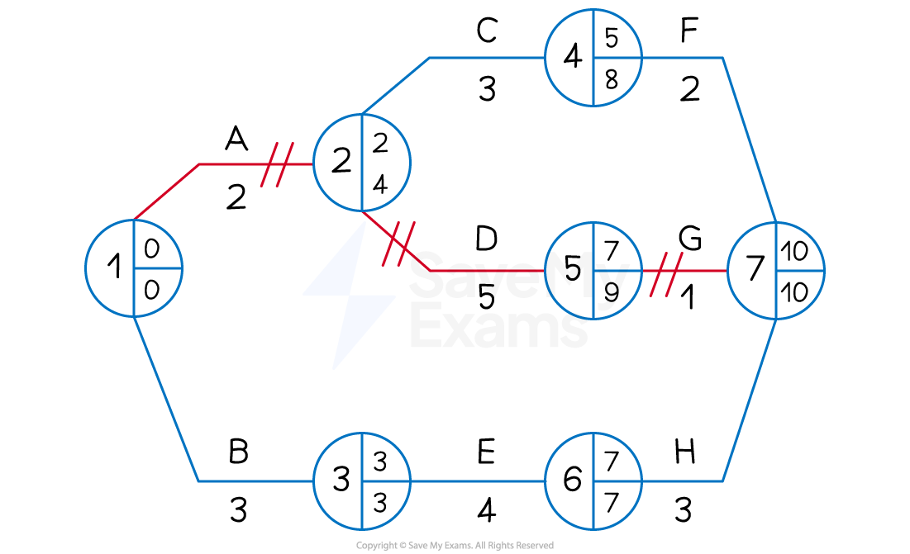

# Operations Planning

## The need for operations planning

> **Spec point** — `spcpt_nsM4WTFTZ5mFMcxS`

## The need for operations planning

- **Operations planning** is the process of organising all the resources and activities needed to produce goods or services efficiently

  - It ensures that the right products are made, at the right time, in the right quantity and using the right resources

#### Benefits of operations planning

*Operations planning helps a business meet customer demand and supports quality and consistency*

- **Meet customer demand**

  - Planning helps businesses produce the correct quantity of goods to match expected demand
  
    - Without it, a business might make too little, causing stock shortages and lost sales,or too much, leading to waste and higher costs
- **Improve the use of resources**

  - Operations planning ensures that staff, machinery and materials are used efficiently
  
    - It helps avoid wasted time, overuse of equipment, or running out of stock during production
- **Coordination of departments**

  - Good planning allows production, purchasing, finance, and marketing to work together
  
    - E.g. Marketing can give sales forecasts, finance can set budgets and production can schedule output to meet targets
- **Reduces delays and disruptions**

  - Planning helps identify potential problems early, such as a shortage of raw materials or a machine breakdown
  
    - Solutions can be prepared in advance, reducing the risk of disruption
- **Supports quality and consistency**

  - Operations planning includes setting clear standards for quality, timing and workflows
  
    - This ensures that products or services are delivered consistently to meet customer expectations

## An introduction to network diagrams

> **Spec point** — `spcpt_Vwwd4XDKtx5RY5WX`

## An introduction to network diagrams

- A **network diagram** is a visual planning tool used in operations management to help **organise and schedule tasks in a project **
- It shows the **order **in which activities must be completed and **how long** each one is expected to take

#### Example network analysis

*A simple network diagram showing key elements*

- A network diagram must** always start and end on a single node**
- **Lines must not cross** and must **only be assigned to activities**

### How network diagrams help operations planning

- Network diagrams** improve time management** by helping managers identify the critical path, the shortest time needed to complete a project

  - They highlight **task dependencies** by showing which activities must be completed before others can begin, helping to avoid mistakes and delays
- Network diagrams support **efficient resource allocation** by showing when people, machines, or materials will be needed, reducing idle time and bottlenecks

  - They improve decision-making by making it **easier to adjust plans** if there are unexpected delays or changes to deadlines

## Elements of network diagrams

> **Spec point** — `spcpt_Hp5c5GfxHZCR8Mhg`

## Elements of network diagrams

### Node

- A **node** is a circle that represents a point in time where an activity either starts or finishes
- Each node is split into three sections

  - The **left half** of the circle shows the activity number
  - The **top right** section shows the **earliest start time (EST)**—the earliest point an activity can begin, based on the completion of the previous activity
  - The **bottom right** section shows the **latest finish time (LFT)**—the latest time by which the previous activity must be completed without delaying the project

### Activities

- An **activity** is a task or process within a project that takes time to complete

  - Activities are shown on a network diagram as a **line linking two nodes**
  - Above the line, you will usually find either a letter or a short description of the activity

### Duration

- The **duration** is the length of time required to complete an activity
- This is shown **below the activity line** and is usually measured in time units such as hours or days

### Dummy activities

- A **dummy activity** is an activity that has a **weight** of **zero**

  - **Dummies** are **not** assigned names (letters)
  - **Dummies** are represented by **dotted lines**

#### Where a dummy activity is used

- To ensure each activity has a **unique pair** of **start** and **end nodes**

  - E.g.  In the activity network below, activity D has **immediate predecessors** B and C
  
    - B and C cannot **both** start at event (node) 1 and end at event (node) 2 (this would not be a unique pair)
    - a dummy activity is used so that B has start and end pair (1, 3) and C has a start and end pair (1, 2)

- When there is a split of **immediate predecessors**

  - E.g.  In the activity network below, activity D has immediate predecessors B and C
  
    - Activity E only has B as an immediate predecessor
    - A dummy activity is used to show that D depends on both B and C

## Using network diagrams for critical path analysis

> **Spec point** — `spcpt_cmxF4RgVgPXhG8Pq`

## Using network diagrams for critical path analysis

### 1. Calculating earliest start times (EST)

- Working forward from Node 1, it is possible to calculate the **Earliest Start Time** for each activity by **adding the duration of each task**

*An example of a simple network diagram showing Earliest Start Times*

- The EST for each activity  is placed in the **top right** of each node

  - Node 1 is the starting point of the project and where both Activity A and Activity B begin
  - Activity A and Activity B are independent processes
  - Activity A has a duration of 2 days and its earliest start time (EST) is 0 days
  - Activity B has a duration of 3 days and its EST is also 0 days
  - Activity C and Activity D both begin at Node 2 and  are dependent upon the completion of Activity A but are independent from each other
  
    - Activity C has a duration of 3 days and its EST is 2 days
    - Activity D has a duration of 5 days and its EST is also 2 days

- Activity E begins at Node 3

  - Activity E has a duration of 4 days and its EST is 3 days
- Activity F begins at Node 4

  - Activity F has a duration of 2 days and its EST is 5 days
- Activity G begins at Node 5

  - Activity G has a duration of 1 day and its EST is 7 days
- Activity H begins at Node 6

  - Activity H has a duration of 3 days and its EST is 7 days
- Node 7  is the end point of the project

### 2. Calculating latest finish times (LFT)

- Working backwards from Node 7, it is now possible to calculate the Latest Finish Time (LFT) for each activity by **subtracting the duration of each task**

*An example of a simple network diagram showing Earliest Start Times and Latest Finish Times*

- The LFT for each activity  is placed in the **bottom  right** of each node

  - Node 7 is the end point of the project, which has a latest finish time of 10 days
  - Activity H has a duration of 3 days
  
    - The LFT in Node 6 is 7 days (10 days - 3 days)
  - Activity G has a duration of 1 day
  
    - The LFT in Node 5 is 9 days (10 days - 1 day)
  - Activity F has a duration of 2 days
  
    - The LFT in Node 4 is 8 days (10 days - 2 days)
  - Activity E has a duration of 4 days
  
    - The LFT in Node 3 is 3 days (7 days - 4 days)
  - Activity D has a duration of 5 days
  
    - The LFT in Node 2 is 4 days (9 days - 5 days)
  - Activity C has a duration of 3 days
  
    - The LFT in Node 3 is 4 days because Activity D is the more time-critical of the two activities that are dependent upon the completion of Activity A and so its LFT is recorded
  - Activity B has a duration of 3 days
  
    - The LFT in Node 1 is 0 days (3 days - 3 days)
  - Activity A has a duration of 2 days
  
    - The LFT in Node 1 is 0 days because Activity B is the more time-critical of the two starting activities and so its LFT is recorded

- The LFT in Node 1 is always 0

### 3. Identifying the critical path

- The **critical path** highlights those **activities that determine the length of the whole project**
- If any of these critical activities are delayed, the **project as a whole will be delayed**
- The critical path follows the** nodes where the EST and LFT are equal**

  - In the diagram below nodes 1 3 6 and 7 have equal ESTs and LFTs
  - Activities that determine these nodes are B E and H
  - These activities are marked with two short lines
  - The critical path is therefore BEH

*An example of a simple network diagram showing the critical path BEH*

### 4. Identifying and calculating float time

- Float time exists where there is a **difference between the Earliest Start Time (EST **and the **Latest Finish Time (LFT)**
- Where float time is identified, managers may

  - **Transfer resources** such as staff or machinery to more critical activities
  - **Allow extra time** to complete tasks to improve quality or allow for creativity

*An example of a simple network diagram showing float nodes (4 and 5) and a critical node (6)*

#### Float time analysis

- The **total float** refers specifically to spare time that is available so that the **overall project completion is not delayed**
- The** total float** for a specific activity is calculated by

$\mathrm{Float}=\mathrm{LFT} \mathrm{for} \mathrm{the} \mathrm{activity}-\mathrm{Duration} \mathrm{of} \mathrm{the} \mathrm{activity}-\mathrm{EST} \mathrm{for} \mathrm{the} \mathrm{activity}$

- Using the diagram above, the following **total float times** can be calculated for Activities A to H:

| **Activity** | **LFT** | **- Duration** | **- EST** | **= Total Float** |
|---|---|---|---|---|
| A | 4 | 2 | 0 | 2 |
| B | 3 | 3 | 0 | 0 |
| C | 8 | 3 | 2 | 3 |
| D | 9 | 5 | 2 | 2 |
| E | 7 | 4 | 3 | 0 |
| F | 10 | 2 | 5 | 3 |
| G | 10 | 1 | 7 | 2 |
| H | 10 | 3 | 7 | 0 |

- The critical activities B E and H each have a total float of 0 days

> **Worked Example**
> The network diagram below shows the activities involved in a new promotional campaign for a small fashion accessories business as well as the time (in weeks) it is expected that each activity will take to complete.
> 
> 
> 
> **Calculate**
> 
> a) The earliest start times and latest finish times for each node.
> 
> [4]
> 
> b) The total float time for activity G
> 
> [2]
> 
> **Step 1: Calculate the Earliest Start Times (EST)**
> 
> Node 1 EST = **0**
> 
> Node 2 EST = 0 + 3 = 3 **but** 0 + 4 = 4 so **4**
> 
> Node 3 EST = 4 + 5 = **9**
> 
> Node 4 EST = 4 + 2 =** 6**
> 
> Node 5 EST = 9 + 3 = **12**
> 
> Node 6 EST = 6 + 4 = **10**
> 
> Node 7 EST = 4 + 6 = **10**
> 
> Node 8 EST = 12 + 2 = 14 **but** 10 + 4 = 14 **and** 10 + 5 = 15 so **15    ****  (2)**
> 
> **Step 2: Calculate the Latest Finish Times (LFT)**
> 
> Node 8 = 15
> 
> Node 7 = 15 - 5 = 10
> 
> Node 6 = 15 - 4 = 11
> 
> Node 5 =15 - 2 = 13
> 
> Node 4 =11 - 4 = 7
> 
> Node 3 =13 - 3 = 10
> 
> Node 2 = 10 - 6 = 4
> 
> Node 1 = 4 - 4 = 0      **(2)**
> 
> **Step 3: Calculate the total float time for Activity G**
> 
> $\mathrm{Total} \mathrm{float}=\mathrm{LFT} \mathrm{for} \mathrm{the} \mathrm{activity}-\mathrm{Duration} \mathrm{of} \mathrm{the} \mathrm{activity}-\mathrm{EST} \mathrm{for} \mathrm{the} \mathrm{activity}$
> 
> $=11\mathrm{weeks}-4\mathrm{weeks}-6\mathrm{weeks}\,\,=1\mathrm{week}$     **  (2)**

### Amending network diagrams

- If the length of time taken to complete an activity changes, there may be an effect on the critical path and available float

*An example of a simple network diagram showing the critical path BEH*

- In the strategy shown in the network diagram above, the duration of activity G is increased from 1 to 4 days

  - The EST at node 7 will increase to 11 days and the LFT to 11 days
  - The EST at node 5 will remains at 11 days, while the LFT will change to 7 days
  - The EST at node 5 will remains at 2 days, while the LFT will change to 2 days
- As a result, the critical path will switch from BEH to ADG

*The amended network diagram showing the critical path ADG*

## Evaluating critical path analysis

> **Spec point** — `spcpt_6cFcYxQR6PCvPGr6`

## Evaluating critical path analysis

- Although critical path analysis can be useful in project planning, the method has some limitations

#### Limitations of critical path analysis

| **Limitations** | **Explanation** |
|---|---|
| - Very lengthy or **complex projects involve a very large number of activities** that have numerous dependencies - Network analysis often **relies on estimates and forecasts** - Network analysis **does not guarantee the success **of a project - Resources may not prove to be as flexible as hoped when managers identify float periods | - **Supervisors and specialist network planning software** may be required - Significant research and good communication with suppliers is required to make** a network diagram** **really useful** - **Project managers** will need to be **highly skilled **and will need **experience** of working with complicated plans - Employees may require **additional training** in order to transfer to critical tasks  - Machinery and other capital resources may need to be adapted or upgraded |
