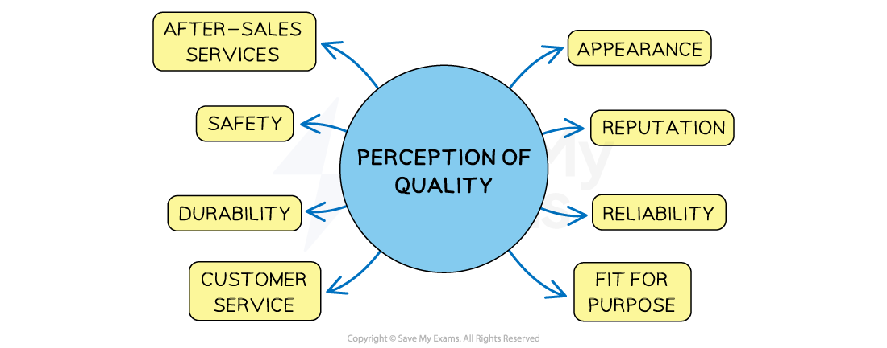

# Methods of Quality Management

## The importance of quality

> **Spec point** — `spcpt_cTm9hDd2CBmGxMRZ`

## The importance of quality

- Quality considers the characteristics and **features** of a product that **satisfy the needs of customers**
- Businesses need to **maintain a level of quality** that attracts and retains customers if they want to remain successful
- Customer **perceptions of quality** are related to a range of product or business features

#### Factors that influence quality perception

*The perception of quality is influenced by appearance, durability and the quality of customer service*

- Customers may consider products or services to be of **good quality** if they

  - **Look good** and are sold by a **reputable** business or brand
  - Are** reliable** and ***durable***
  - Are **safe** and ***fit for purpose***
  - Receive good customer service, including ***after-sales service***
- If quality is **not maintained, **then businesses may be at **risk** of

  - Losing their competitive advantage and customers to other brands that offer better quality goods or services
  - Experiencing **higher costs **due to having to replace faulty or defective goods
  - Gaining a **poor reputation** as customers spread poor reviews about the business to others

- In some countries **laws protect consumers **so businesses need to ensure that the products they sell are free of faults or defects to **avoid harming customers or their reputation**

## Quality control

> **Spec point** — `spcpt_qdZVQ9cNnPNZGQ9x`

## Quality control

- Quality control is a traditional method of **checking quality at the end of the production process **by** **using ***quality inspectors*** to find faults
- It** **is not possible to **achieve perfection** in every production process

  - E.g. there will always be some variation in terms of materials used, production skills applied or reliability of the finished product

### The impact of quality control on business

#### 1. Reduces risk of poor-quality products reaching customers

- Helps maintain the business’s reputation and avoid customer complaints

#### 2. Wasted output may increase

- Faulty items are found after production, so time and materials may already be wasted

#### 3. Higher inspection costs

- Employing inspectors adds to labour costs, especially in large-scale operations

#### 4. Low training costs

- Limited staff training is needed as inspectors check quality rather than the employees themselves

#### 5. Less responsibility for workers

- Employees may depend on inspectors instead of taking ownership of quality themselves

#### 6. Inconsistent quality improvements

- Problems are found but not always prevented, so the same issues may continue to occur

## Quality assurance

> **Spec point** — `spcpt_MxFhW7whKdFyNfPs`

## Quality assurance

- Quality assurance involves inspecting the quality of production **throughout** the process

  - Workers **check their own work **and, sometimes, the work of others throughout the **various stages of production **
- Some business take a **whole-business **approach to quality assurance, with systems such as ***quality circles***, **benchmarking** and **total quality management**

#### The impact of quality assurance on business

| **Impact** | **Explanation** |
|---|---|
| **Fewer errors and waste** | - Mistakes are prevented during production, reducing scrap and rework costs - The **cause of *****defects**** *is the focus, so **future quality issues** may be prevented |
| **Improved customer satisfaction** | - Products are consistent, leading to fewer returns and better reviews |
| **Workers take more responsibility** | - Skilled staff feel involved and are expected to meet quality standards themselves |
| **Training and systems required** | - Employees must be trained and procedures created, which takes time and investment |
| **Can improve brand reputation** | - Reliable, high-quality products help build a stronger, more trusted brand |

## Total Quality Management (TQM)

> **Spec point** — `spcpt_c96P8QhrfMPvDPsy`

## Total Quality Management (TQM)

- Total Quality Management (TQM) places **quality at its core** and makes **every worker responsible for quality** throughout the business

  - Quality is considered from the **customer's perspective**
  - **Inefficiency **and** wastage is removed** from **every** business activity or function, including those that are not directly related to production

#### Advantages and disadvantages of TQM

| **Advantages** | **Disadvantages** |
|---|---|
| - **Improved efficiency**    - Reduces waste and mistakes by focusing on quality throughout the business, leading to higher profits - **Positive culture**    - Builds a workplace where everyone aims for high standards and *continuous improvement* | - **Commitment and training**    - Requires all employees to be fully committed and regularly trained to maintain standards - **Strong leadership needed**    - Managers must monitor progress closely and lead by example to keep TQM effective |

> **Case Study**
> **The impact of TQM at Nestlé**
> 
> - Nestlé is one of the largest food and beverage companies in the world, with operations in over 180 countries
> - With such a large global footprint, consistent product quality and customer trust are essential to its success
> 
> **Why Nestlé introduced TQM**
> 
> - To maintain **consistent quality** across its many factories and brands
> - To improve **efficiency** in production and reduce waste
> - To respond better to **customer expectations** regarding food safety, nutrition, and quality
> 
> **What changes were made**
> 
> - Nestlé introduced a global quality management system based on **TQM principles**, including **continuous improvement (Kaizen)**
> - It developed a company-wide culture of quality with the slogan: **“Quality is the foundation of our company”**
> - It invested heavily in **employee training**, so every worker understood their role in maintaining high standards
> - It used **customer feedback, regular audits** and **process checks** to improve quality at every stage, from sourcing its raw materials to final packaging
> 
> **Impact on the business**
> 
> | **Area** | **Impact** |
> |---|---|
> | **Product quality** | - Improved consistency and food safety across all international markets |
> | **Operational efficiency** | - Reduced production delays, waste, and costs related to product recalls |
> | **Customer trust** | - Nestlé maintained a strong brand reputation, even in highly competitive markets |
> | **Employee engagement** | - Staff across all levels became more involved in problem-solving and quality improvement |

## The importance of benchmarking

> **Spec point** — `spcpt_2JpcZRH5p4YCs2hK`

## The importance of benchmarking

- **Benchmarking **involves a business **comparing its quality and performance** with market leaders within the same industry

### 1. Internal benchmarking

- Comparison of different functions within a business, such as finance or marketing

  - **Performance**
  
    - Comparison of key performance indicators such as *labour productivity* or *labour turnover* rates
  - **Process**
  
    - Comparison of business operations and processes such as call centre queue times or delivery times

### 2. External benchmarking

- Comparison of key performance indicators, such as the number of  *product recalls*, against those of market leaders in an industry

#### Evaluating benchmarking

| **Advantages** | **Disadvantages** |
|---|---|
| - Helps identify areas where businesses can improve their performance by **learning from the best practice** of other successful companies - Can identify ***innovative *****practices and processes** used by competitors - Can support the setting of **realistic performance goals** by comparing current performance with industry standards - Workers may feel a **sense of pride and motivation** when they see their employer striving to be a leader in the industry | - **Differences in metrics** used to measure performance affects the comparability of benchmarking data - Best practices from market leaders **may not always be directly applicable** to the needs of a specific business - Small businesses may **struggle to find the time and resources** for data collection and analysis required for benchmarking - Focusing too much on benchmarking against competitors may lead to a **narrow view of success** that ignores ideas from other sources |
