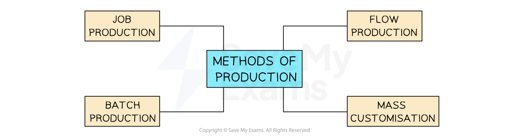
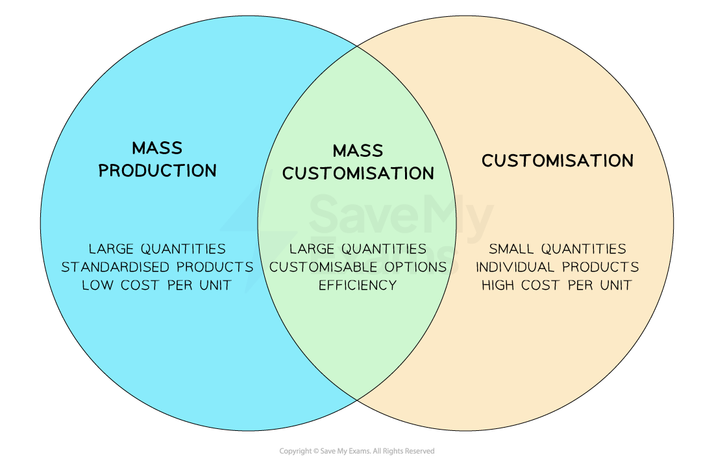

# Methods of Operation (Production)

## Capital intensive operations

> **Spec point** — `spcpt_TWbnNKRVc2zzxQx8`

## Capital intensive operations

- **Capital-intensive production **predominately **uses** **machinery and technology in the production of goods and services**

  - **Large-scale** production of **standardised products** is likely to be capital-intensive
  - Manufacturing in **developed countries** where **labour costs are relatively high** is likely to be capital-intensive
  
    - E.g. Vehicle manufacturers such as **Ford **use robots and other production technology to manufacture cars, with supervisors overseeing the quality of output

#### Evaluating capital intensive production

| **Advantages** | **Disadvantages** |
|---|---|
| - Low-cost production where output is high - Machines are usually consistent and precise - Machines can run without breaks | - Significant set-up and maintenance costs - Breakdowns can severely delay production - May not provide flexibility in production |

## Labour intensive operations

> **Spec point** — `spcpt_Gbjy7rm7dD9Nh8CH`

## Labour intensive operations

- **Labour-intensive production** predominantly **uses physical labour** in the production of goods and services

  - The **delivery of services** is usually more labour-intensive than manufacturing
  - In countries where **labour costs are low**, such as Bangladesh and Vietnam, labour-intensive production is common
  - **Small-scale production** is likely to be labour-intensive
  - E.g. UK schools are labour-intensive operations as teachers plan and deliver lessons and provide pastoral support

#### Evaluating labour intensive production

| **Advantages** | **Disadvantages** |
|---|---|
| - Low-cost production where labour costs are low - Provides opportunities for workers to be creative - Workers are flexible (e.g. they can be retrained) | - Workers may be unreliable and need regular breaks - Incentives may be needed to motivate staff - Training costs can be significant |

## An introduction to production methods

> **Spec point** — `spcpt_FxgBFWSXRF8C6nVB`

## An introduction to production methods

- Production is the **transformation of resources** (e.g. raw materials components and processes) into finished goods or services

  - Goods are **physical products**, such as bicycles and T-shirts
  - Services are **non-physical items **such as hairdressing, tourism and manicures

#### The four main production methods

*The type of production method used often depends on the nature of the product being made   *

- The method of production used by a business depends upon a number of factors

  - The **level of output **required to be produced
  - The **nature** of the product
  - Whether the product is **standardised or customised**
  - The level of ***automation**** *used in production

## Job production

> **Spec point** — `spcpt_sbgVqKmMs7Cfbq3M`

## Job production

- Job production is where products are made to meet the **specific requirements** **of individual customers**

  - Each item is **produced separately** and the production process is **tailored** to the unique specifications of the customer's order
- It is typically used for unique or **specialised **products that are not produced in large quantities
- Job production often requires **skilled labour**, such as craftsmen or technicians, as the manufacturing process may involve intricate tasks or specialised techniques

#### Examples of job production

| **Furniture made to order**  Where customers can choose the design, dimensions, materials and finishes | **Tailored clothing**  Such as wedding suits, where each garment is made to fit the specific preferences of the individual customer | **High-end jewellery**  Especially those with unique designs or personalised engravings |
|---|---|---|
|  |  |  |

- Job production has the potential to add **significant levels of** ***added value*** and can therefore be very** profitable**

  - Specialised products made by skilled craftspeople can** command high prices** because they are unique and can be made to** meet customer needs very precisely**
  - This would arguably be lost if other methods of production were to be adopted

#### Advantages and disadvantages of job production

| **Advantages** | **Disadvantages** |
|---|---|
| - High customisation – meets unique customer needs | - More expensive due to customisation |
| - Flexible – can adapt to changes in demand or trends | - Longer lead times – not ideal for urgent orders |
| - High quality – greater attention to detail and control | - Complex to manage – requires close coordination with customers |
| - Personalised experience – customers involved in design, increasing loyalty | - Low volume – limits ability to achieve economies of scale |

## Batch production

> **Spec point** — `spcpt_NGJCXXNvzdkwC9hB`

## Batch production

- Batch production occurs when products are **produced in groups** or batches

  - A certain quantity of products is produced together before moving on to the next batch
  - Each batch goes through the **entire production process**, from raw materials to the finished product, before the next batch begins
  - Batches are usually of a **standardised size** **and composition** and follow a certain sequence of operations

#### Goods made using batch production

*Commonly used in industries such as pharmaceuticals, beauty products and food processing*

- Batch production strikes a **balance between customisation and cost-effectiveness**, making it a suitable production method for industries that deal with **diverse product range**s and **varying customer needs**
** **

#### Advantages and disadvantages of batch production

| **Advantages** | **Disadvantages** |
|---|---|
| - Batch production allows manufacturers to **switch between batches **and **cater for varying customer demand** - It can be more **cost-effective **compared to flow production, especially when producing items in smaller quantities - It allows a business to benefit to some extent from ***purchasing economies*** as larger quantities of stock may be purchased than with job production - **Quality** issues can be identified and ***defects*** can be rectified within a specific batch before moving on to the next, minimising the impact on the entire production line | - Setting up the equipment and configuring the production line for each batch can be **time-consuming **and may result in idle time between batches - Often leads to the **accumulation of** ***inventory***, which requires storage and careful management to avoid wastage - It is **not as adaptable as other production methods,** such as flow production    - Rapid changes in product demand or frequent product variations may be difficult to manage - Frequent start-up and shutdown of machinery can put additional **stress on equipment**, requiring regular maintenance and repair to ensure smooth operations |

## Mass (flow) production

> **Spec point** — `spcpt_n5ggqskjmfnmBGrM`

## Mass (flow) production

- Flow production occurs when a product is produced in a **continuous sequence of operations on a production line**

  - It involves the movement of materials or components **through a series of workstations** or machines with each workstation performing a specific task or operation
  - As a product moves along the **production line** it undergoes a series of operations, such as assembly, testing, packaging or quality control until it is completed
- This method is commonly used in industries that produce **high volumes of standardised products** such as automobiles and consumer electronics

### Characteristics of flow production

- **Division of labour**

  - Different tasks are allocated to different workstations or machines, allowing workers to specialise in a specific task
- **Standardisation**

  - The manufacture of identical products helps to ensure consistency and the smooth flow of production
- **Continuous movement**

  - The product moves continuously from one workstation to another, minimising idle time and maximising productivity
- **High volume**

  - Flow production is suitable for high-volume manufacturing as it enables the efficient production of large quantities of identical or similar products
- **Automation**

  - Flow production often involves the use of machinery and automated equipment to perform repetitive tasks quickly and accurately

#### Advantages and disadvantages of flow production

| **Advantages** | **Disadvantages** |
|---|---|
| - The continuous flow of production **eliminates the need for frequent equipment start-ups and shutdowns**, reducing energy consumption and minimising material waste - **Labour costs may be lower** due to automation and processes that require less skilled workers - It allows for greater **control over product quality **because it is easy to identify and address any defects early on - **It enables fast production,** resulting in **short lead times,** which help companies respond more quickly to market demands | - Implementing flow production systems often requires **significant *****capital investment*** to purchase expensive manufacturing equipment and automation technologies - It relies on the **reliability and efficiency of equipment and machinery**    - If any part of the production line breaks down, it can disrupt the entire process, leading to costly ***down time*** - If a defect is detected, it may require the **stoppage of the entire production line,** resulting in substantial losses - Relies on a **steady supply of** ***components***** and** ***raw materials ***    - Any disruption in the supply chain can have a severe impact on production |

> **Exam Hint**
> When recommending a suitable method of production, carefully consider the needs of the customers. Where the selling price is a key driver of consumer demand, flow production (where ***unit costs*** are minimised) is likely to be very suitable. Where demand is driven by quality or where customisation is required, job or batch production are likely to be better choices.

## Mass customisation

> **Spec point** — `spcpt_vXK2DxFgwJMV89JJ`

## Mass customisation

- **Mass production** is usually achieved through flow production and involves the manufacture of **large quantities of standardised products**

  - This results in low costs per unit compared to other methods of production
- **Customisation** is usually associated with job production or small-scale batch production

  - This allows customers to **design products from scratch**
- **Mass customisation** seeks to bridge this gap by offering **flexibility** with **a **range of customisable options within a standardised production process alongside the **low unit costs** typically associated with flow production

  - It uses **technology**, such as computer-aided design (CAD), flexible manufacturing systems and data analytics to efficiently accommodate customer preferences

*A comparison of mass production, customisation and mass customisation*

### Stages of mass customisation

#### 1. Choice

- Customers are presented with **a range of pre-designed product options**, features or configurations from which they can choose

  - E.g. **Audi **customers can select a specific model, such as the Avant, Saloon, Coupé or Sportback and decide the trim level from Premium, Premium Plus and Prestige

#### 2. Customisation

- Customers have the opportunity to **personalise** **their chosen product **by selecting specific features, colours, sizes or other configurable elements

  - E.g. **Audi **customers can choose extra features such as driver assistance tools, a towbar or a dashcam

#### 3. Production

- Once the customer's preferences are received, the **manufacturing** process can begin
- The production system is designed to efficiently produce the customised product, often using flexible manufacturing techniques such as ***cell production***

  - E.g. At **Audi **each new vehicle takes between six and twelve weeks to manufacture on the highly automated production plant in Germany, with steps involving the use of 3D printing and artificial intelligence

### Evaluating mass customisation

- Mass customisation offers several **advantages for both businesses and customers**

  - Customers can obtain **products that match their unique preferences** and requirements and are likely to be **highly satisfied,** which leads to **positive feedback and loyalty**
  - Businesses can **adapt to changing market demands** effectively by offering a **wide range** of product variations **without the expense of full customisation**
  - Using **standardised components and processes** allows businesses to achieve** economies of scale**, reduce stock costs and improve overall production efficiency
  - Mass customisation can** *****differentiate*** **a business from competitors**, attract new customers and create a perception of **high value** and innovation
- However, mass customisation

  - Usually r**equires heavy capital investment **in technology
  - Tends to lead to **higher *****variable costs*** than for standardised, mass produced items

## Problems of changing from one method to another

> **Spec point** — `spcpt_jpGMJGN3gnNvtXBk`

## Problems of changing from one method to another

- A business may want to change its method of production for several reasons

  - It wants to achieve **higher levels of output**
  - It wants to **increase quality**
  - **Labour costs **have increased
  - **Costs of running machinery**, such as power, have increased
- However, it could face a range of **challenges** in making changes to its method of production

  - Increasing the scale of production is likely to require extensive ***capital investment*** in **machinery**, facilities for the **storage** of inventory and **training** of workers in new processes
  
    - Using ***loans*** to finance this investment will increase ***fixed costs*** and would likely increase the business's level of ***gearing***, making it more difficult to borrow more finance in the future
  - Changing the method of production places **different demands on workers**
  
    - Some workers' skills may no longer be required, leading to the need for ***redundancies***
    - Others may be **resistant to change**, concerned about the impact on their day-to-day working life and experiences
    - Adjusting to roles that require lower levels of skill or creativity could** demotivate **workers, lowering their ***productivity***
  - A business needs to ensure that increased demand can be sustained before making significant changes
  
    - Detailed ***market research*** and ***sales forecasting*** that firmly established future demand should be carried out
    - ***Outsourcing*** may be a more suitable solution in the short-term before capital is invested in ***non-current assets*** and staff development
