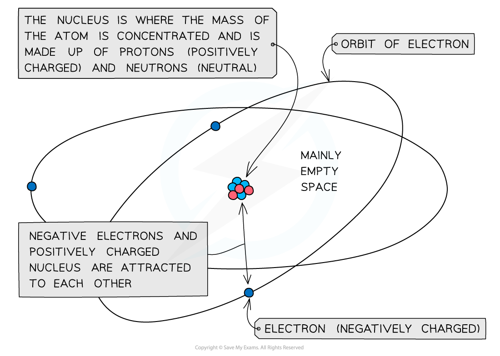
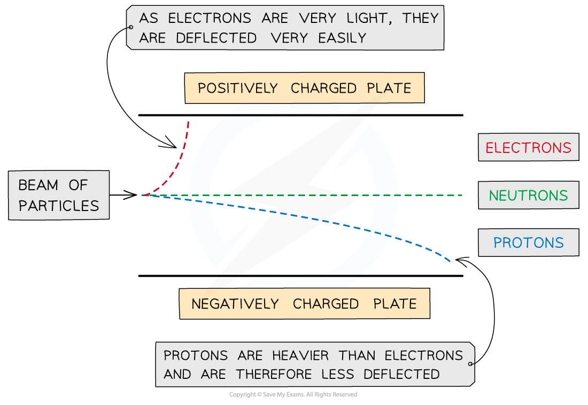

# Atomic Structure & Subatomic Particles

## Structure of the Atom

> **Spec point** — `spcpt_G6Szf8cjj4s8vS64`

## Structure of the Atom

- All matter is composed of **atoms**, which are the smallest parts of an element that can take place in **chemical reactions**
- Atoms are mostly made up of **empty** **space** around a very small, dense **nucleus** that contains **protons** and **neutrons**
- The nucleus has an overall **positive** **charge**

  - The protons have a positive charge and the neutrons have a neutral charge
- **Negatively** **charged** electrons are arranged in shells (also known as energy levels) that surround the nucleus

#### The structure of an atom

*Atoms contains protons, neutrons and electrons*

## Mass & Charge of Subatomic Particles

> **Spec point** — `spcpt_55MQgFXdfMQTbHBn`

## Mass & Charge of Subatomic Particles

- Atoms are made up of **protons**, **neutrons**, and **electrons**, collectively known as **subatomic particles**.

  - These particles are **very small**, so their **actual masses and charges** cannot be measured easily in standard units like grams or coulombs
  - Instead, chemists use **relative masses and relative charges**, comparing each particle to the others
  - These are not absolute values, but **scaled values** used for easier comparison.
  - **Protons and neutrons** have almost the same mass, so each is assigned a **relative mass of 1**
  - **Electrons** are about $\frac{1}{1836}$** the mass** of a proton or neutron, so their mass is considered **negligible** in most calculations
- The relative mass and charge of the subatomic particles are:

  - Proton
  
    - Relative charge: +1
    - Relative mass: 1
  - Neutron
  
    - Relative charge: 0
    - Relative mass: 1
  - Electron
  
    - Relative charge: -1
    - Relative mass: $\frac{1}{1836}$
- The **mass of an atom** is concentrated in the **nucleus**, which contains the heavier subatomic particles: **protons** and **neutrons**
- The **mass of an electron** is **negligible** in comparison
- The **nucleus is positively charged**, due to the presence of **protons**
- **Electrons orbit** the nucleus in energy levels, forming a **cloud of negative charge** around it
- The atom is held together by the **electrostatic attraction** between the **positively charged nucleus** and the **negatively charged electrons**

#### The distribution of mass in an atom

*The mass of the atom is concentrated in the positively charged nucleus which is attracted to the negatively charged electrons orbiting around it*

> **Exam Hint**
> - You can see from the table how the **relative** **mass** of an electron is **almost negligible**
> - The **charge** of a single **electron** is -1.602 x 10-19  coulombs, whereas the charge of a **proton** is +1.602 x 10-19  coulombs
> - So, relative to each other, their charges are -1 and +1 respectively

## Behaviour of Subatomic Particles in an Electric Field

> **Spec point** — `spcpt_vzpcy8Qmb5b3YQQR`

## Behaviour of Subatomic Particles in an Electric Field

- When **protons, neutrons, and electrons** travel at the **same velocity** through an electric field, they behave differently due to differences in **charge and mass**

  - A **beam of electrons** is deflected **strongly toward the positive plate**
  
    - This shows that **electrons are negatively charged**, since they are repelled by the negative plate and attracted to the positive one
    - The **large deflection** also indicates that electrons have a **very small mass**.

  - A **beam of protons** is deflected **slightly toward the negative plate**
  
    - This observation confirms that protons carry a **positive charge**, as they are attracted to the negative plate
    - The smaller deflection (compared to electrons) shows that **protons are much heavier**

  - A **beam of neutrons** passes through **without deflection**
  
    - This confirms that **neutrons are neutral**, they have **no charge** and are unaffected by the electric field

#### Subatomic particles passing through an electric field

*The lighter electrons undergo much more deflection than the protons*
