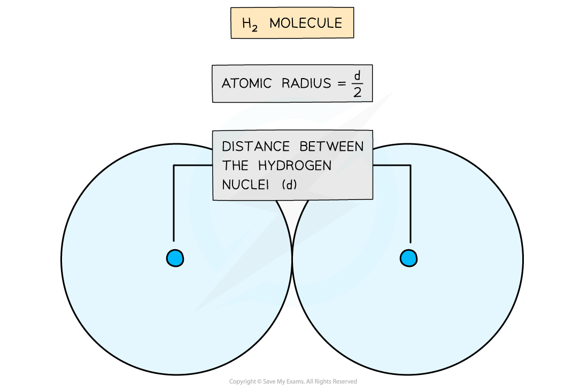
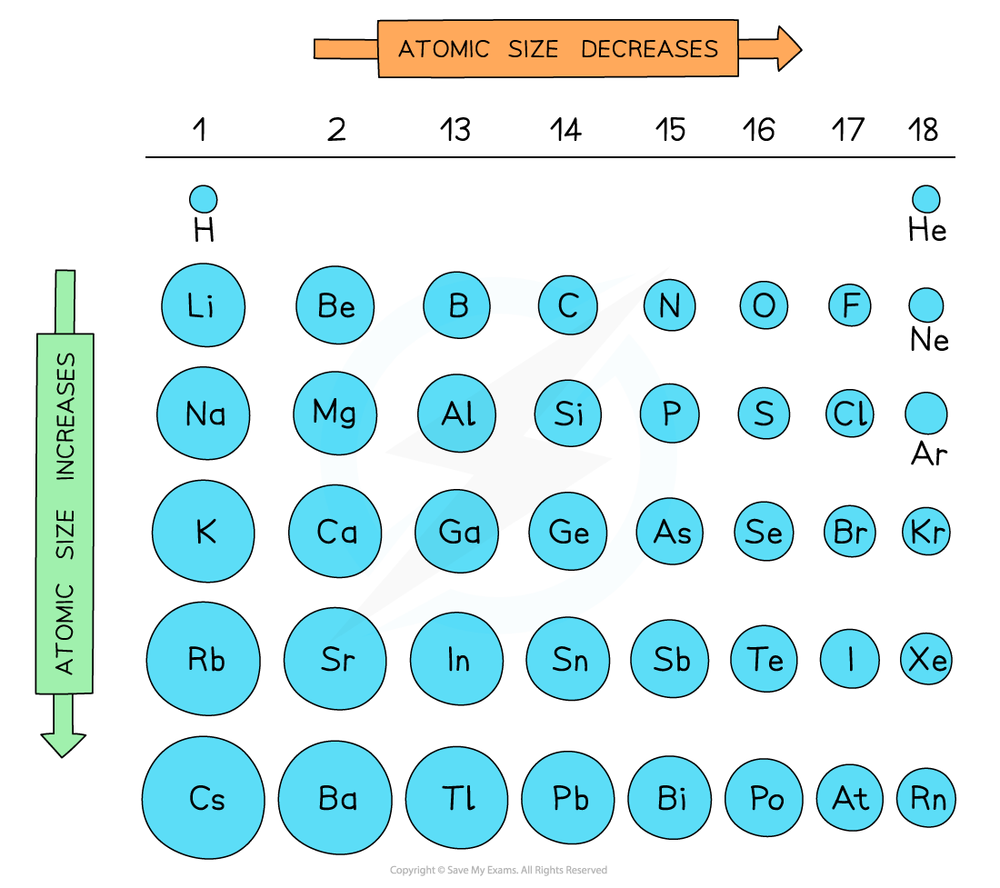
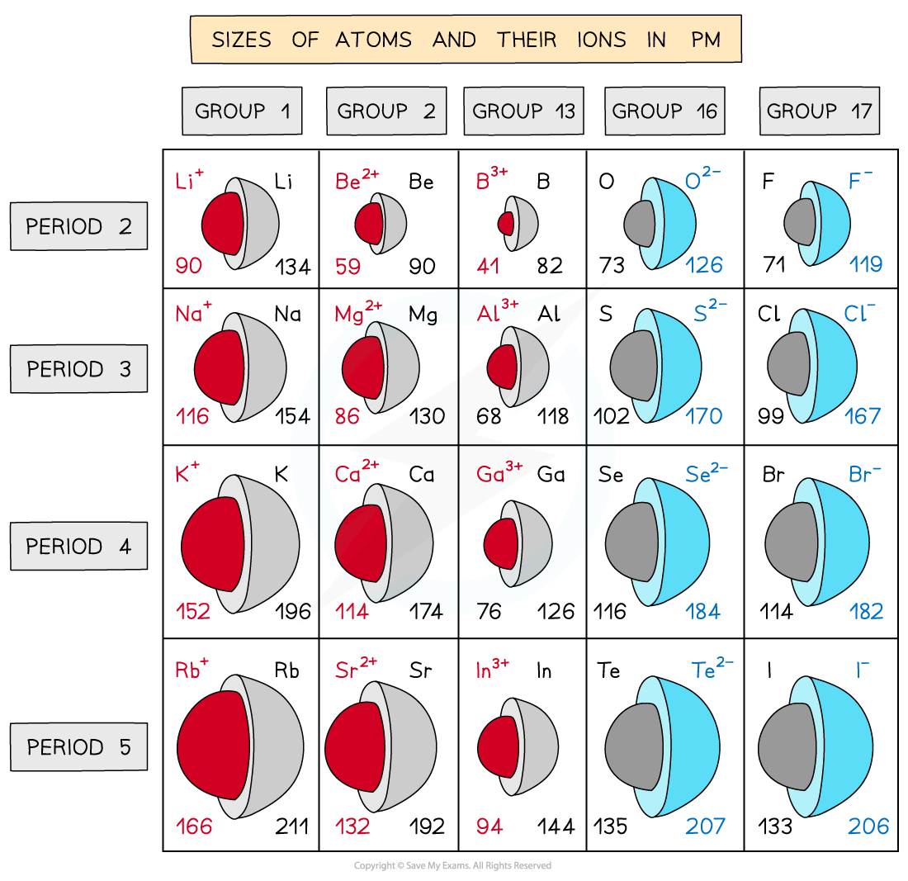

# Variations in Atomic & Ionic Radius

## Atomic & Ionic Radius

> **Spec point** — `spcpt_zb9mdZDfSD9sPHYQ`

## Atomic & Ionic Radius

### Atomic radius

- The **atomic** **radius** of an element is a measure of the size of an atom
- It is **half **the distance between the two **nuclei **of two covalently bonded atoms of the same type

#### Diagram showing the atomic radius of hydrogen

*The atomic radius of a hydrogen atom is determined by halving the distance between the nuclei of two hydrogen atoms covalently bonded*

- Atomic radii show predictable patterns across the Periodic Table

  - They generally **decrease** across each period
  - They generally **increase **down each group
- These trends can be explained by the **electron** **shell** **theory**

  - Atomic radii decrease as you move across a Period as the atomic number increases (increased positive **nuclear** **charge**) but at the same time extra electrons are added to the same **principal** **quantum** **shell**
  - The larger the nuclear charge, the greater the pull of the nuclei on the electrons
  
    - This results in **smaller **atoms
  - Atomic radii increase moving down a group as there is an increased number of shells going down the group
  - The electrons in the **inner** **shells** repel the electrons in the **outermost shells**, **shielding** them from the positive nuclear charge
  - This weakens the pull of the nuclei on the electrons, resulting in larger atoms

#### Summary of atomic radii

*Atomic radius increases down a group and decreases across a period*

- The diagram shows that the atomic radius increases sharply between the **noble** **gas** at the end of each period and the **alkali** **metal** at the beginning of the next period
- This is because the **alkali metals **at the beginning of the next period have **one **extra principal quantum shell

  - This increases shielding of the outermost electrons and therefore increases the atomic radius

### Ionic radius

- The **ionic** **radius** of an element is a measure of the size of an ion
- Ionic radii show predictable patterns

  - Ionic radii **increase** with increasing** negative charge**
  - Ionic radii **decrease **with increasing **positive charge**

#### Negative ions

- These trends can also be explained by the **electron** **shell** **theory**

  - Ions with **negative** charges are formed by atoms **accepting** extra electrons while the **nuclear** **charge** remains the same
  - The **outermost** electrons are further away from the positively charged nucleus and are therefore held only **weakly** to the nucleus which increases the ionic radius
  - The greater the negative charge, the larger the ionic radius

#### Positive ions

- **Positively **charged ions are formed by atoms **losing** electrons
- The **nuclear charge **remains the same but there are now fewer electrons which undergo a **greater electrostatic force of attraction** to the nucleus which decreases the ionic radius
- The greater the positive charge, the smaller the ionic radius

#### Summary of atom and ion sizes

*Trends in the ionic radii across a period and down a group*
