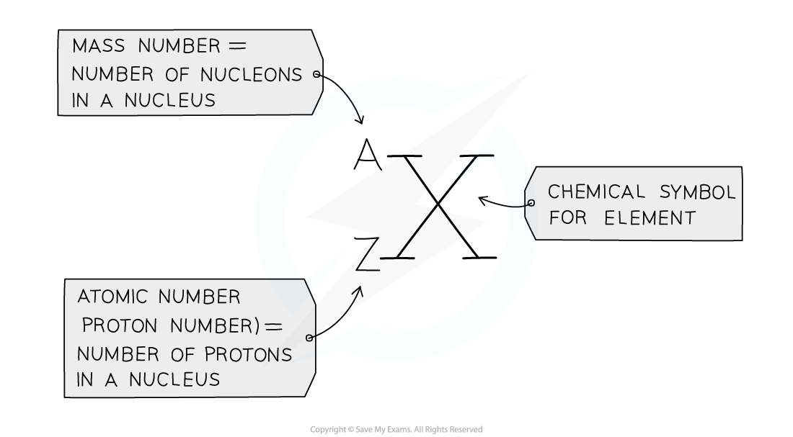
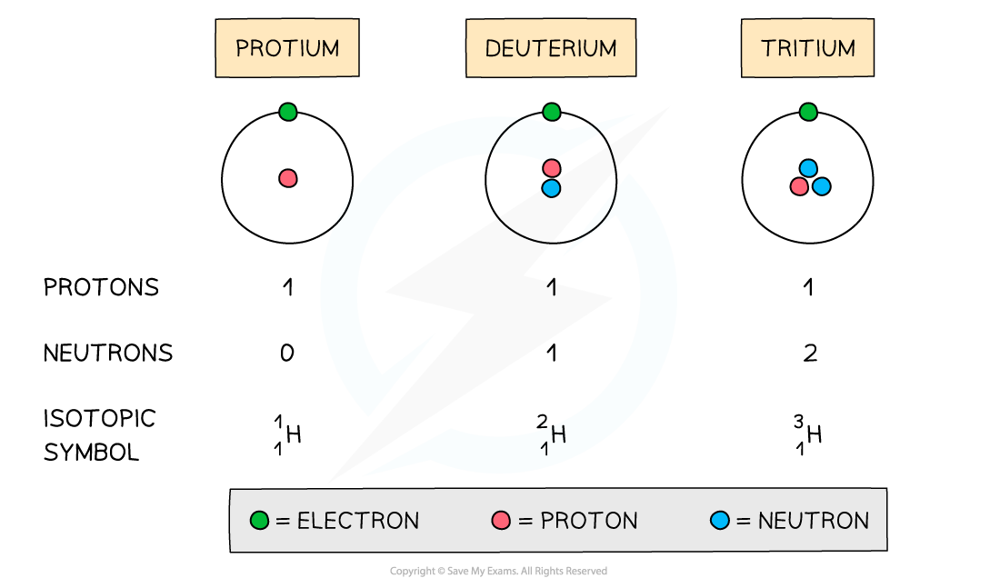

# Isotopes

## Defining Isotopes

> **Spec point** — `spcpt_wCq3cvHxBcjcPq9s`

## Defining Isotopes

- Isotopes are atoms of the **same** **element** that contain the same number of **protons** and electrons but a different number of **neutrons**
- The name of an isotope is the **chemical** **symbol** (or **word**) followed by a **dash** and then the **mass** **number**

  - E.g. carbon-12 and carbon-14 are isotopes of carbon containing 6 and 8 neutrons respectively
- The chemical symbol of an isotope will still be shown in the usual form, as shown:

#### A general chemical symbol

*Isotopes of the same element have the same chemical symbol with a different mass number*

- For chemical symbols, isotopes have:

  - The **same chemical symbol**
  
    - e.g. isotopes of chlorine all have the symbol Cl
  - The **same atomic number**
  
    - e.g. isotopes of chlorine all have an atomic number of 17
  - A **different mass / nucleon number**
  
    - e.g. the chlorine-35 isotope has a mass number of 35, while the chlorine-37 isotope has a mass number of 37

#### The atomic structure and symbols of three isotopes of hydrogen

*All three hydrogen isotopes have the chemical symbol H, the same number of protons but a different number of neutrons*

## Chemical & Physical Properties of Isotopes

> **Spec point** — `spcpt_wMmgX5bpCKqKvXws`

## Chemical & Physical Properties of Isotopes

- Isotopes have **similar chemical properties **but **different physical properties**

#### Chemical properties

- The **chemical behaviour** of an atom depends on its **electron configuration**, especially the **electrons in the outer (valence) shell**
- This is because all isotopes of the same element have the **same number of electrons and the same electron arrangement**, they:

  - Form the same types of bonds
  - React with the same elements
  - Show identical chemical reactivity

#### Physical properties

- Although isotopes have **identical chemical properties**, they differ in **physical properties** because they have **different numbers of neutrons**
- Neutrons add **mass** to the nucleus but carry **no charge** and don’t influence chemical bonding
- As a result, isotopes have:

  - Different relative atomic masses
  - Slight differences in density

> **Exam Hint**
> - These small differences in **physical** properties become important in processes like:
> 
>   - **Mass spectrometry** (detecting different isotopes by mass)
>   - **Isotope separation** (e.g. in nuclear chemistry)
>   - **Medical imaging** (radioisotopes rely on differences in physical properties)
