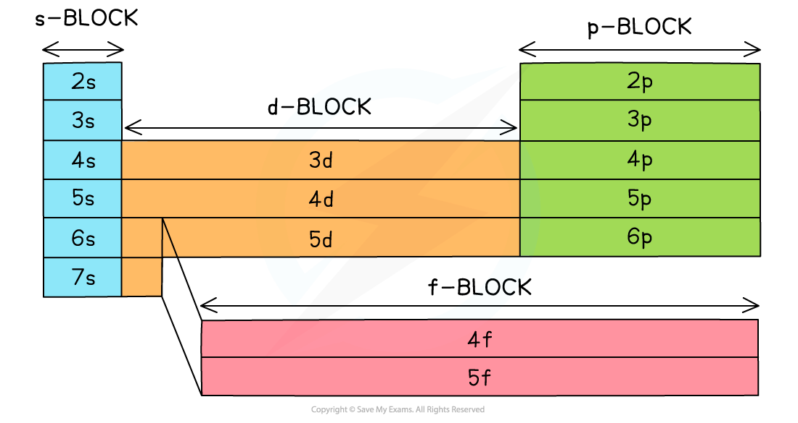

# Determining Electronic Configuration

## Determining Electronic Configurations

> **Spec point** — `spcpt_PCXmSVmcYjz89QXw`

## Determining Electronic Configurations

- Electron configuration shows how electrons are arranged in shells, subshells, and orbitals.
- There are two formats:

  - **Full configuration**; lists all electrons from 1s onward
  - **Shorthand configuration**; uses the symbol of the **nearest noble gas** in brackets to represent inner electrons (e.g. [Ar])
- **Ions** form when atoms **gain** or **lose** electrons:

  - **Anions** (negative) form by **adding** electrons to the outer shell
  - **Cations** (positive) form by **removing** electrons from the outer shell
- **Transition metals**:

  - Fill the **4s** before **3d** when neutral
  - **Lose electrons from 4s first**, not 3d, when forming ions
- In the Periodic Table the elements are grouped into blocks based on their **valence subshell**:

  - **s-block**: valence electrons in an s orbital
  - **p-block**: valence electrons in a p orbital
  - **d-block**: valence electrons in a d orbital
  - **f-block**: valence electrons in an f orbital

#### The blocks of the Periodic Table

*The elements can be divided into the s, p, d or f block, according to their outer shell electron configuration*

### Examples

- Electronic configuration of Fe

  - Atomic number = 26 so there are **26 electrons**
  - Full configuration: 1s2 2s2 2p6 3s2 3p6 4s2 3d6
  - Shorthand: [Ar] 4s2 3d6
- Electronic configuration of Fe2+

  - Atomic number = 26 so there are 26 electrons, but the Fe2+ ion only has** 24 electrons**
  - Electrons are removed from the **4s** orbital **before** the 3d
  - Full configuration: 1s2 2s2 2p6 3s2 3p6 3d6
  - Shorthand: [Ar] 3d6

### Exceptions to the Aufbau principle

- **Chromium** and **copper** have the following electron configurations:

  - Cr is [Ar] 3d5 4s1 **not** [Ar] 3d4 4s2
  - Cu is [Ar] 3d10 4s1 **not** [Ar] 3d9 4s2
- This is because the [Ar] 3d5 4s1 and [Ar] 3d10 4s1 configurations are **energetically favourable**
- By promoting an electron from 4s to 3d, these atoms achieve a half full or full d-subshell, respectively

> **Worked Example**
> - Write down the full and shorthand electron configuration of the following elements: **Answer:**
> 
>   1. Potassium
>   2. Calcium
>   3. Gallium
>   4. Ca2+
> 
>   - Potassium
>   
>     - Electrons: 19
>     - Full configuration: 1s2 2s2 2p6 3s2 3p6 4s¹
>     - Shorthand: [Ar] 4s¹
>     - Note: Argon (Ar) has 18 electrons and is the previous noble gas
>   - Calcium
>   
>     - Electrons: 20
>     - Full configuration: 1s2 2s2 2p63s2 3p6 4s2
>     - Shorthand: [Ar] 4s²
>     - Note: 4s is filled before 3d because it is lower in energy
>   - Gallium
>   
>     - Electrons: 31
>     - Full configuration: 1s2 2s2 2p6 3s2 3p6 3d10 4s2 4p1
>     - Shorthand: [Ar] 3d10 4s2 4p1
>     - Note: Includes filled 3d subshell after argon
>   - Calcium 2+ ion
>   
>     - Electrons: 18 (after losing two 4s electrons)
>     - Full configuration: 1s2 2s2 2p6 3s2 3p6
>     - Shorthand: [Ar]
>     - Note: Ca²⁺ has the same configuration as argon
