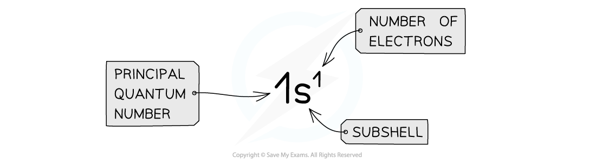
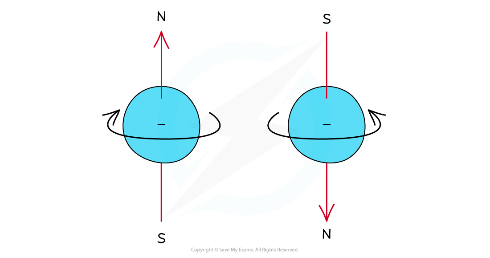
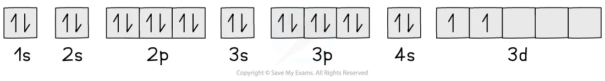
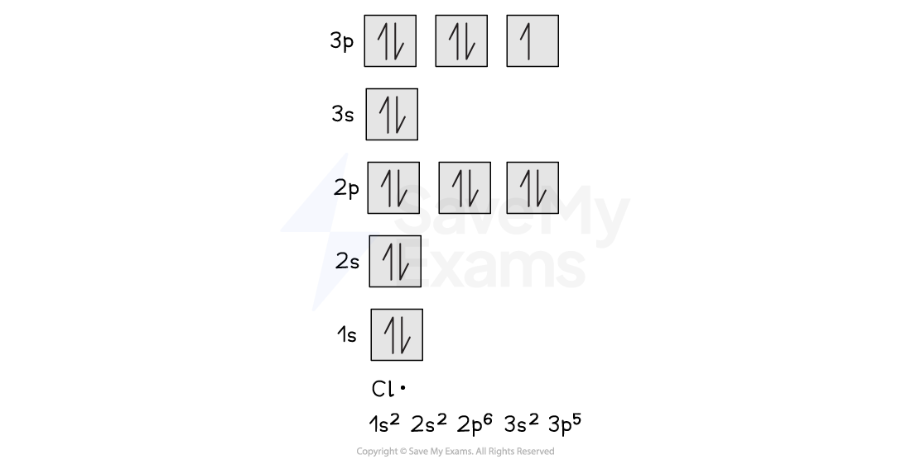

# Electronic Configuration

## Describing Electronic Configurations

> **Spec point** — `spcpt_RvMnd782dRsMs9yd`

## Describing Electronic Configurations

- The **electron configuration** gives information about the number of electrons in each **shell, sub-shell **and** orbital** of an atom
- The sub-shells are filled in order of increasing energy

#### Representing electronic configurations

*he electron configuration shows the number of electrons occupying a sub-shell in a specific shell*

## Explaining Electronic Configurations

> **Spec point** — `spcpt_Gnpf6FRNkztTrQVY`

## Explaining Electronic Configurations

- Electrons can be imagined as small **spinning charges** which rotate around their own axis in either a **clockwise **or **anticlockwise direction**

  - The spin of the electron is represented by its direction

#### Electron spin diagram

*Electrons can spin either in a clockwise or anticlockwise direction around their own axis*

- When two electrons occupy the same orbital, they must have opposite spins and experience a form of repulsion known as **spin-pair repulsion**
- Electrons will therefore occupy separate orbitals in the same sub-shell first, and with the same spin, to minimise repulsion

#### Electron configuration: three electrons in a p sub-shell

*When there are three electrons in a p sub-shell, one electron will go into each px, py and pz orbital*

- Electrons only pair when there are no more empty orbitals available within a sub-shell

  - When this happens, they adopt **opposite **spins to reduce repulsion

#### Electron configuration: four electrons in a p subshell

*The fourth electron in a p sub-shell pairs up with one of the electrons in a px, py or pz orbital*

- The principal quantum number indicates:

  - The energy level of a particular shell
  - The energy of the electrons in that shell
- For example:

  - A 2p electron is in the second shell
  - Therefore, it has an energy corresponding to *n *= 2
- Even though there is repulsion between negatively charged electrons (**inter-electrons repulsion**), they occupy the same region of space in orbitals
- This is because the energy required to jump to **successive **empty orbital is **greater **than the inter-electron repulsion
- For this reason, electrons pair up and occupy the lower energy levels first

## Electron Box Notation

> **Spec point** — `spcpt_2ppDy4sP8RmGYX97`

## Electron Box Notation

- The **electron configuration **can also be represented using the **electrons in boxes **notation
- Each box represents an **atomic orbital**
- The boxes are arranged in order of **increasing **energy from lowest to highest
- The electrons are represented by opposite arrows to show the **spin **of the electrons

  - E.g. the box notation for titanium is shown below
  - Note that since the 3d sub-shell cannot be either full or half full, the second 4s electron is not promoted to the 3d level and stays in the 4s orbital

#### Arrangement of electrons in titanium

*The electrons in titanium occupy the lowest energy levels first before filling those with higher energy*

### Free radicals

- A **free radical **is a species with one or more **unpaired electron**
- The unpaired electron in the free radical is shown as a **dot**

  - E.g. a chlorine free radical has the electron configuration 1s22s22p63s23p5
  - Two of the three p orbitals have paired electrons whereas one of them has an unpaired electron

#### Arrangement of electrons in a chlorine radical

*One of the p orbitals has unpaired electrons in a chlorine radical*

> **Exam Hint**
> Free radicals are formed when a molecule undergoes **homolytic fission **where the two electrons of a covalent bond are split evenly between the two atoms.
