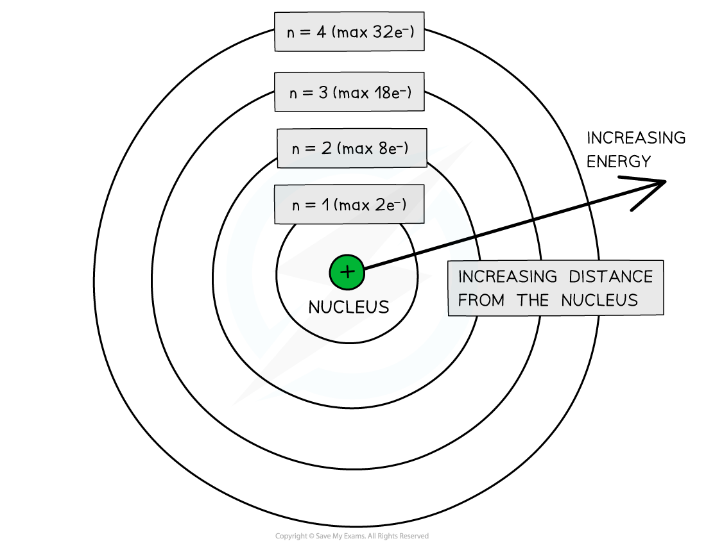
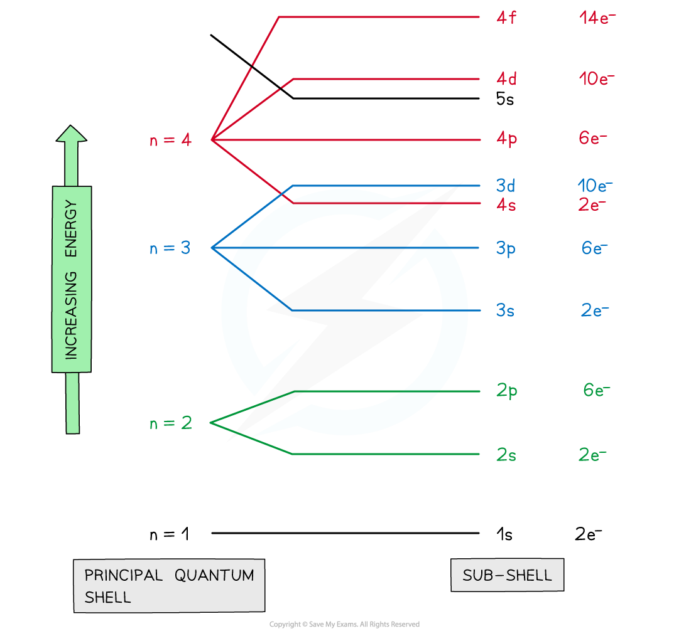
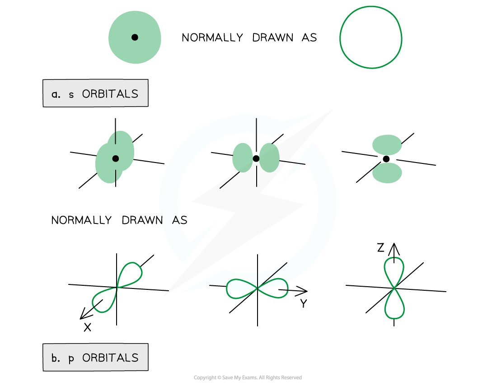
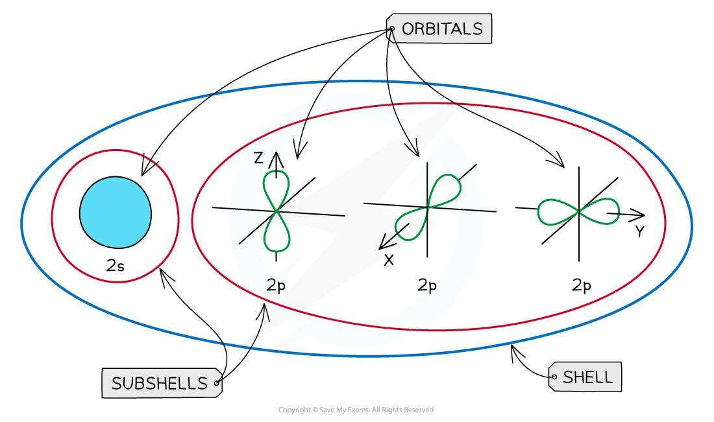
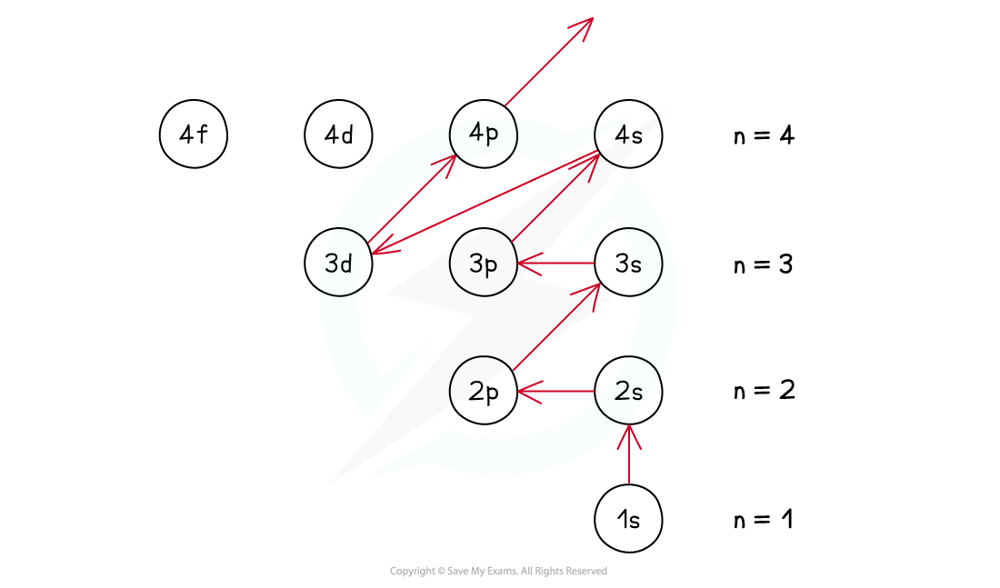

# Electronic Structure

## Basic Electronic Structure

> **Spec point** — `spcpt_z2rXCjQxxfBQW8d3`

## Basic Electronic Structure

### Shells

- The arrangement of electrons in an atom is called the **electronic** **configuration**
- Electrons are arranged around the nucleus in **principal energy levels **or **principal quantum shells**
- **Principal quantum numbers **(**n**) are used to number the energy levels or quantum shells

  - The **lower **the principal quantum number, the closer the shell is to the nucleus
  - The **higher **the principal quantum number, the higher the energy of the shell
- Each principal quantum number has a **fixed **number of electrons it can hold

  - n = 1 : up to 2 electrons
  - n = 2 : up to 8 electrons
  - n = 3 : up to 18 electrons
  - n = 4 : up to 32 electrons

#### Principal quantum shells

*Electrons are arranged in principal quantum shells, which are numbered by principal quantum numbers*

### Sub-shells

- The principal quantum shells are split into **sub-shells **which are given the letters **s**, **p** and **d**

  - Elements with more than 57 electrons also have an **f** shell
  - The energy of the electrons in the sub-shells increases in the order s < p < d
- The order of sub-shells appear to overlap for the higher principal quantum shells as seen in the diagram below:

#### Energy levels of the quantum shells

*At principal quantum shell n = 3, the energy levels of the sub-shells start to overlap*

### Orbitals

- Sub-shells contain one or more **atomic orbitals**
- Orbitals exist at **specific** energy levels and electrons can only be found at these specific levels, **not** in between them

  - Each atomic orbital can be occupied by a maximum of two electrons
- This means that the number of orbitals in each sub-shell is as follows:

  - **s** : one orbital (1 x 2 = total of 2 electrons)
  - **p** : three orbitals ( 3 x 2 = total of 6 electrons)
  - **d** : five orbitals (5 x 2 = total of 10 electrons)
  - **f** : seven orbitals (7 x 2 = total of 14 electrons)
- The orbitals have specific 3-D shapes

#### Shapes of the electron orbitals

*Representation of orbitals (the dot represents the nucleus of the atom) showing (a) spherical s orbitals and (b) p orbitals containing ‘lobes’ along the x, y and z axis*

> **Exam Hint**
> Note that the shape of the d orbitals is **not** required at AS Level

#### An overview of the shells, sub-shells and orbitals in an atom

*s and p orbitals have different shapes*

### Ground state

- The **ground state **is the **most stable electronic configuration **of an atom which has the **lowest amount of energy**
- This is achieved by filling the sub-shells with the lowest energy first (1s)
- The order of the sub-shells in terms of increasing energy does **not **follow a regular pattern at n = 3 and higher

#### Summary of filling sub-shells

*The ground state of an atom is achieved by filling the lowest energy sub-shells first*
