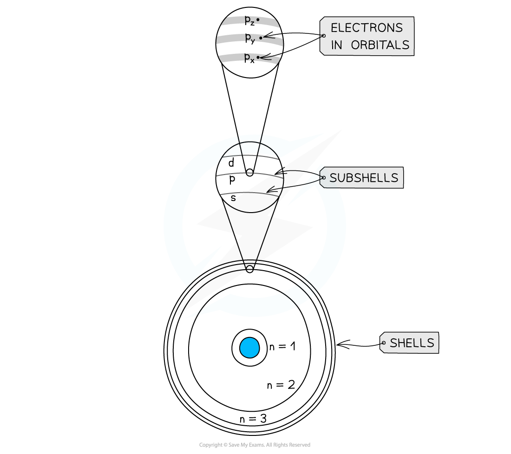
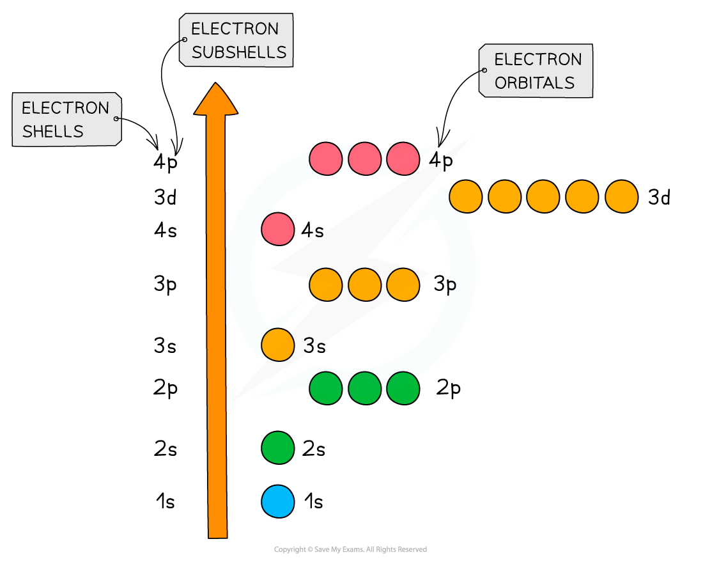
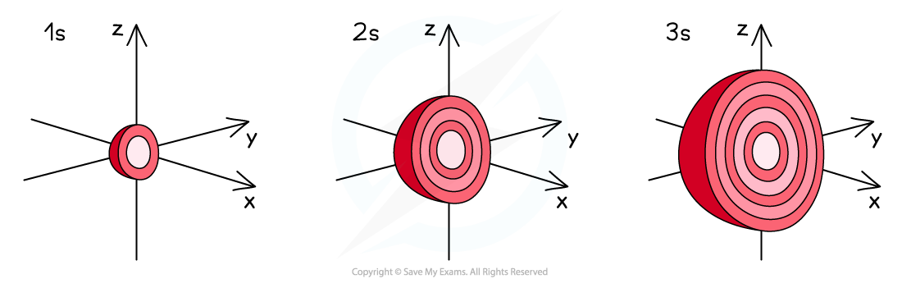
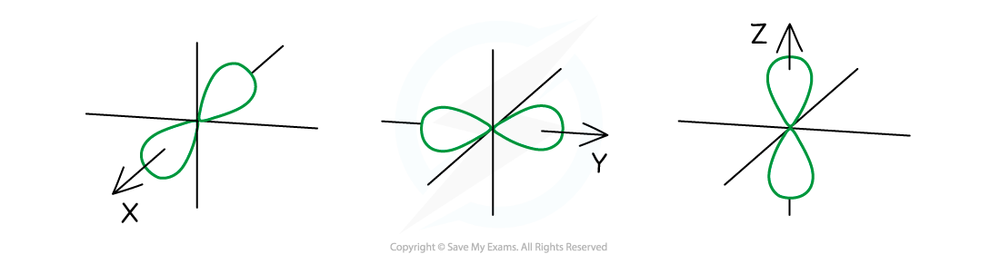

# Sub-shells & Orbitals

## Electron Orbitals & Sub-shells

> **Spec point** — `spcpt_y2WBtQ8CHYb4CPW3`

## Electron Orbitals & Sub-shells

- Each shell can be divided further into **subshells, labelled s, p, d and f**
- Each subshell can hold a specific number of orbitals:

  - s subshell : 1 orbital
  - p subshell : 3 orbitals labelled px, py and pz
  - d subshell : 5 orbitals
  - f subshell : 7 orbitals
- Each orbital can hold a maximum number of 2 electrons so the maximum number of electrons in each subshell are as follows:

  - s : 1 x 2 = total of 2 electrons
  - p : 3 x 2 = total of 6 electrons
  - d : 5 x 2 = total of 10 electrons
  - f : 7 x 2 = total of 14 electrons
- In the ground state, orbitals in the same subshell have the same energy and are said to be degenerate, so the energy of a px orbital is the same as a py orbital

#### Detailed summary of electron shells

*Shells are divided into subshells which are further divided into orbitals*

#### Summary of the arrangement of electrons in atoms

| **Principal quantum number, n (shell)** | **Sub-shells possible** **(s, p, d, f)** | **Orbitals per sub-shell** | **Orbitals per principal quantum number** | **Electrons per sub-shells** | **Electrons per shell** |
|---|---|---|---|---|---|
| 1 | s | 1 | 1 | 2 | 2 |
| 2 | s | 1 | 4 | 2 | 8 |
| p | 3 | 6 |   |   |   |
| 3 | s | 1 | 9 | 2 | 18 |
| p | 3 | 6 |   |   |   |
| d | 5 | 10 |   |   |   |
| 4 | s | 1 | 16 | 2 | 32 |
| p | 3 | 6 |   |   |   |
| d | 5 | 10 |   |   |   |
| f | 7 | 14 |   |   |   |

## Energy of the Sub-shells

> **Spec point** — `spcpt_6dxKVxTJt2jjxKg9`

## Energy of the Sub-shells

- The **principal quantum shells **increase in energy with increasing **principal quantum number**

  - E.g. *n* = 4 is higher in energy than *n* = 2
- The **sub-shells **increase in energy as follows: s ＜ p ＜ d ＜ f

  - The only exception to these rules is the 3d orbital which has slightly higher energy than the 4s orbital
  - Because of this, the 4s orbital is filled before the 3d orbital
- All the orbitals in the **same **sub-shell have the same energy and are said to be **degenerate**

  - E.g. px, py and pz are all equal in energy

#### Relative energies of the shells and sub-shells

*The 4s orbital is lower in energy than the 3d orbital*

## Shape of s & p Orbitals

> **Spec point** — `spcpt_Zt25mTwwxK5GP3RX`

## Shape of s & p Orbitals

### s orbitals

- The s orbitals are **spherical **in shape
- The **size **of the s orbitals increases with increasing shell number

  - E.g. the s orbital of the **third **quantum shell (n = 3) is bigger than the s orbital of the **first **quantum shell (n = 1)

#### s orbital diagram

*The s orbitals become larger with increasing principal quantum number*

### p orbitals

- The p orbitals are **dumbbell-shaped**
- Every shell has three p orbitals except for the first one (*n* = 1)
- The p orbitals occupy the x, y and z-axis and point at right angles to each other so are oriented **perpendicular** to one another
- The lobes of the p orbitals become **larger** and **longer** with increasing shell number

#### p orbital diagram

*The p orbitals become larger and longer with increasing principal quantum number*
