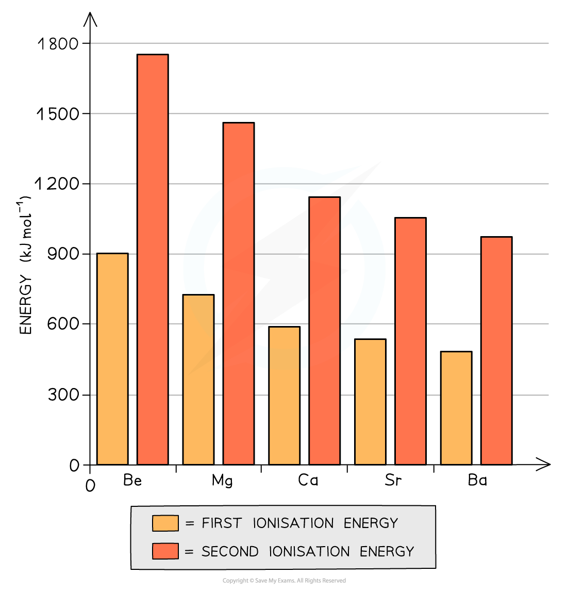
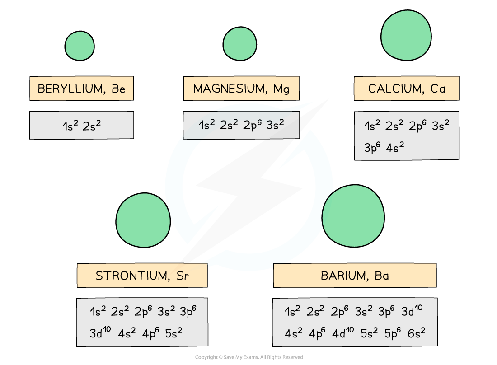

# Physical & Chemical Trends in Group 2

## Physical & Chemical Trends in Group 2

> **Spec point** — `spcpt_PDpsg9sZvq5fb2rC`

## Physical & Chemical Trends in Group 2

### Chemical trends

- All elements in Group 2 (also called **alkali earth metals)** have the two electrons in their **outermost principal quantum shell**
- All Group 2 metals can form **ionic** **compounds** in which they donate these **two outermost electrons **(so they act as **reducing agents) **to become an ion with +2 charge (so they themselves become **oxidised)**
- Going down the group, the metals become more **reactive**
- This can be explained by looking at the Group 2 ionisation energies:

#### Graph of the first and second ionisation energies of the Group 2 elements

*The graph shows that both the first and second ionisation energies decrease going down the table*

- The **first ionisation energy **is the energy needed to remove the first outer electron of an atom
- The **second ionisation energy** is the energy needed to remove the second outer electron of an atom
- The graph above shows that going down the group, it becomes easier to remove the outer two electrons of the metals
- Though the **nuclear charge **on the nucleus increases going down the group (because there are more protons);

  - Factors such as an **increased shielding effect **and a **larger distance **between the outermost electrons and the nucleus outweigh the attraction of the higher nuclear charge
- The elements become more reactive going down the group as it gets easier for the atoms to lose two electrons and become 2+ ions
- This trend is shown by looking at the reactions of the Group 2 metals:

  - With dilute hydrochloric acid;
  
    - **Bubbles** of **hydrogen gas** are given off much faster indicating that the reactions become more vigorous
  - With oxygen;
  
    - The metals get more reactive with oxygen down the group (Ba is so reactive, that it must be stored in oil to prevent it from reacting with oxygen in air)

### Physical trends

- Going down the group, the elements become larger as the outer two electrons occupy a new **principal quantum shell **which is further away from the nucleus

#### The atomic radius of the Group 2 elements

*The atomic radius of the Group 2 elements increases going down the group due to the addition of an extra principal quantum shell*

#### Graph of the atomic radius descending Group 2

*The graph shows an increase in atomic radius going down the group*

- The **melting point **of the elements decreases going down the group as the outer electrons get further away from the nucleus
- This means that the **attraction** between the **nucleus** and the **bonding** **electrons** decreases causing a decrease in melting point

#### Graph of the melting points descending Group 2

*The graph shows a general decrease in melting point going down the group*

- As you go down the group, the **density **of the alkali earth metals increases

#### Graph of the density descending Group 2

*The graph shows an overall increase in density going down the group*

> **Worked Example**
> **Predicting properties of radium**
> 
> Radium, Ra, is a radioactive element found below barium, at the bottom of Group 2.
> 
> Applying your knowledge of the Group 2 elements, predict:
> 
> 1. The formula of the ion formed by radium.
> 2. The formula radium's oxide and hydroxide.
> 3. The first ionisation energy of radium.
> 4. The reactivity of radium compared to barium.
> 5. The relative pH of a saturated radium hydroxide solution compared with a saturated calcium hydroxide solution.
> 6. The solubility of radium sulfate compared with strontium sulfate.
> 7. The equation for the reaction of solid radium oxide with dilute hydrochloric acid.
> 8. What you would expect to see if you mixed radium hydroxide solution with dilute sulfuric acid.
> 
> **Answer**
> 
> - **Answer 1:**
> 
>   - Since Ra is in Group 2, it will form an ion with a +2 charge to give Ra2+
> - **Answer 2:**
> 
>   - The Group 2 oxides and hydroxides have the general formula XO and X(OH)2 respectively, where X is the Group 2 element
>   - Therefore, radium oxide is RaO and radium hydroxide is Ra(OH)2
> - **Answer 3:**
> 
>   - Radium is below barium, so its atomic radius is larger than the atomic radius of barium.
>   - This means that radium’s outermost electrons are even further away and are therefore even more easily removed than barium’s outermost electron pair.
>   - The first ionisation energy is between 450 - 480 kJ mol-1
> - **Answer 4:**
> 
>   - Radium’s outermost electrons are even further away than in barium and are therefore more easily removed, making radium more reactive than barium
> - **Answer 5:**
> 
>   - The Group 2 hydroxides become more soluble going down the group
>   - Radium hydroxide will therefore be more soluble than calcium hydroxide
> - **Answer 6:**
> 
>   - The Group 2 sulfates become less soluble going down the group
>   - Radium sulfate will therefore be less soluble than strontium sulfate
> - **Answer 7:**
> 
>   - The general equation for the reaction of Group 2 oxides with dilute hydrochloric acid is:
> 
> **XO (s) + 2HCl (aq) → XCl****2 ****(aq) + H****2****O (l)**
> 
> - where X is the Group 2 element
> 
>   - The reaction of radium oxide with dilute hydrochloric acid is therefore:
> 
> **RaO (s) + 2HCl (aq) → RaCl****2 ****(aq) + H****2****O (l)**
> 
> - **Answer 8:**
> 
>   - Radium sulfate will be formed in this reaction
>   - However, the solubility of Group 2 sulfates decreases going down the group
>   - Therefore, a white precipitate of radium sulfate will be formed in this reaction
