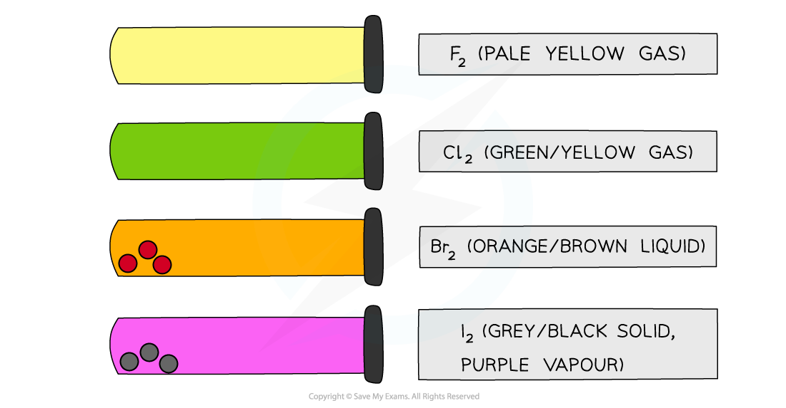
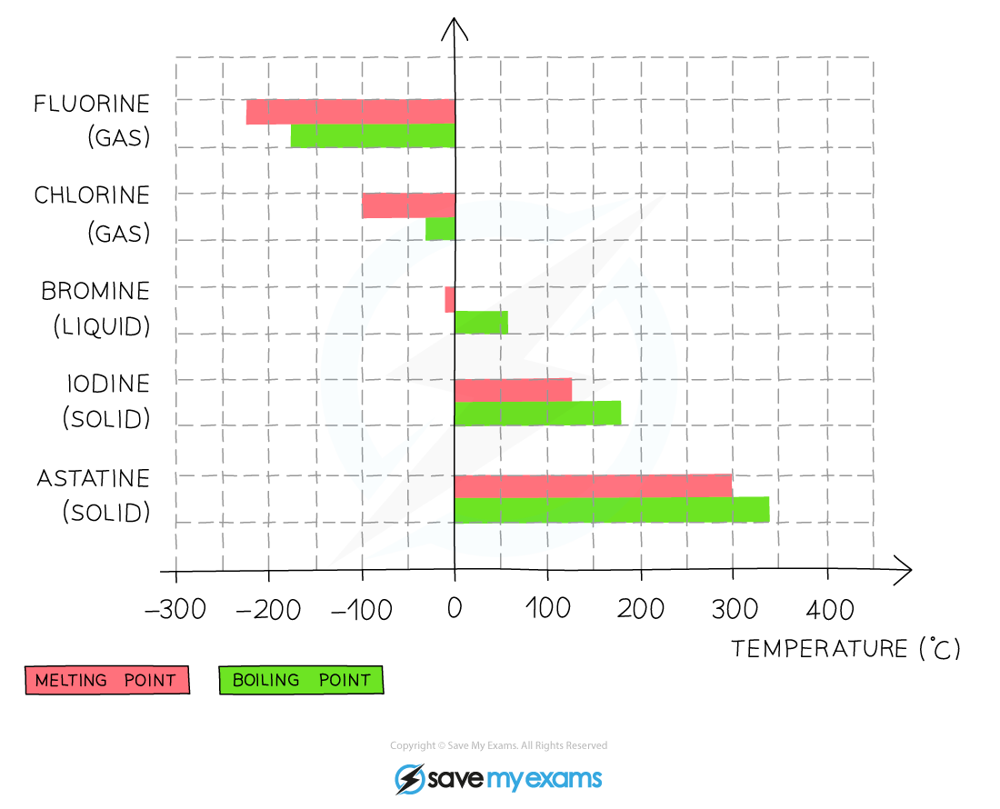
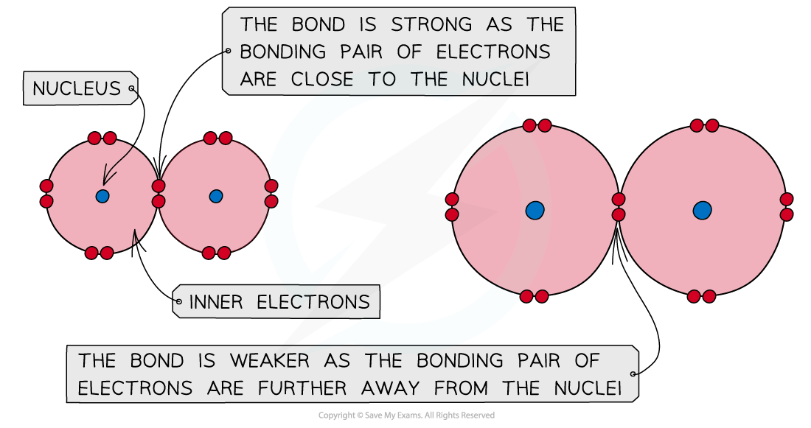
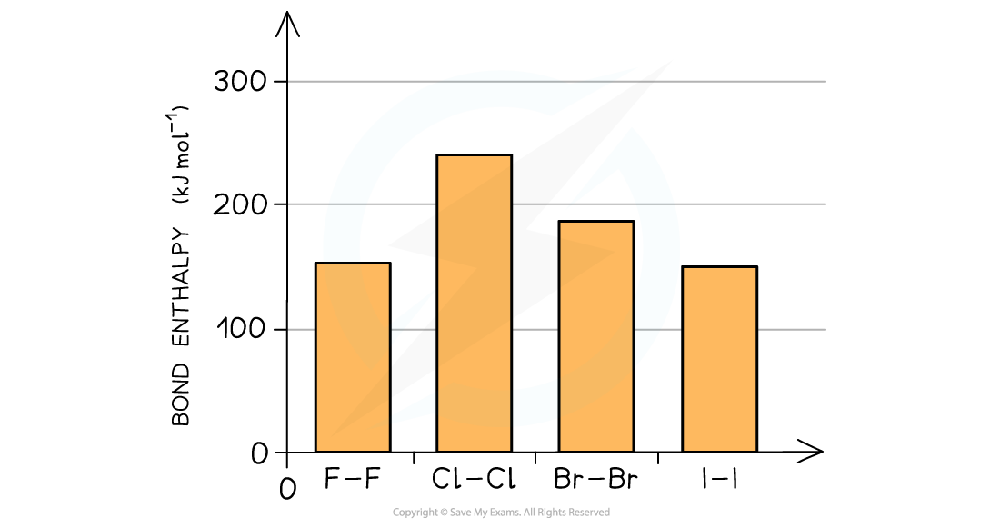
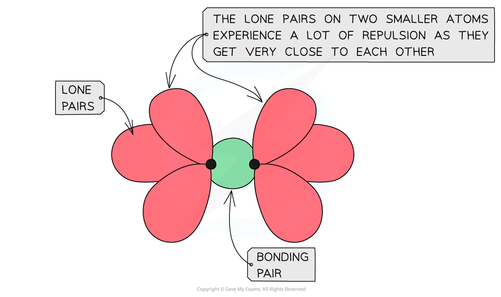
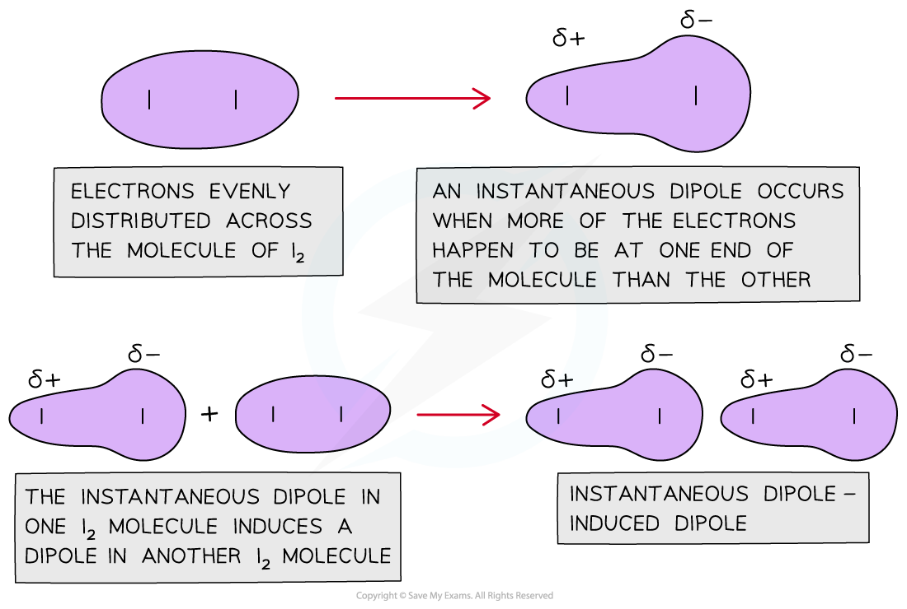
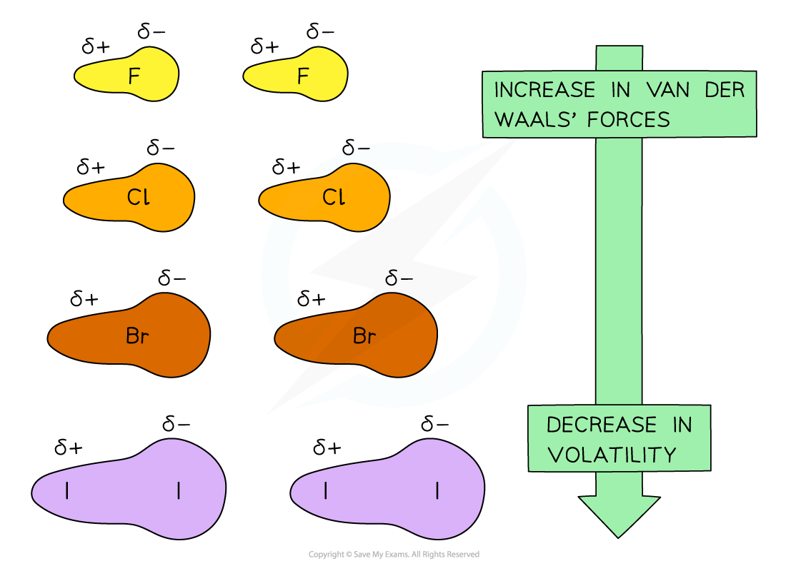

# Physical Properties of the Group 17 Elements

## Physical Trends in Group 17

> **Spec point** — `spcpt_8bVPpTcNgrh9KmWr`

## Physical Trends in Group 17

- The Group 17 elements are called **halogens**
- The halogens have uses in water purification as bleaching agents (chlorine), as flame-retardants and fire extinguishers (bromine) and as antiseptic and disinfectant agents (iodine)

### Colours

- All halogens have distinct **colours **which get **darker **going down the group

#### The colours and states of the Group 17 elements

*The colours of the Group 17 elements get darker going down the group*

### Volatility

- **Volatility **refers to how easily a substance can evaporate

  - A volatile substance will have a low melting and boiling point

#### Melting & boiling points of the Group 17 elements

*The melting & boiling points of the Group 17 elements increase going down the group which indicates that the elements become less volatile*

- *** ***Going down the group, the **boiling point **of the elements increases which means that the **volatility **of the halogens decreases

  - This means that fluorine is the most volatile and iodine the least volatile

## Trends in Bond Strength of Group 17

> **Spec point** — `spcpt_QRKPgfwMmHynwqkw`

## Trends in Bond Strength of Group 17

- Halogens are **diatomic **molecules in which **covalent bonds **are formed by overlapping their orbitals
- In a covalent bond, the **bonding pair **of electrons is attracted to the nuclei on either side and it is this attraction that holds the molecule together
- Going down the group, the atomic size of the halogens **increases**
- The bonding pair of electrons get further away from the halogen nucleus and are therefore less strongly attracted towards in

#### Covalent bonding in Group 17 elements

*A covalent bond is formed by the orbital overlap of two atoms and the attraction of electrons towards the nuclei; the bigger the atom, the weaker the covalent bond*

- The bond strength of the halogen molecules therefore decreases going down the group

#### Group 17 bond enthalpies

*The bond enthalpies decrease indicating that the bond strengths decrease going down the group*

- Bond enthalpy is the heat needed to break one mole of a covalent bond
- The higher the bond enthalpy, the stronger the bond
- An exception to this is **fluorine** which has a smaller bond enthalpy than chlorine and bromine
- Fluorine is so small that when two atoms of fluorine get together their **lone** **pairs** get so close that they cause significant **repulsion** counteracting the attracting between the bonding pair of electrons and two nuclei

#### Lone pair repulsion in fluorine

*The lone pairs of fluorine get so close to each other in a fluorine molecule that they cause repulsion which decreases the bond strength*

## Dipole Forces & Volatility in Group 17

> **Spec point** — `spcpt_5vBTSkW5VhKcbxN7`

## Dipole Forces & Volatility in Group 17

- Halogens are non-metals and are **diatomic molecules **at room temperature

  - This means that they exist as molecules which are made up of two similar atoms, such as F2
- The halogens are **simple molecular structures **with **weak **van der Waals’ forces between the diatomic molecules caused by instantaneous dipole-induced dipole forces

#### Electron distribution in a nonpolar molecule

*The diagram shows that a sudden distribution of electrons in a nonpolar molecule can cause an instantaneous dipole. When this molecule gets close to another non-polar molecule it can induce a dipole as the cloud of electrons repel the electrons in the neighbouring molecule to the other side*

- The more **electrons **there are in a molecule, the greater the instantaneous dipole-induced dipole forces
- Therefore, the **larger **the molecule the **stronger **the van der Waals’ forces between molecules
- This is why as you go down the group, it gets more difficult to separate the molecules and the **melting **and **boiling points **increase
- As it gets more difficult to separate the molecules, the **volatility **of the halogens **decreases **going down the group

#### Van der Waals' forces and volatility in Group 17

*Going down the group, the van der Waals’ forces increase due to an increased number of electrons in the molecules which means that the volatility decreases*

> **Exam Hint**
> Instantaneous induced – induced dipole forces are a type of van der Waals’ forces.
