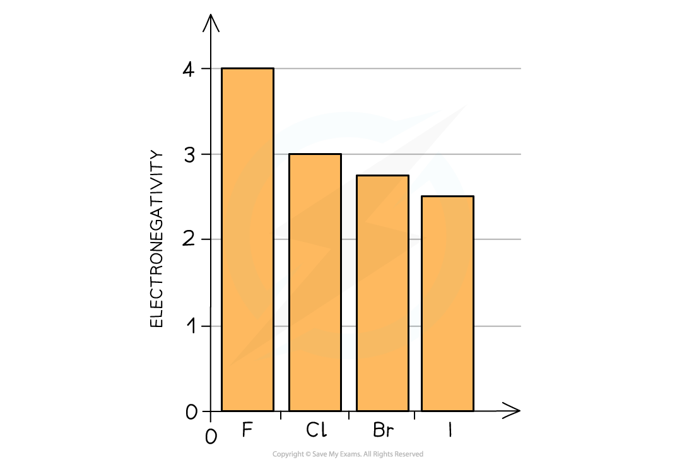
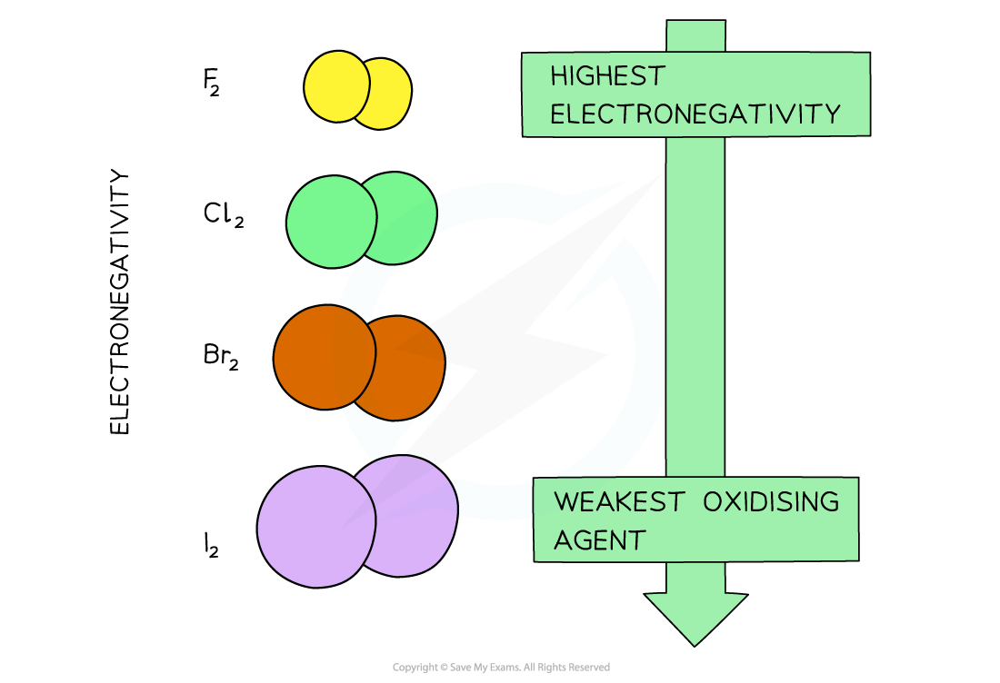
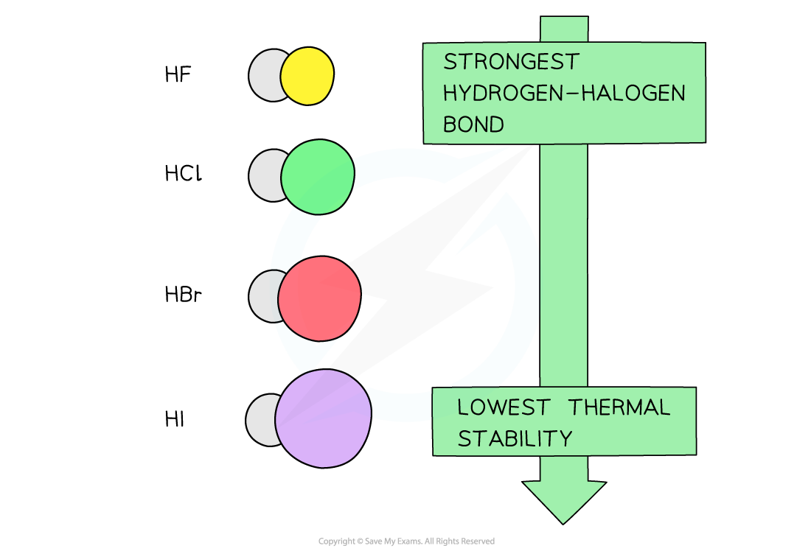

# Chemical Properties of the Halogens & Hydrogen Halides

## Group 17: Oxidising Agents

> **Spec point** — `spcpt_gfsbYJqyKjjnKfcj`

## Group 17: Oxidising Agents

- Halogens react with metals by accepting an electron from the metal atom to become an ion with 1- charge, e.g.

**Ca (s) + Cl****2 ****(g) → Ca****2+ ****(Cl****-****)****2 ****(s)**

- Halogens are therefore **oxidising agents**:

  - Halogens **oxidise** the metal by removing an electron from the metal (the oxidation number of the metal increases)
  - Halogens become **reduced** as they gain an extra electron from the metal atom (the oxidation number of the halogen decreases)
- The **oxidising power** of the halogens **decreases **going **down the group** (the halogens get less reactive)
- This can be explained by looking at their electronegativities:

#### Graph of Halogen electronegativity

*The electronegativity of the halogens decreases going down the group*

- The **electronegativity** of an atom refers to how strongly it attracts electrons towards itself in a covalent bond
- The decrease in electronegativity is linked to the size of the halogens
- Going down the group, the atomic radii of the elements increase which means that the outer shells get further away from the nucleus
- An ‘incoming’ electron will therefore experience more **shielding** from the attraction of the positive nuclear charge
- The halogens’ ability to accept an electron (their **oxidising power**) therefore decreases going down the group

#### Trend in halogen electronegativity

*With increasing atomic size of the halogens (going down the group) their electronegativity, and therefore oxidising power, decreases*

- The reactivity of halogens is also shown by their **displacement** **reactions** with other halide ions in solutions
- A **more** **reactive **halogen can displace a **less reactive **halogen from a halide solution of the less reactive halogen

  - E.g. The addition of chlorine water to a solution of bromine water:

**Cl****2 ****(aq) + 2NaBr (aq) → 2NaCl (aq) + Br****2 ****(aq)**

- The chlorine has displaced the bromine from the solution as it is more reactive which can be summarised in the following ionic equation:

**Cl****2 ****(aq) + 2Br****– ****(aq) → 2Cl****– ****(aq) + Br****2 ****(aq)**

## Group 17: Reaction with Hydrogen

> **Spec point** — `spcpt_XshHNTPKvbZCSWWD`

## Group 17: Reaction with Hydrogen

- Halogens react with hydrogen gas to form **hydrogen halides**
- Due to the decrease in reactivity of the halogens going down the group, the reactions between halogen and hydrogen gas become less vigorous
- The table below shows a summary of the reaction between halogen and hydrogen gas

#### Reaction between halogen & hydrogen gas

- H2 (g) + F2 (g) → 2HF (g)

  - Reacts explosively, even in cool / dark conditions
- H2 (g) + Cl2 (g) → 2HCl (g)

  - Reacts explosively in sunlight
- H2 (g) + Br2 (g) → 2HBr (g)

  - Reacts slowly on heating
- H2 (g) + I2 (g) $\rightleftharpoons$ 2HI (g)

  - Forms an equilibrium mixture on heating

## Thermal Stability of the Hydrogen Halides

> **Spec point** — `spcpt_hM52r8ppXrSnHVBk`

## Thermal Stability of the Hydrogen Halides

- **Thermal stability **refers to how well a substance can resist breaking down when heated

  - A substance that is thermally stable will break down at high temperatures
- The hydrogen halides formed from the reaction of halogen and hydrogen gas decrease in **thermal** **stability** going down the group
- The decrease in thermal stability can be explained by looking at the bond energies of the hydrogen-halogen bond

  - Going down the group, the atomic radius of the halogens increases
  - The overlap of its outer shell with a hydrogen atom therefore gives a longer bond length
  - The longer the bond, the weaker it is, and the less energy required to break it
- As the bonds get weaker, the hydrogen halogens become less stable to heat going down the group

#### Trend in thermal stability of the hydrogen halides

*The thermal stability of the hydrogen halide decreases going down the group as their bonds become weaker due to the increased atomic radius of the halogens*
