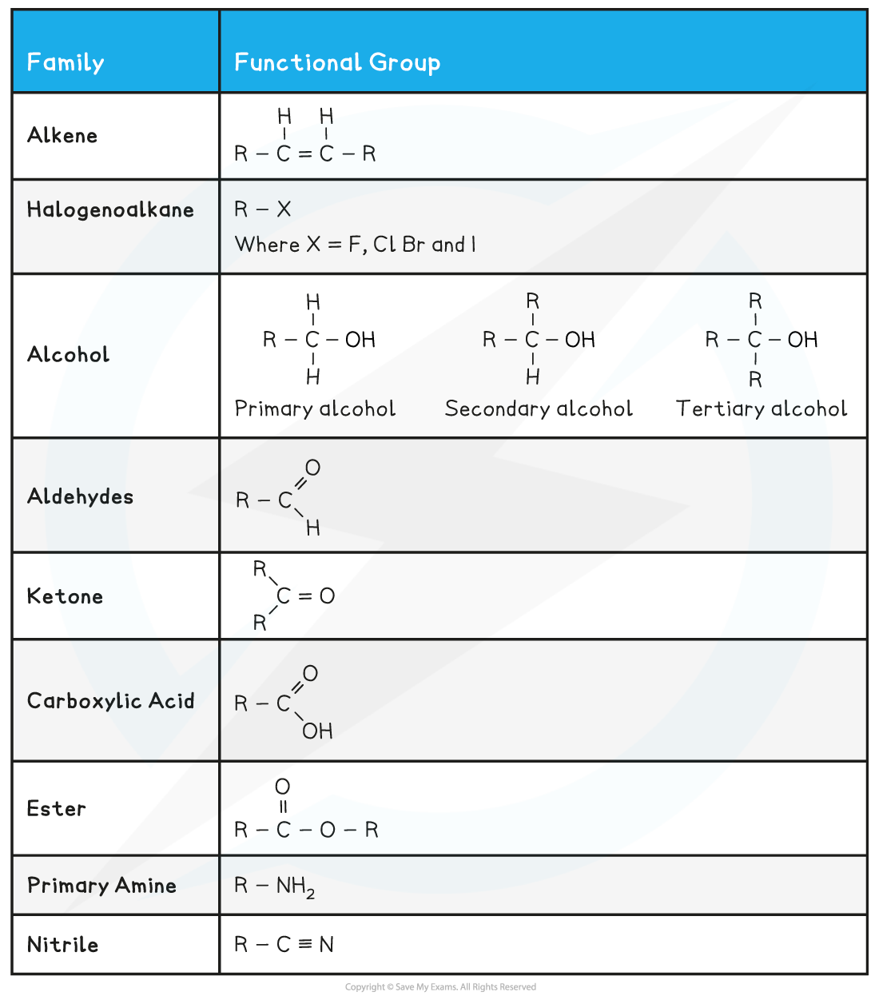
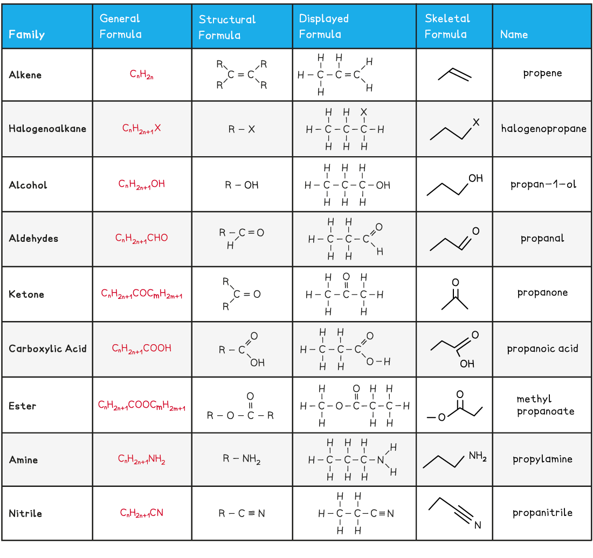

# Functional Groups & their Formulae

## Functional Groups of Organic Compounds

> **Spec point** — `spcpt_fcDYWx3VbRymtyBX`

## Functional Groups of Organic Compounds

- Functional groups determine the physical and chemical properties of molecules
- The table below shows a summary of common functional groups found in compounds
- R is any other atom or group of atoms (except for hydrogen)

#### Functional groups found in compounds table

## Formulae of Organic Compounds

> **Spec point** — `spcpt_k7Xhrz8Mdj3G3s46`

## Formulae of Organic Compounds

- The **general formula **is a formula that represents a **homologous series** of compounds using letters and numbers

  - Eg. the general formula of alkanes is CnH2n+2
  - A homologous series is a group of organic compounds that have the same functional group, the same general formula and the same chemical properties
- The **structural formula **is a formula that shows how the atoms are bonded to each carbon atom in a molecule
- The **displayed formula **is a 2D representation of an organic molecule showing **all** its atoms (by their **symbols**) and their bonds (by single, double or triple bonds)
- The **skeletal formula** is a simplified displayed formula with all the carbon and hydrogen (C-H) bonds removed

#### Overview of the formulae of organic compounds table

> **Worked Example**
> Draw the skeletal formula of the following molecules:
> 
> 1. CH3(CH2)3OH
> 2. (CH3)2CHCH2OH
> 3. CH3CH2OCH2CH3
> 
> **Answer:**
> 
> 

> **Worked Example**
> Draw the fully displayed formula of the following molecules:
> 
> 
> 
> **Answer:**
> 
> 
