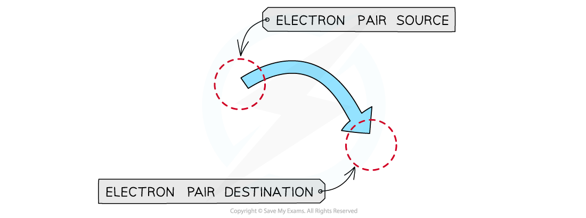
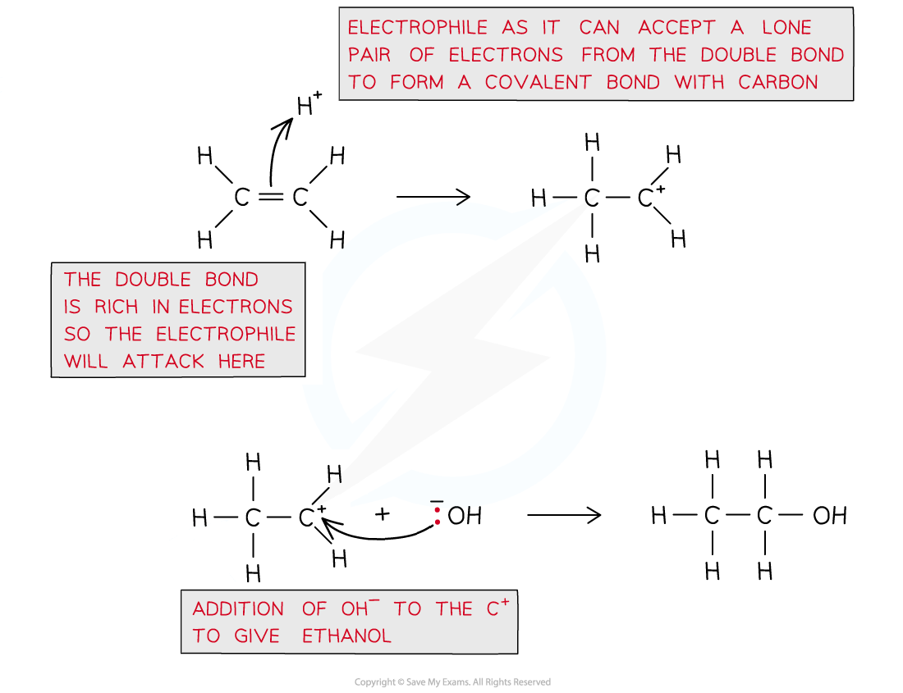
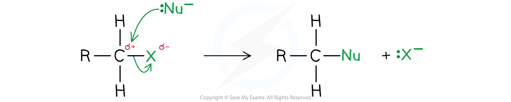
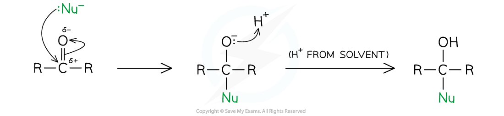

# Terminology Used in Reaction Mechanisms

## Terminology of Reaction Mechanisms

> **Spec point** — `spcpt_qDgtcCxSVxWwxNfy`

## Terminology Used in Reaction Mechanisms

- In organic reaction mechanisms, **curly** **arrows** represent the movement of **electron** **pairs**
- The arrow begins at a bond or a lone pair of electrons and points to the species that accepts the lone pair of electrons

#### An organic mechanism curly arrow

*Curly arrows show electron pairs moving from the source (eg. a nucleophile) to its destination (eg. an electrophile)*

### Free-radical substitution

- A **free-radical substitution reaction **is a reaction in which halogen atoms substitute for hydrogen atoms in alkanes
- Free radical substitution involves three standard steps:

  - Initiation
  - Propagation
  - Termination

#### Initiation step

- The covalent Cl-Cl bond is broken by energy from the UV light
- Each atom takes **one electron** from the covalent bond
- This produces two radicals in a **homolytic** **fission** reaction

**Cl–Cl → 2Cl****•**

#### Propagation step

- The halogen free radicals are very reactive and will attack the unreactive alkanes
- One of the methane C-H bond breaks homolytically to produce an alkyl radical

**CH****4**** + Cl****•**** → ****•****CH****3**** + HCl**

- The alkyl radical can attack another chlorine molecule to form a halogenoalkane
- This also regenerates the chlorine free radical

**•****CH****3**** + Cl****2**** → CH****3****Cl + Cl****•**** **

- The regenerated chlorine free radical can then repeat the cycle

#### Termination step

- Multiple products are possible, dependent on the radicals involved

  - They are commonly classed as desirable (wanted) and undesirable (unwanted)
- In the single substitution of methane with chlorine:

  - Chloromethane is the desirable (wanted) product:

**•****CH****3**** + Cl****•**** → CH****3****Cl **

- Ethane and chlorine are undesirable (unwanted) products:

**•****CH****3**** + ****•****CH****3**** → CH****3****CH****3**** **

**Cl****•**** + Cl****•**** → Cl****2**

### Electrophilic addition

- An **electrophilic addition **reaction is a reaction in which an electron rich region in a molecule is attacked by an electrophile (a species that likes electrons/negative charge) followed by the addition of a small molecule to give one product only

#### Example of an electrophilic addition reaction to form ethanol from ethene

*Curly arrows always move from an area of high electron density to an area of low electron density*

### Nucleophilic substitution

- A **nucleophilic substitution **reaction is a reaction in which an electron-rich nucleophile **displaces** a halogen atom

#### The general nucleophilic substitution reaction mechanism

*In nucleophilic substitution reaction mechanisms, the nucleophile replaces an atom / group in the target molecule*

- The C-X carbon of the halogenoalkane is electron deficient and has a δ+ charge

  - The halogen atom, X, is more electronegative than the carbon atom which means that it pulls electrons towards itself and is δ–
- The nucleophile has a lone pair of electrons that it can donate to the δ+ carbon atom and form a covalent bond
- This causes the displacement of the halogen atom, X, which leaves as a halide ion, X–

  - The displaced halide ion is known as a **leaving group**

### Nucleophilic addition

- A **nucleophilic addition **reaction is a reaction in which a nucleophile (a species that likes a nucleus/positive charge) attacks an electron-deficient region in a molecule followed by the addition of a small molecule to give one product only

#### The general nucleophilic addition reaction mechanism

*In nucleophilic addition reaction mechanisms, the nucleophile is added to the target molecule*
