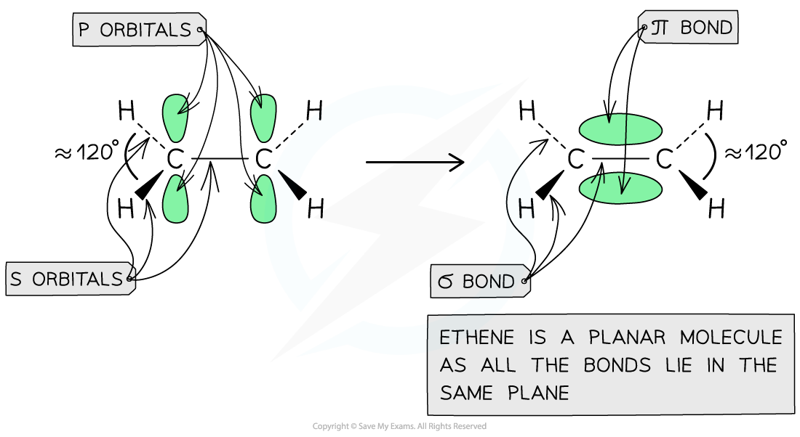
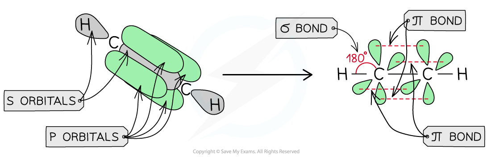
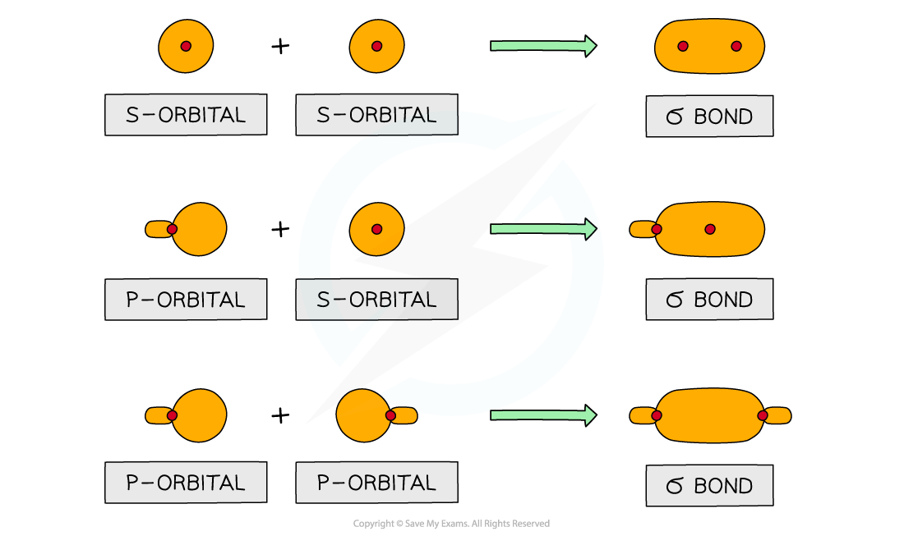
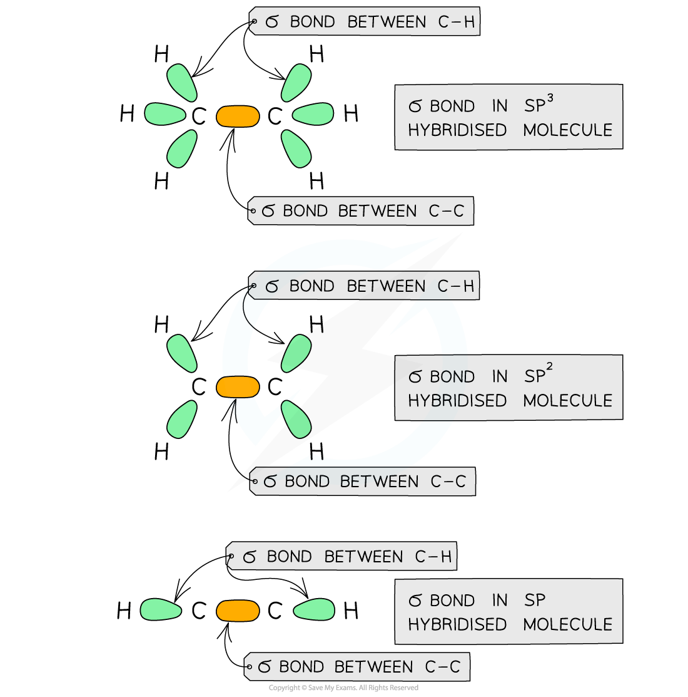
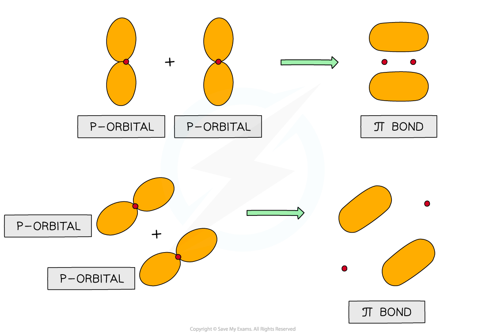
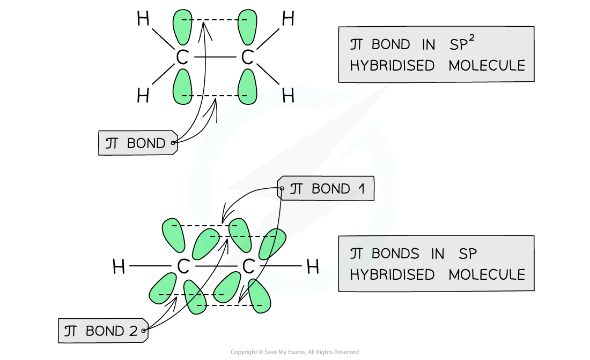

# Hybridisation in Organic Molecules

## Hybridised Atoms: Shapes & Bond Angles in Molecules

> **Spec point** — `spcpt_QytGnRrdQn5z8m9n`

## Hybridised Atoms: Shapes & Bond Angles in Molecules

- Each carbon atom has four electrons in its outer shell (**electronic configuration**: 1s22s22p2)
- Carbon atoms share these four electrons in four covalent bonds with other atoms to achieve a **full outer shell configuration**
- These electrons are found in orbitals within the respective atoms
- When forming a covalent bond, the orbitals overlap in such a way to form two types of bonds

  - Sigma bonds (σ)
  - Pi bonds (π)

### Hybridisation: sp3

- The electron pair in a σ bond is found in a region of space between the nuclei of the two atoms that are sharing the electrons
- The **electrostatic** **attraction** between the **electrons** (negatively charged) and the two **nuclei** (positively charged) holds the two atoms together
- Carbon atoms that form four σ bonds are said to be **sp****3** **hybridised**
- The four pairs of electrons around each carbon repel each other forcing the molecule to adopt a configuration in which the bonding pairs of electrons are as far away from each other as possible

  - The molecule adopts a **tetrahedral** arrangement with bond angles of **109.5 ****o**

#### Bonding in ethane

*The diagram shows a molecule of ethane in which each carbon atom forms four σ bonds to adopt a tetrahedral configuration and minimise the repulsion between the bonding pairs of electrons*

### Hybridisation: sp2

- When carbon atoms use only three of their electron pairs to form a σ bond, they are said to be **sp****2** **hybridised**

  - Each carbon atom will have a p orbital which contains **one** spare electron
- When the p orbitals of two carbon atoms overlap with each other, a π bond is formed (the π bond contains two electrons)
- The two orbitals that form the π bond lie above and below the plane of the two carbon atoms to maximise bond overlap
- The three bonding pairs of electrons are in the plane of the molecule and repel each other
- The molecule adopts a **planar **arrangement with bond angles of **120 ****o**

#### Bonding in ethene

*The overlap of the two p orbitals results in the formation of a π bond in ethene (sp2 hybridised molecule) in which the bonding pair of electrons repel each other to force the molecule into a planar configuration with bond angles of 120o*

### Hybridisation: sp

- Carbon atoms can also use only one of their electron pair to form a σ bond, in which case the carbon atoms are said to be **sp hybridised**

  - Each carbon atom will have **two** p orbitals with **one **spare electron each
- When the four p orbitals of the carbon atoms overlap with each other, **two** π bonds are formed (each π bond contains two electrons)
- The two orbitals that form the π bond lie above and below the plane of the carbon atoms
- The two orbitals of the **other **π bond lie in front and behind the plane of the atoms

  - This maximises the overlap of the four p orbitals
- The molecule adopts a **linear **arrangement with bond angles **180 ****o**

#### Bonding in ethyne

*The overlap of the p orbitals results in the formation of two π bonds in ethyne (sp hybridised molecule) which adopts a linear arrangement with bond angles of 180o*

> **Exam Hint**
> A **double** **bond** is a combination of a σ and π bond and a **triple** **bond** is a combination of one σ and two π bonds
> 
> The strength of the bonds increases as follows: **single < double < triple bond**
> 
> This is due to the increased electron density around the C-C atom, making the bond stronger and more difficult to break.

## Hybridised Atoms: σ & π Bonds in Molecules

> **Spec point** — `spcpt_qzx4VbjHZKNywYNz`

## Hybridised Atoms: σ and π Bonds in Molecules

### σ bonds

- Sigma bonds are formed from the end-on overlap of atomic orbitals

  - S orbitals overlap this way as well as p orbitals

#### Forming sigma bonds

*Sigma bonds can be formed from the end-on overlap of s or p orbitals*

- The electron density in a σ bond is **symmetrical** about a line joining the nuclei of the atoms forming the bond

  - The pair of electrons is found between the nuclei of the two atoms
  - The electrostatic attraction between the electrons and nuclei bonds the atoms to each other

#### The arrangement of the σ bond in sp3, sp2 and sp hybridised carbon atoms

*The σ orbitals are formed from the end-on overlap of the atomic orbitals resulting in symmetrical electron density on the atoms*

### π bonds

- Pi (π) bonds are formed from the sideways overlap of p orbitals
- The two lobes that make up the π bond lie above and below the plane of the atoms

  - This maximises the overlap of the p orbitals

#### Forming pi bonds

*π bonds can be formed from the end-on overlap of p orbitals*

- In triple bonds, there is an additional overlap of p orbital
- The two lobes of the π bond lie in front of and behind the plane of the atoms in the molecule

  - This maximises the overlap of the p orbitals

#### The arrangement of the π bond in sp3, sp2 and sp hybridised carbon atoms

*The π bonds are formed from the sideway overlap of the atomic orbitals*

> **Exam Hint**
> π bonds are drawn as two electron clouds, one arising from each lobe of the p orbitals
> 
> The two clouds of electrons in a π bond represent **one **bond consisting of **two **electrons (one from each orbital)
