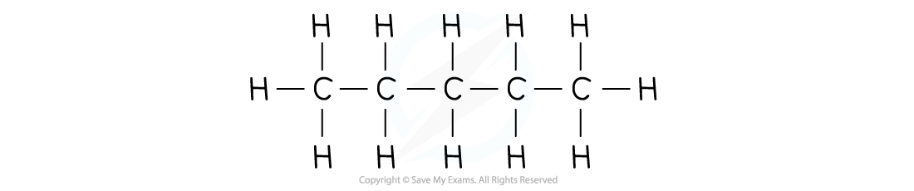
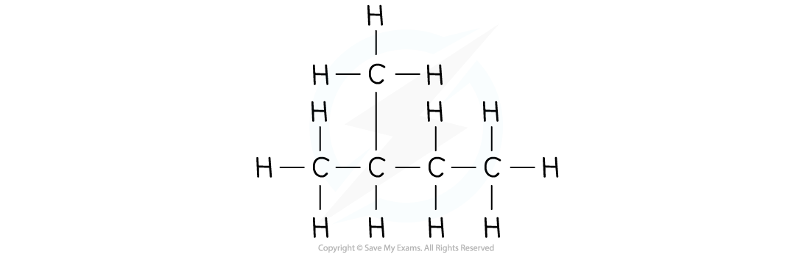
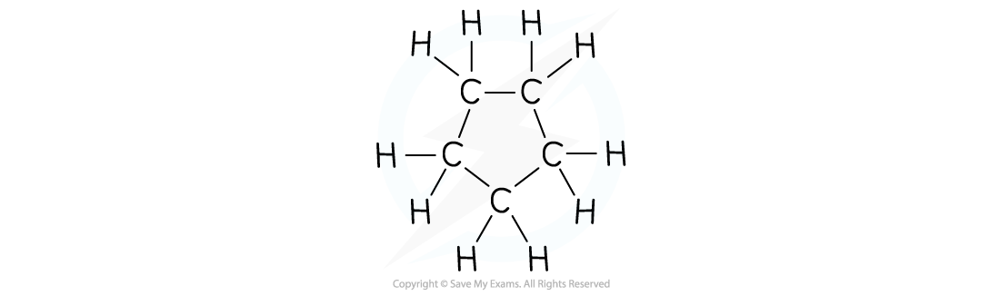

# Shapes of Organic Molecules; σ & π Bonds

## Straight, Branched & Cyclic Molecules

> **Spec point** — `spcpt_cHbPsjbjjBc9CgH7`

## Straight, Branched & Cyclic Molecules

- Straight, branched and cyclic organic molecules are also called **aliphatic **compounds as long as they do not contain a **benzene ring**

### Straight-chain

- **Straight-chain **organic molecules are those in which the carbon atoms are connected to each other in one continuous chain

#### A straight-chain organic molecule

*Pentane is a straight-chain organic molecule as the carbon atoms are connected in a straight line*

### Branched

- **Branched **organic molecules have side groups attached to the main chain of carbon atoms

#### A branched organic molecule

*2-methylbutane is a branched organic molecule as the main chain (consisting of 4 carbon atoms) has a methyl branch*

### Cyclic

- **Cyclic **organic molecules are those in which the carbon atoms are connected to each other in a ring shape

#### A cyclic organic molecule

*Cyclopentane is a cyclic organic molecule as the carbons are attached to each other in a ring structure*
