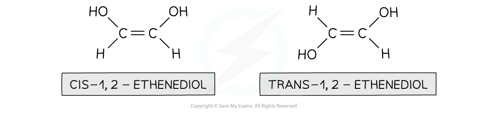
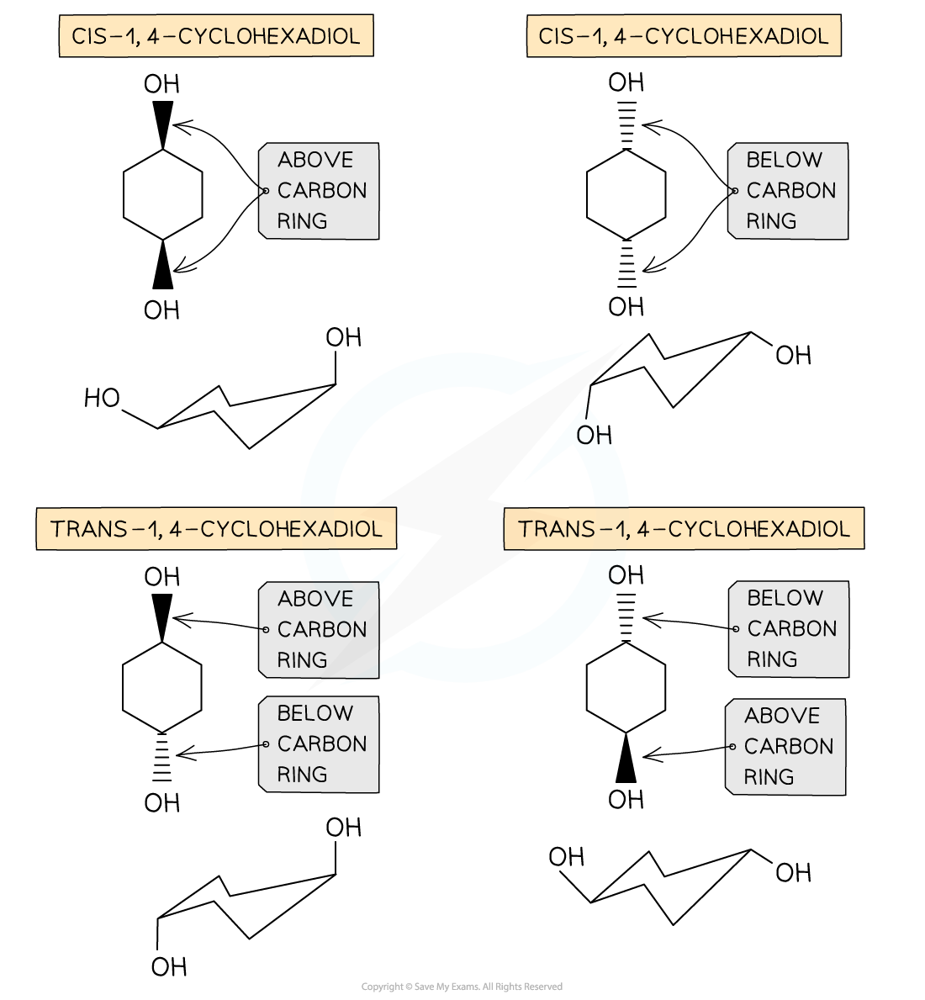
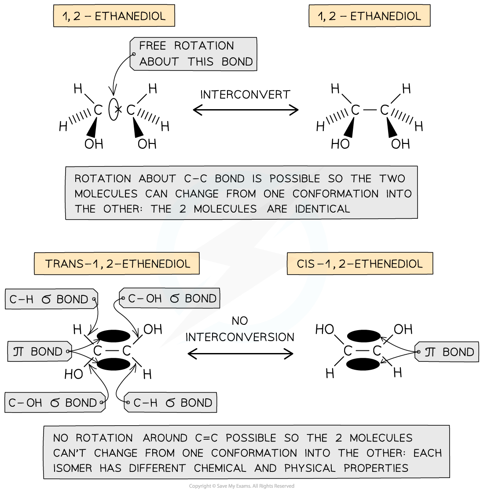

# Stereoisomerism

## Stereoisomerism: Geometrical & Optical

> **Spec point** — `spcpt_CSfwBM2MqSxzCtjr`

## Stereoisomerism: Geometrical & Optical

- **Stereoisomers **are compounds that have the same atoms connected to each other, however the atoms are differently arranged in space
- There are two types of **stereoisomerism**:

  - Geometrical (cis/trans) isomerism
  - Optical isomerism

### Geometrical (cis/trans) isomerism

- **Geometrical isomerism **is seen in unsaturated (double bond containing) or ring compounds that have the same molecular formula and order of atoms (the atoms are connected similarly to each other) but different shapes
- **Cis/trans** nomenclature is used to distinguish between the isomers

  - Cis isomers have functional groups on the same side of the double bond/carbon ring
  - Trans isomers have functional groups on opposite sides of the double bond/carbon ring

#### Geometrical isomerism in unsaturated compounds

*cis isomers have both functional groups above or both below the C=C bond. Trans isomers have one functional group above and one functional group below the C=C bond*

#### Geometrical isomerism in cyclic compounds

*The same principle of cis and trans applies to cyclic compounds, where cis means both functional groups above or below the ring structure and trans means one functional group above and the other below the ring structure*

- This causes the compounds to have different **chemical** and **physical** properties
- For example, they may have different reaction rates for the same reaction (chemical property) or different melting/boiling points (physical property)

### Optical isomerism

- **Optical isomers **arise when a carbon atom in a molecule is bonded to four different atoms or groups of atoms
- The carbon atom is ‘asymmetric’ as there is no plane of symmetric in the molecule and is also called the **chiral centre **of the molecule
- Just like the left hand cannot be **superimposed** on the right hand, enantiomers too are **non**-**superimposable**
- Enantiomers are **mirror** **images** of each other.
- The two different optical isomers are also called **enantiomers**

#### Optical isomers

*Both molecules are made up of the same atoms which are bonded to each other identically, however the chiral centre (carbon with four different groups) gives rise to optical isomerism*

- Optical isomers differ in their ability to rotate the **plane** **of** **polarised** **light**

  - One enantiomer will rotate it **clockwise** and the other **anticlockwise**

## Geometrical Isomerism in Alkenes

> **Spec point** — `spcpt_d2F29zJhG2yRcw8x`

## Geometrical Isomerism in Alkenes

### Unsaturated compounds

- In unsaturated compounds, the groups attached to the C=C carbons remain fixed in their position
- This is because free rotation of the bonds about the C=C bond is not possible due to the presence of a π bond

#### Explaining cis and trans geometric isomerism

*The presence of a π bond in unsaturated compounds restricts rotation about the C=C bond forcing the groups to remain fixed in their position and giving rise to the formation of geometrical isomers*

> **Exam Hint**
> Geometrical isomerism is also possible in **cyclic compounds **because there is limited rotation about C-C single bonds that make up the rings
> 
> Therefore, the substitutions in cyclic compounds are fixed in their position (to stay either above or below the ring of carbon atoms)
