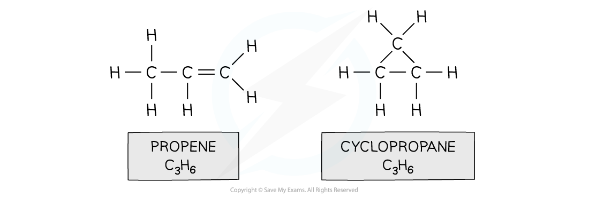
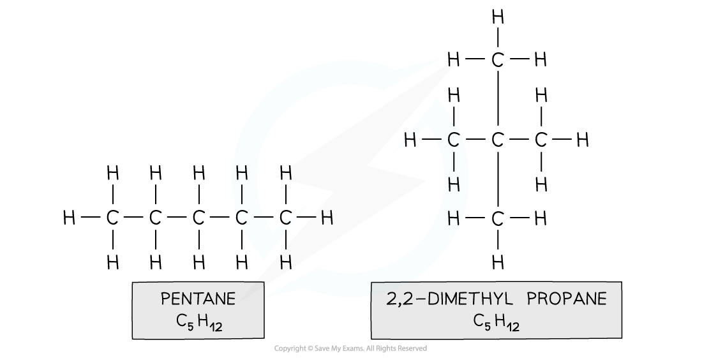
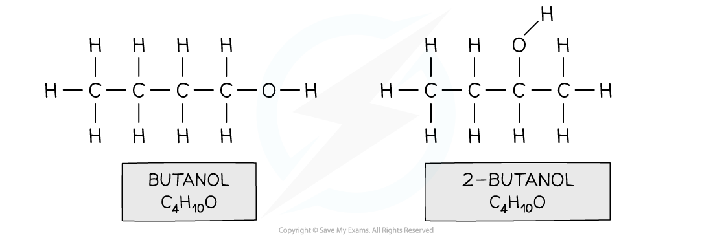
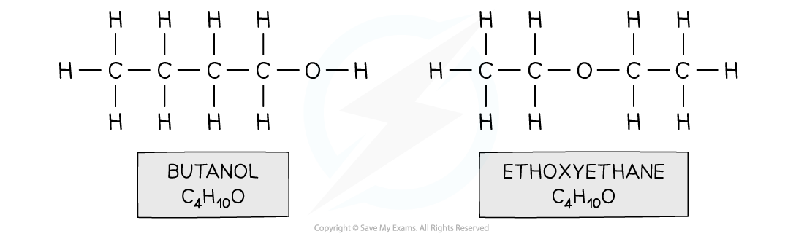

# Structural Isomerism

## Structural Isomerism: Chain, Position & Functional Group

> **Spec point** — `spcpt_sqZ99NMZvSzmpf4v`

## Structural Isomerism: Chain, Position & Functional Group

- **Structural isomers **are compounds that have the same **molecular** formula but different **structural** formulae

  - E.g. propene and cyclopropane

#### C3H6 structural isomers

*Both propene and cyclopropane are made up of 3 carbon and 6 hydrogen atoms but the structure of the two molecules differs*

- There are three different types of structural isomerism:

  - **Chain** isomerism
  - **Positional** isomerism
  - **Functional** group isomerism

### Chain isomerism

- **Chain isomerism **is when compounds have the same molecular formula, but their longest hydrocarbon chain is not the same
- This is caused by branching

  - E.g. pentane and 2,2-dimethylpropane

#### C5H12 branch / chain isomers

*Both compounds are made up of the same atoms however the longest carbon chain in pentane is 5 and in 2,2-dimethylpropane 3 (with two methyl branches)*

### Positional isomerism

- **Positional isomers **arise from differences in the position of a functional group in each isomer

  - The functional group can be located on different carbons
  - E.g. butan-1-ol and butan-2-ol / 2-butanol

#### C4H10O positional isomers

*Both compounds have an alcohol group and are made up of 4 carbon, 10 hydrogen and one oxygen atom however in butan-1-ol the functional group is located on the first carbon and in butan-2-ol on the second carbon*

### Functional group isomerism

- When different functional groups result in the same molecular formula, **functional group isomers **arise
- The isomers have very different chemical properties as they have different functional groups

  - E.g. butan-1-ol and ethoxyethane

#### C4H10O functional group isomers

*Both compounds have the same molecular formula however butanol contains an alcohol functional group and ethoxyethane an ether functional group*
