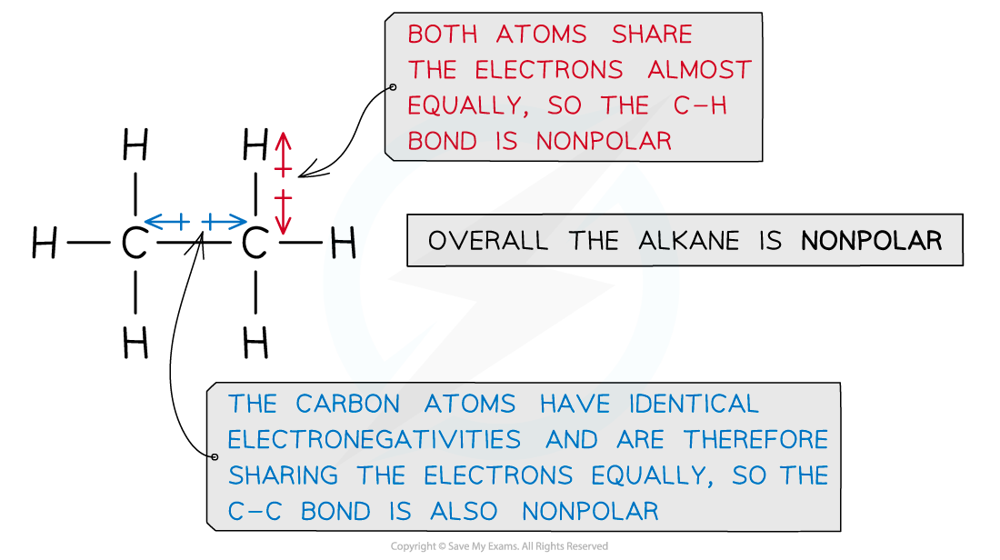

# Chemical Reactivity of Alkanes

## Unreactivity of Alkanes

> **Spec point** — `spcpt_zrb4jxWNJKsGf4qb`

## Unreactivity of Alkanes

### Strength of C-H bonds

- Alkanes consist of carbon and hydrogen atoms which are bonded together by **single** **bonds**
- Unless a lot of heat is supplied, it is difficult to break these **strong **C-C and C-H covalent bonds
- This decreases the alkanes’ reactivities in chemical reactions

### Lack of polarity

- The **electronegativities** of the carbon and hydrogen atoms in alkanes are almost the same
- This means that both atoms share the electrons in the covalent bond almost equally

#### The Pauling Scale

*The Pauling Scale shows that the difference in electronegativity between carbon and hydrogen is only 0.4*

- As a result of this, alkanes are **nonpolar **molecules and have no partial positive or negative charges (δ+ and δ- respectively)
- Alkanes therefore do not react with **polar reagents**

  - They have no electron-deficient areas to attract **nucleophiles**
  - They also lack electron-rich areas to attract **electrophiles**

#### Examining bond polarity in ethane

*Ethane is an example of an alkane that lacks polarity due to almost similar electronegativities of the carbon and hydrogen atoms*

- Due to the unreactivity of alkanes, they only react in combustion reactions and undergo substitution by halogens

> **Exam Hint**
> Remember: nucleophiles are negatively charged and are attracted to electron-deficient regions
> 
> Electrophiles are positively charged and attracted to electron-rich regions
