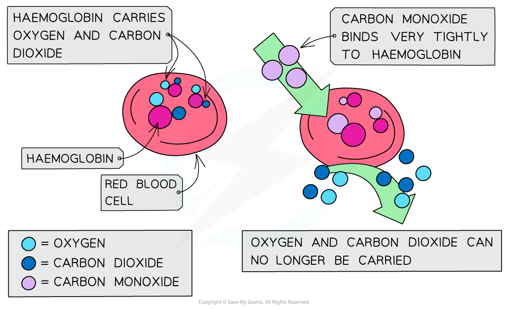

# Combustion of Alkanes

## Combustion of Alkanes & the Environment

> **Spec point** — `spcpt_7pQqq4p8gk94GxNW`

## Combustion of Alkanes & the Environment

- Cars’ **exhaust fumes **include toxic gases such as **carbon monoxide **(CO), **oxides of nitrogen **(NO/NO2) and **volatile organic compounds **(VOCs)
- When released into the atmosphere, these pollutants have drastic environmental consequences damaging nature and health

### Carbon monoxide

- When oxygen supply is limited, **carbon monoxide (CO)** forms instead of carbon dioxide:

**fuel + oxygen → carbon monoxide + water**

- For example, Incomplete combustion of **propane**:

**propane + oxygen → carbon monoxide + water**

**C****3****H****8**** (l) + 3½O****2**** (g) → 3CO (g) + 4H****2****O (l)**

- **Carbon monoxide is extremely dangerous** because it is:

  - **Colourless** and **odourless** (can’t be seen or smelled)
  - Hard to detect without a sensor
- It is a **toxic** and **poisonous** gas that binds **irreversibly** to **haemoglobin** in the blood.

  - This prevents haemoglobin from carrying **oxygen**.
- Lack of oxygen transport leads to:

  - **Dizziness**
  - **Loss of consciousness**
  - Potentially **death** if not treated

#### The effect of carbon monoxide on haemoglobin

*The high affinity of CO to haemoglobin prevents it from binding to O2 and CO2*

### Oxides of nitrogen

- Normally, nitrogen is too unreactive to react with oxygen in air
- In a car’s engine, high temperatures and pressures are reached, causing the oxidation of nitrogen to take place:

**N****2 ****(g) + O****2 ****(g) → 2NO (g)**

**N****2 ****(g) + 2O****2 ****(g) → 2NO****2 ****(g)**

- The **oxides of nitrogen** are then released in the car’s exhaust fumes into the atmosphere
- Car exhaust fumes also contain **unburnt** **hydrocarbons** from fuels and their **oxides** (VOCs)
- In the air, the nitrogen oxides can react with these VOCs to form **peroxyacetyl** **nitrate** (PAN) which is the main pollutant found in **photochemical smog**

  - PAN is also harmful to the lungs, eyes and plant life
- Nitrogen oxides can also dissolve and react in water with oxygen to form nitric acid which is a cause of **acid rain**

  - Acid rain can cause corrosion of buildings, endanger plant and aquatic life (as lakes and rivers become too **acidic**) and directly damage human health

### Catalytic removal

- To reduce the amount of pollutants released in cars’ exhaust fumes, many cars are now fitted with **catalytic converters**
- Precious metals (such as platinum) are coated on a honeycomb to provide a **large surface area**
- The reactions that take place in the catalytic converter include:

  - Oxidation of CO to CO2:

**2CO + O****2**** → 2CO****2**

or

**2CO + 2NO → 2CO****2**** + N****2**

- Reduction of NO/NO2 to N2:

**2CO + 2NO → 2CO****2**** + N****2**

- Oxidation of unburnt hydrocarbons:

**C****n****H****2n+2**** + (3n+1)[O] → nCO****2**** + (n+1)H****2****O**

#### Pollutants, their effect & removal summary

- **Carbon Monoxide (CO)**

  - Formation:
  
    - Incomplete combustion of alkanes in car engines
  - Environmental consequence:
  
    - Toxic gas
  - Catalytic removal:
  
    - Oxidised to carbon dioxide (CO2):

**2CO + O**2** → 2CO**2

**2CO + 2NO → 2CO**2** + N**2

- **Oxides of Nitrogen (NO, NO****2**** etc.)**

  - Formation:
  
    - Oxidation of nitrogen in car engines (due to high temperatures)
  - Environmental consequence:
  
    - Dissolve in water and react with oxygen to form acid rain
  - Catalytic removal:
  
    - Reduced to nitrogen gas:

**2CO + 2NO → 2CO**2** + N**2

- **Volatile Organic Compounds (VOCs)**

  - Formation:
  
    - Unburnt hydrocarbons from fuels
    - Oxides of these hydrocarbons formed in car engines
  - Environmental consequence:
  
    - React with oxides of nitrogen in the atmosphere to form PAN
  - Catalytic removal:
  
    - Oxidised to CO2 and H2O
    - General formula reaction:

**C****n****H****2n+2**** + (3n + 1)[O] → nCO****2**** + (n + 1)H₂O**

- **PAN (peroxyacyl nitrate)**

  - Formation:
  
    - From the photochemical reaction of VOCs and nitrogen oxides in the atmosphere
  - Environmental consequence:
  
    - Contributes to photochemical smog
  - Catalytic removal:
  
    - Oxidise unburnt hydrocarbons
    - Reduce nitrogen oxides to prevent PAN formation

> **Exam Hint**
> Although CO2 is not a **toxic **gas, it is still a **pollutant **causing **global warming **and **climate change**
