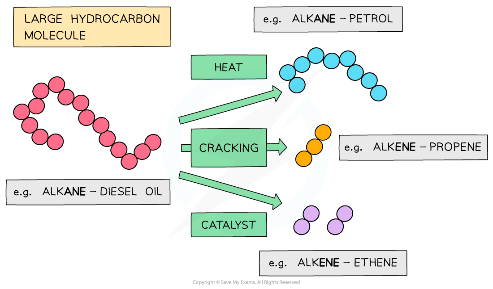

# Cracking of Alkanes

## Obtaining Useful Compounds by Cracking

> **Spec point** — `spcpt_VkwQyZswQ9jSKtgx`

## Obtaining Useful Compounds by Cracking

### Crude oil

- Crude oil is a **mixture **of hydrocarbons containing **alkanes**, **cycloalkanes** and **arenes** (compounds with a benzene ring)
- The crude oil is **extracted** from the earth in a **drilling** **process** and transported to an **oil** **refinery**
- At the oil refinery, the crude oil is separated into useful fuels by **fractional distillation**
- This is a separating technique in which a wide range of different hydrocarbons are separated into fractions based on their boiling points

#### A fractional distillation column

*Crude oil is initially separated into fractions with similar boiling points in a process called fractional distillation*

- However, the smaller hydrocarbon fractions (such as gasoline fractions) are in high demand compared to the larger ones
- Therefore, some of the **excess **heavier fractions are broken down into smaller, **more** **useful** **compounds**
- These more useful compounds include **alkanes** and **alkenes** of **lower** relative formula mass (***M*****r**)
- This process is called **cracking**

#### The process of cracking

*The heavier fractions that are obtained in fractional distillation are further cracked into useful alkanes and alkenes with lower Mr values*

### Cracking

- The large hydrocarbon molecules are fed into a **steel** **chamber**, **heated** to a high temperature and then passed over an **aluminium** **oxide** (Al2O3) catalyst

  - The chamber does not contain any **oxygen** to prevent **combustion** of the hydrocarbon to water and carbon dioxide
- When a large hydrocarbon is cracked, a **smaller** **alkane** and **alkene** molecules are formed

  - E.g. octane and ethene from decane

#### Cracking of long-chain hydrocarbons

*The long hydrocarbon fraction is cracked into two smaller ones*

- The **low-molecular mass** **alkanes** formed make good fuels and are in high demand

- The **low-molecular** **mass** **alkenes** are more reactive than alkanes due to their double bond
- This makes them useful for the chemical industry as the starting compounds (**feedstock**) for making new products

  - E.g. they are used as monomers in polymerisation reactions

#### Using alkenes to form other useful compounds

*Alkenes are reactive molecules and can undergo many different types of reactions making them useful as starting compounds*
