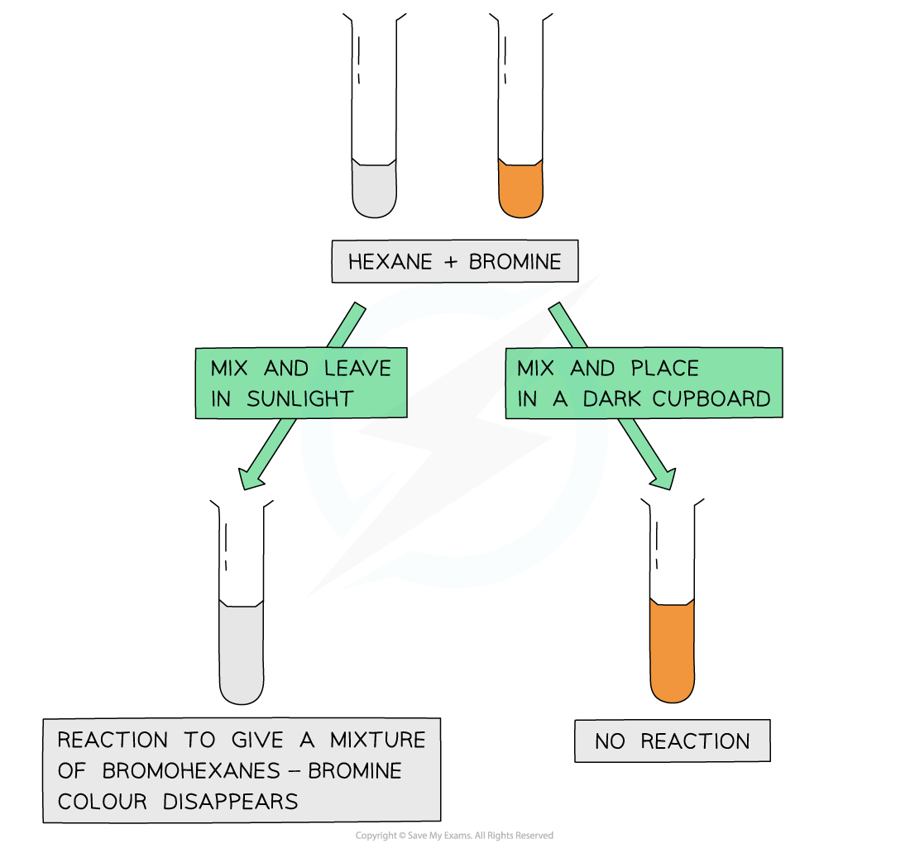

# Free Radical Substitution

## Free Radical Substitution Mechanism

> **Spec point** — `spcpt_PfqCXXkxHSs3pGcc`

## Free Radical Substitution Mechanism

- Alkanes can undergo **free-radical substitution **in which a hydrogen atom gets **substituted **by a halogen (chlorine/bromine)
- Since alkanes are very unreactive, **ultraviolet **light** (sunlight)** is needed for this substitution reaction to occur

#### Reacting an alkane with bromine

*The fact that the bromine colour has disappeared only when mixed with an alkane and placed in sunlight suggests that the ultraviolet light is essential for the free radical substitution reaction to take place*

- The free-radical substitution reaction consists of **three steps**

### Initiation step

- In the **initiation step**, the halogen bond (Cl-Cl or Br-Br) is broken by **UV energy** to form two radicals
- The covalent Cl-Cl bond is broken by energy from the UV light
- Each atom takes **one electron** from the covalent bond
- This produces two radicals in a **homolytic** **fission** reaction

**Cl–Cl 2Cl****•**

- For more information about the initiation step, see our revision note about [homolytic fission](https://www.savemyexams.com/dp/chemistry/ib/23/hl/revision-notes/what-are-the-mechanisms-of-chemical-change/electron-sharing-reactions/homolytic-fission/)

### Propagation step

- The halogen free radicals are very reactive and will attack the unreactive alkanes
- One of the methane C-H bond breaks homolytically to produce an alkyl radical

**CH****4**** + Cl****•**** → ****•****CH****3**** + HCl**

- The alkyl radical can attack another chlorine molecule to form a halogenoalkane
- This also regenerates the chlorine free radical

**•****CH****3**** + Cl****2**** → CH****3****Cl + Cl****•**** **

- The regenerated chlorine free radical can then repeat the cycle
- For example, the **chlorination of ethane** is:

**ethane + chlorine radical → ethyl radical + hydrogen chloride**

**CH****3****CH****3 ****+ Cl****•**** → ****•****CH****2****CH****3 ****+ HCl**

**ethyl radical + chlorine molecule → chloroethane + regenerated chlorine radical**

**•****CH****2****CH****3 ****+ Cl****2 ****→ CH****3****CH****2****Cl + Cl****•**

- This reaction is not very suitable for preparing specific halogenoalkanes as a **mixture **of substitution products is formed
- If there is enough **halogen** present, all the hydrogens in the alkane will eventually get substituted
- For example, the chlorination of ethane could continue:

**chloroethane + chlorine radical → radical + hydrogen chloride**

**CH****3****CH****2****Cl + Cl****•**** → ****•****CH****2****CH****2****Cl + HCl**

**radical + chlorine molecule → 1,2-dichloroethane + regenerated chlorine radical**

**•****CH****2****CH****2****Cl + Cl****2 ****→ CH****2****Cl****2**** + Cl****•**

- This process can repeat until **hexachloroethane**, C2Cl6, is formed

### Termination step

- The **termination step** is when the chain reaction **terminates **(stops) due to two free radicals reacting together and forming a single unreactive molecule

  - Multiple products are possible
- For example, the single substitution of **ethane by chlorine** can form:

**ethyl radical + chlorine radical → chloroethane**

**•****CH****2****CH****3 ****+ Cl****•**** → CH****3****CH****2****Cl**

**ethyl radical + ethyl radical → butane**

**•****CH****2****CH****3 ****+ ****•****CH****2****CH****3 ****→ CH****3****CH****2****CH****2****CH****3**

**chlorine radical + chlorine radical → chlorine molecule**

**Cl****•**** + Cl****•**** → Cl****2**

> **Exam Hint**
> If you are asked to give an equation for the termination step of a free radical reaction / mechanism, you should not give the equation reforming the original halogen as this is often marked as "ignore" on mark schemes.
> 
> Free radical substitution using bromine instead of chlorine is possible and follows similar initiation, propagation and termination steps

### Further substitution

- Often, free radical reactions are not very suitable for preparing specific halogenoalkanes as a **mixture **of substitution products are formed
- If there is enough chlorine / bromine present, all the hydrogens in the alkane will eventually get substituted
- For example, methane could be substituted to become chloromethane and then further substituted
- Single substitution:

**CH****4**** + Cl****•**** → ****•****CH****3**** + HCl**

**•****CH****3**** + Cl****2**** → CH****3****Cl + Cl****•**** **

- Second substitution:

**CH****3****Cl + Cl****•**** → ****•****CH****2****Cl + HCl**

**•****CH****2****Cl + Cl****2**** → CH****2****Cl****2**** + Cl****•**

- Third substitution:

**CH****2****Cl****2**** + Cl****•**** → ****•****CHCl****2**** + HCl**

**•****CHCl****2**** + Cl****2**** → CHCl****3**** + Cl****•**

- Complete substitution:

**CHCl****3**** + Cl****•**** → ****•****CCl****3**** + HCl**

**•****CCl****3**** + Cl****2**** → CCl****4**** + Cl****•**

> **Exam Hint**
> You could be asked to draw the mechanism for initiation and termination steps for free radical substitution
> 
> This mechanism will use half-headed arrows to show the movement of one electron (double-headed arrows show the movement of a pair of electrons)
> 
> A half-headed arrow is known as a ‘fish hook’ arrow.
> 
> **Initiation:**
> 
> 
> 
> **Termination:**
> 
> 
> 
> The key is the use of the ‘fish hook’ arrow to show the homolytic fission of the bond in initiation and the formation of the bond in termination.
