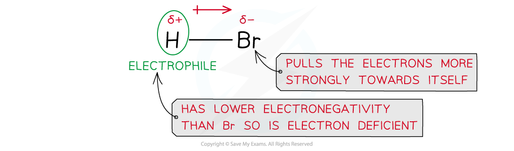
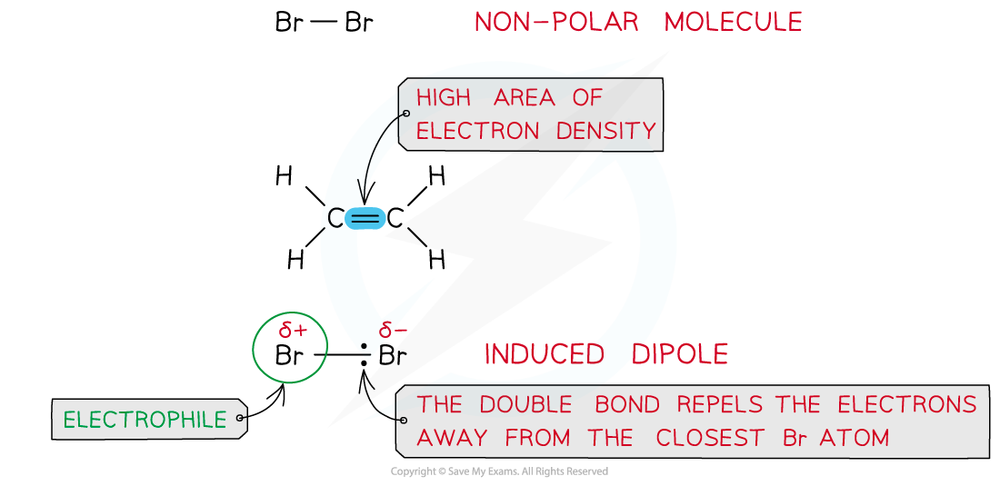
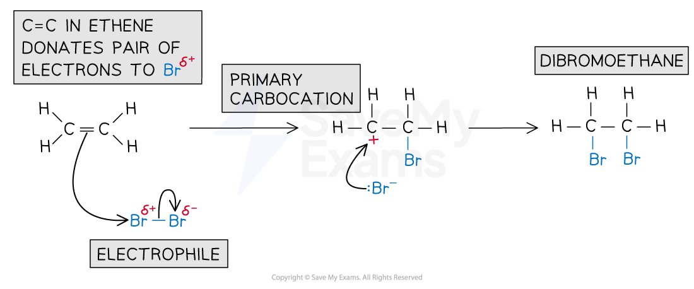

# Electrophilic Addition of Alkenes

## Electrophilic Addition of Alkenes

> **Spec point** — `spcpt_dYZdxgWdCksdx74b`

## Electrophilic Addition of Alkenes

- The double bond in alkenes is an area of high electron density (there are four electrons found in this double bond)
- This makes the double bond susceptible to attack by electrophiles (electron-loving species)
- An **electrophilic addition **is the addition of an **electrophile** to a double bond

### Electrophilic addition of hydrogen bromide

- A molecule of hydrogen bromide (HBr) is polar as the hydrogen and bromine atoms have different electronegativities
- The bromine atom has a stronger pull on the electrons in the H-Br bond
- As a result of this, the Br atom has a partial negative and the H atom a partial positive charge

#### Explaining the polarity of a HBr molecule

*Due to differences in electronegativities of the hydrogen and bromine atoms, HBr is a polar molecule*

- In an addition reaction, the H atom acts as an electrophile and accepts a pair of electrons from the C-C bond in the alkene
- The H-Br bond breaks heterolytically, forming a Br- ion
- This results in the formation of a highly reactive carbocation intermediate which reacts with the bromide ion, Br-
- For example, the mechanism for the electrophilic addition of hydrogen bromide and ethene is:

#### Electrophilic addition of HBr mechanism

*Electrophilic addition reaction of HBr and ethene to form bromoethane *

### Electrophilic addition of bromine

- Bromine (Br2) is a non-polar molecule as both atoms have similar electronegativities and therefore equally share the electrons in the covalent bond
- However, when a bromine molecule gets closer to the double bond of an alkene, the high electron density in the double bond repels the electron pair in Br-Br away from the closest Br atom
- As a result of this, the closest Br atom to the double bond is slightly positive and the further Br atom is slightly negatively charged

#### The polarity of a Br2 molecule

*Bromine is a non-polar molecule however when placed close to an area of high electron density it can get polarised*

- In an addition reaction, the closest Br atom acts as an electrophile and accepts a pair of electrons from the C-C bond in the alkene

  - The Br-Br bond breaks heterolytically, forming a Br- ion
- This results in the formation of a highly reactive carbocation intermediate which reacts with the Br- (nucleophile)

#### Electrophilic addition of Br2 mechanism

*Example of an electrophilic addition reaction of bromine and ethene to form dibromoethane*
