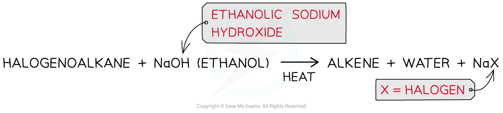
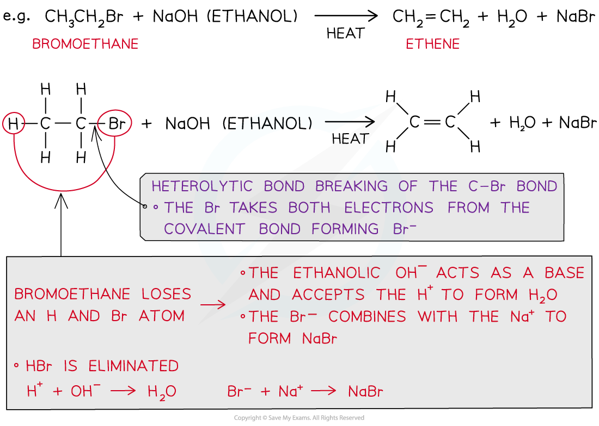
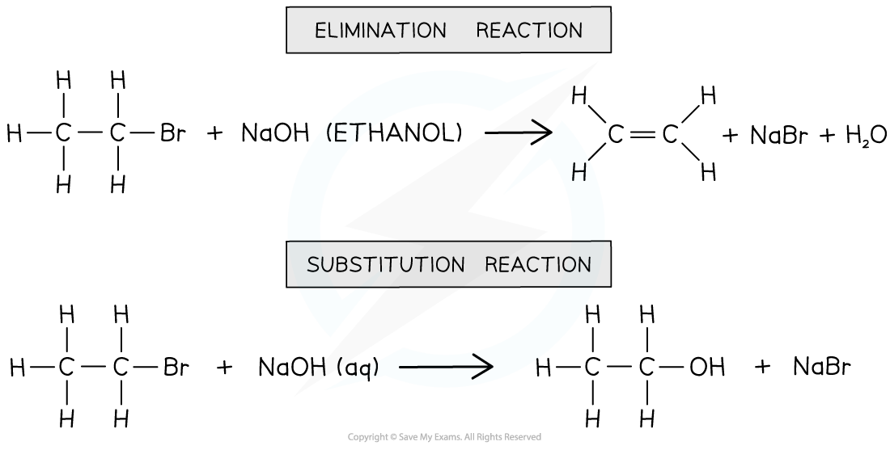
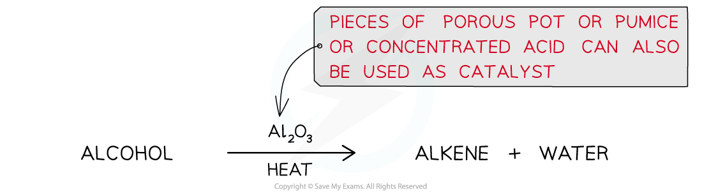
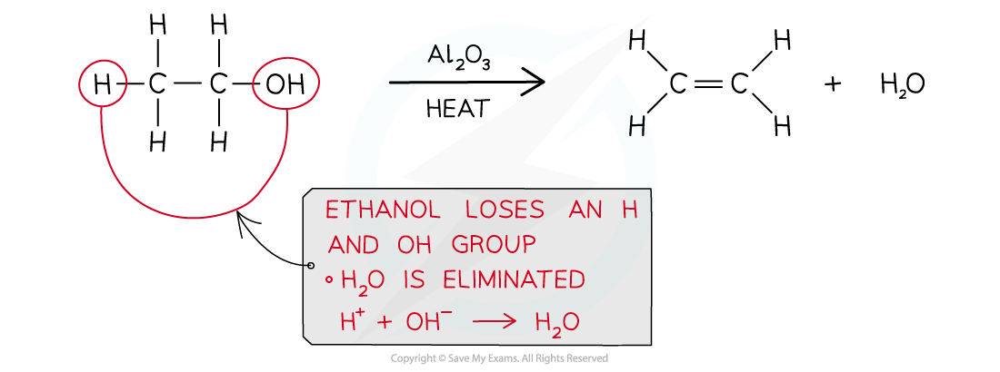
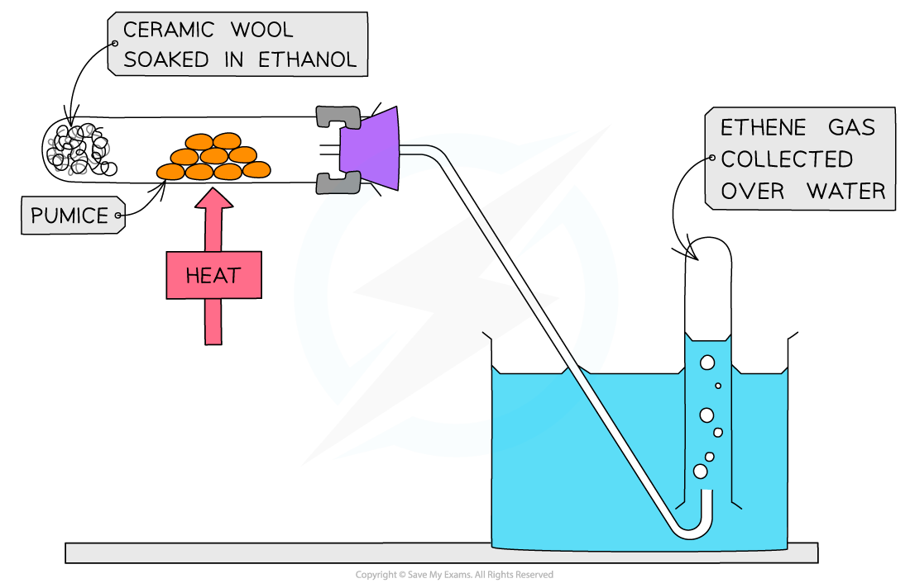
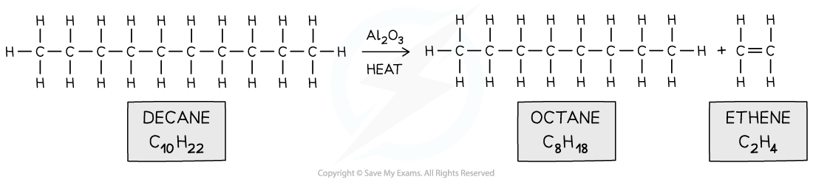
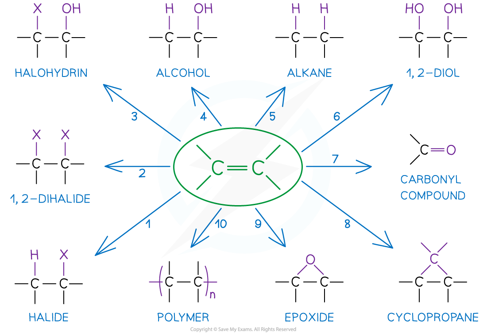

# Producing Alkenes

## Production of Alkenes: Elimination, Dehydration & Cracking

> **Spec point** — `spcpt_swkZRwSVcdT2zFZB`

## Production of Alkenes: Elimination, Dehydration & Cracking

- Alkenes can be made by a series of reactions including **elimination**, **dehydration reactions **and **cracking**

### Elimination reaction

- Alkenes can be produced from the elimination reaction of a **halogenoalkane**
- An **elimination reaction **is one in which a **small molecule **is lost

  - In the case of halogenoalkanes, the small molecule that is eliminated is a hydrogen halide, HX, where X is the halogen
- The halogenoalkane is heated with **ethanolic sodium hydroxide**

#### Making alkenes from halogenoalkanes

*Production of an alkene from a halogenoalkane by reacting it with ethanolic sodium hydroxide and heating it*

- The eliminated H+ in HBr reacts with the ethanolic OH- to form water
- The eliminated Br- in HBr reacts with Na+ to form NaBr

#### Overview of halogenoalkane elimination

*The eliminated HBr reacts with ethanolic OH- and Na+ to form water and sodium bromide*

- Note that the reaction conditions should be stated correctly as different reaction conditions will result in different types of organic reactions
- NaOH (ethanol): an **elimination **reaction occurs to form an **alkene**
- NaOH (aq): a **nucleophilic substitution **reaction occurs, and an **alcohol **is one of the products

#### Comparing reaction conditions

*Different reaction conditions will give different products*

### Dehydration reaction

- Alkenes can also be produced from the elimination reaction of alcohols in which a water molecule is lost

  - This is also called a **dehydration **reaction
- Alcohol vapour is passed over a hot catalyst of **aluminium oxide powder **(Al2O3)

  - **Concentrated acid, pieces of porous pot **or **pumice **can also be used as catalysts

#### Making alkenes from alcohols

*Production of an alkene from an alcohol by using a hot aluminium oxide powder catalyst*

#### Overview of alcohol elimination

*The formation of ethene from ethanol is an example of a dehydration reaction of alcohol*

- The smaller alkenes (such as ethene, propene and butene) are all **gases** at room temperature and can be **collected** over **water**

#### Practical set-up to form alkenes from alcohol

*The smaller alkenes are gases at room temperature and collected over water*

### Cracking

- Alkenes can also be produced from the **cracking **of long hydrocarbon molecules in crude oil
- An **aluminium oxide **(Al2O3) catalyst and high temperatures are used to speed up this reaction.
- It is important to ensure that the crude oil doesn’t come into contact with **oxygen **as this can cause the **combustion** of the hydrocarbons to produce **water **and **carbon dioxide**
- The cracking of crude oil produces **smaller** **alkane** and **alkene** molecules

#### Cracking hydrocarbons

*Long hydrocarbon fraction is cracked into two smaller ones*

- The **low-molecular** **mass** **alkenes** are more reactive than alkanes as they have an electron-rich double bond
- They can therefore be used as ***feedstock*** for making new products

#### Possible compounds formed from alkenes

*Alkenes are reactive molecules and can undergo many different types of reactions making them useful as starting compounds*
