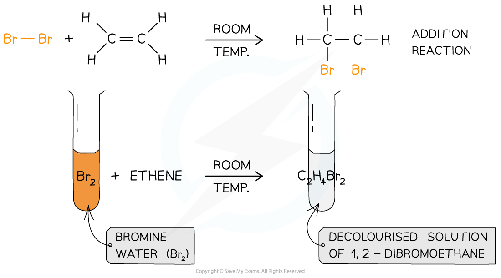

# Test for Unsaturation

## Test for Unsaturation

> **Spec point** — `spcpt_mRVQs6cxrKQQkDzh`

## Test for Unsaturation

- Halogens can be used to test if a molecule is **unsaturated **(i.e. contains a double bond)
- Br2 (aq) is an orange or yellow solution, called **bromine water **and this is the halogen most commonly used
- The unknown compound is **shaken **with the bromine water
- If the compound is unsaturated, an addition reaction will take place and the coloured solution will decolourise

#### The unsaturation test

*The decolourisation of bromine water by an unsaturated compound as a result of an addition reaction*
